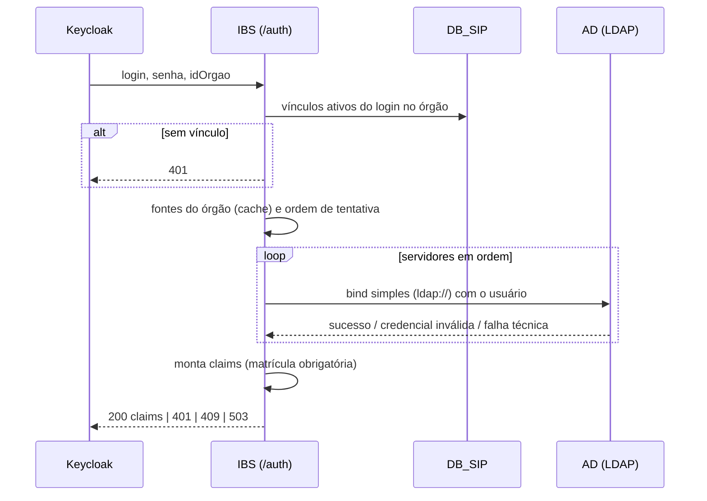

# IBS Backend — fluxo de autenticação (`POST /auth`)

Voltar: [[01-Sistemas/IBS/Backend/IBS-Backend-Index|Índice]]

## Objetivo
Descrever o passo a passo ponta a ponta de uma autenticação.

## Evidências
- Classes em `sources`; testes `AutenticarUsuarioHandlerTest` (14 cenários) e `LdapBindServiceTest` (11) cobrem o comportamento descrito.

## Informações confirmadas
1. ✅ `LoginController` valida o body (Bean Validation), resolve o `CorrelationKey` (header `X-Correlation-Key` ou novo UUID), cria `LoginUsuario` (mín. 3 caracteres, sem `@`) e `SenhaUsuario` e envia `AutenticarUsuarioCommand` ao mediator.
2. ✅ `AutenticarUsuarioHandler` chama `AutenticacaoService.autenticarUsuario` e, no `finally`, zera a senha (`SenhaUsuario.clear()`).
3. ✅ **Vínculo primeiro:** `IdentidadeInstitucionalService.buscarIdentidade(login, idOrgao)` consulta `DB_SIP`. Sem vínculo ativo → `USUARIO_SEM_VINCULO_NO_ORGAO` (401), **antes** de qualquer bind LDAP ([[01-Sistemas/IBS/Backend/04-Regras-de-Negocio/IBS-Backend-Regra-Vinculo-Ativo-e-Matricula|regra]]).
4. ✅ **Fontes:** `ResolverFontesAutenticacaoService.resolverPorOrgao` obtém do cache as fontes do órgão, ordenadas pelo menor id de servidor; vazio → `FonteAutenticacaoNaoEncontradaException`.
5. ✅ **Tentativas:** `AutenticacaoService` monta a lista de tentativas servidor a servidor e executa `LdapBindService.autenticar` em ordem ([[01-Sistemas/IBS/Backend/04-Regras-de-Negocio/IBS-Backend-Regra-Ordem-de-Tentativa-LDAP|regra]]). A primeira com sucesso registra a fonte como "recente" para o par órgão+login e encerra.
6. ✅ Se nenhuma tiver sucesso: houve credencial inválida em alguma → `CREDENCIAL_INVALIDA`; senão, houve falha técnica → `SERVICO_INDISPONIVEL`; senão → `FONTE_NAO_ENCONTRADA`.
7. ✅ **Claims:** `ClaimsService.montar` falha com `USUARIO_SEM_MATRICULA` se a matrícula vier vazia; senão devolve `ClaimsUsuario`, que o controller converte em `AutenticarUsuarioResponse`.

## Inferências e limitações
- ✅ Não há retry nem circuit breaker além da própria iteração sobre servidores.
- 🔶 `SenhaUsuario` é zerada, mas o `String senha` do record de request e o `String.valueOf(char[])` do ambiente JNDI permanecem na memória até o GC.

## Relacionamentos
- [[01-Sistemas/IBS/Backend/03-Modulos/IBS-Backend-Autenticacao-de-Usuario|Autenticação de usuário]] · [[01-Sistemas/IBS/Backend/03-Modulos/IBS-Backend-Fontes-de-Autenticacao|Fontes de autenticação]] · [[01-Sistemas/IBS/Backend/06-API/IBS-Backend-Catalogo-de-Endpoints|Endpoints]] · [[01-Sistemas/IBS/Backend/07-Integracoes/IBS-Backend-Integracao-AD-LDAP|AD/LDAP]] · [[01-Sistemas/IBS/Backend/07-Integracoes/IBS-Backend-Integracao-SIP-SQLServer|SIP]] · [[01-Sistemas/KEYCLOAK-CGDF/Servico-Keycloak/05-Fluxos/KEYCLOAK-CGDF-Servico-Fluxo-Direct-Grant-IBS|Fluxo Direct Grant (lado Keycloak)]]

## Pendências e próximo passo
- Nenhuma específica.
