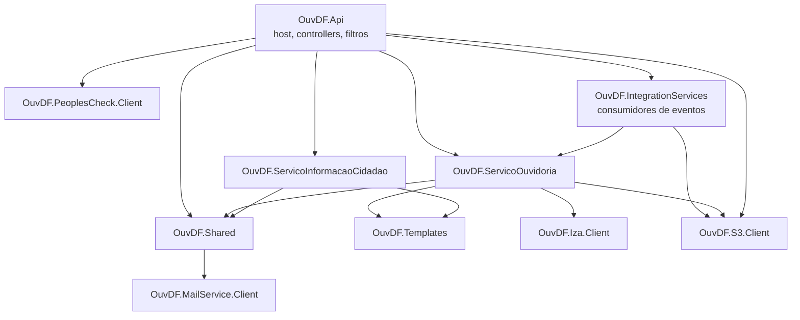

# Arquitetura do backend

Voltar: [[01-Sistemas/PARTICIPA-DF/Backend/PARTICIPA-DF-Backend-Index|Índice do Backend]] · Relacionado: [[01-Sistemas/PARTICIPA-DF/Backend/01-Visao-Geral/PARTICIPA-DF-Backend-Stack-e-Dependencias|Stack]], [[01-Sistemas/PARTICIPA-DF/Backend/05-Fluxos/PARTICIPA-DF-Backend-Workflows-e-Consumidores|Workflows-e-Consumidores]], [[01-Sistemas/PARTICIPA-DF/Backend/03-Modulos/PARTICIPA-DF-Backend-Jobs-Agendados|Jobs-Agendados]]

## Objetivo
Descrever a estrutura em camadas e os padrões do backend: host, serviços de domínio, mediação de comandos e persistência.

## Evidências
`src/OuvDF.Api/Startup.cs` (`ConfigureServices` e `Configure`), `Program.cs`, `Controllers/OuvDFBaseController.cs`, `Filters/`, `Middlewares/`, estrutura de pastas dos projetos. Commit `4901ad5`.

## Informações confirmadas

### Estrutura

*Atualizado em 2026-10-23 (`820666c`): `IntegrationServices` passou a depender de `ServicoOuvidoria` (antes era o contrário) e a existir como projeto de consumidores; `S3.Client` é novo. Versão anterior do diagrama (commit `4901ad5`): `ServicoOuvidoria` → `IntegrationServices`, sem `S3.Client`.*
- ✅ Cada serviço (`ServicoOuvidoria`, `ServicoInformacaoCidadao`) e o `Shared` repetem as pastas `Domain/` (Commands, Entities, Enums, Events), `Infra/` (Queries, Config/Maps; `Repositories` e `Services` quando existem), `Config/Settings` e `Jobs/`.
- ✅ A `OuvDF.Api` contém só o host: controllers por área (`Controllers/ServicoOuvidoria`, `ServicoInformacaoCidadao`, `Shared`), filtros, middlewares, health checks e templates HTML de e-mail.

### Mediação por comandos (estilo CQRS)
- ✅ Controllers enviam objetos de comando/consulta pelo MediatR; `OuvDFBaseController.ProcessCommand` devolve `400` com `Notifications` (Flunt) se `!command.IsValid`, senão `200` com `command.Response`.
- ✅ Consultas também são comandos: ex.: `ConsultarManifestacoesVencidas` com `ConsultarManifestacoesVencidasHandler : CommandHandler<…>` em `Infra/Queries`.
- ✅ MediatR registra handlers dos 4 assemblies: Api, `OuvDF.Shared`, `OuvDF.ServicoOuvidoria`, `OuvDF.ServicoInformacaoCidadao`. Os consumidores de `OuvDF.IntegrationServices` não são handlers MediatR: são `IIntegrationEventHandler<T>` do SDK PubSub e enviam comandos pelo `IMediator`.
- ✅ Casos de uso longos são **workflows** de passos (`PipelineBehaviorWorkflow`, `AddStep<...>`): ver [[01-Sistemas/PARTICIPA-DF/Backend/05-Fluxos/PARTICIPA-DF-Backend-Workflows-e-Consumidores|Workflows-e-Consumidores]].
- ✅ Políticas via `AddPolicyManagement` (hoje uma: `IsSolicitacaoZeladoria`).

### Persistência
- ✅ NHibernate + FluentNHibernate; `ISessionFactory` singleton, com mapeamentos nos namespaces `OuvDF.Shared.Infra.Config.Maps`, `OuvDF.ServicoInformacaoCidadao.Infra.Config.Maps` e `OuvDF.ServicoOuvidoria.Infra.Config.Maps`.
- ✅ Cache distribuído em SQL Server (tabela `TB_DISTRIBUTED_CACHE`, esquema `dbo`, limpeza a cada 5 min).
- ✅ O filtro de resultado `DisposeConnection` fecha e descarta a `ISession` após cada resposta (registrado em `AddMvc`).

### Pipeline HTTP (`Configure`)
`UseRouting` → `UseGlobalExceptionHandler` → `UseCors("CorsPolicy")` → `UseAuthentication` → `UseAuthorization` → `UseRequestLocalization` (pt-BR) → endpoints: `MapControllers`, `/healthcheck` e o hub SignalR `/notification-auth`.

### Filtros e tratamento de erro
| Componente | Função verificada | Uso verificado |
|---|---|---|
| `ValidateCommandFilter` | registrado como filtro global em `AddMvc` | classe fora do repositório (SDK, 🔶) |
| `DisposeConnection` | fecha a sessão NHibernate | global em `AddMvc` ✅ |
| `LogAudit` | grava `GravarLogAuditoria` com payload, operação, rota e usuário | atributo em ações (ex.: `PedidoController`, `FeriadoController`) ✅ |
| `ValidateTokenFilter` | recusa (`401`) token presente em `TokenCancelado` | sem uso em `OuvDF.Api` fora de `Filters/` (🔶) |
| `ExceptionHandlingFilter` | loga com código de rastreio e mascara campos sensíveis (senhas, relato) | sem uso em `OuvDF.Api` fora de `Filters/` (🔶) |
| `ExceptionHandlingMiddleware` | `500` com código de rastreio | não aparece no pipeline de `Configure` (🔶); o que está ligado é `UseGlobalExceptionHandler` |

### Recursos transversais
- ✅ Logs: Serilog com Console e Grafana Loki (`Program.cs`); rótulos `appName` e `environment` vêm de `LoggerSettings`.
- ✅ Health checks: SQL Server, `LocalStorage` (Degraded), `SharedStorage` (Unhealthy), `MailService` (Degraded), `RabbitMQ` (Degraded).
- ✅ Tempo da aplicação: `IApplicationDateTime` singleton, configurável por `ApplicationDateTime`; `Startup` registra aviso se difere de `DateTime.Now`.
- ✅ Eventos de integração: `ConfigurePubSub` com consumidores de fila.
- ✅ Jobs: contrato `IJob` (`Name`, `Execute`) e `AddJob<T>`; execução por endpoint ([[01-Sistemas/PARTICIPA-DF/Backend/03-Modulos/PARTICIPA-DF-Backend-Jobs-Agendados|Jobs-Agendados]]).
- ✅ JSON: Newtonsoft com `DefaultContractResolver`, cultura pt-BR, ignorando nulos.

## Inferências e limitações
- 🔶 CORS: a política lê `CorsOrigins`, divide em lista, mas aplica `AllowAnyOrigin` (a lista `origins` não é usada). Vai para débitos técnicos (lote 8).
- ❓ Autenticação: `UseCgdfSecurity(securityKey)` e `AddJwtSecurity` vêm do SDK; o fluxo detalhado fica para o lote 2.
- Camadas não seguem estritamente arquitetura hexagonal; não há decisão arquitetural registrada (`decision`) por falta de evidência.

## Relacionamentos
- [[01-Sistemas/PARTICIPA-DF/Backend/01-Visao-Geral/PARTICIPA-DF-Backend-Perfis-e-Ambientes|Perfis-e-Ambientes]] · [[01-Sistemas/PARTICIPA-DF/Backend/01-Visao-Geral/PARTICIPA-DF-Backend-Glossario|Glossário]]

## Pendências e próximo passo
- Lote 2: segurança (JWT, `[Authorize]`, perfis) e usuários.
- Confirmar quais filtros/middlewares de erro estão realmente ativos (buscar usos fora de `OuvDF.Api`).
