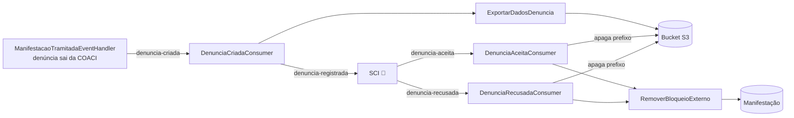

# Workflows e consumidores de eventos

Voltar: [[01-Sistemas/PARTICIPA-DF/Backend/PARTICIPA-DF-Backend-Index|Índice do Backend]] · Relacionado: [[01-Sistemas/PARTICIPA-DF/Backend/01-Visao-Geral/PARTICIPA-DF-Backend-Arquitetura|Arquitetura]], [[01-Sistemas/PARTICIPA-DF/Backend/01-Visao-Geral/PARTICIPA-DF-Backend-Jobs-Agendados|Jobs-Agendados]]

## Objetivo
Servir de índice dos casos de uso orquestrados por passos (workflows) e dos eventos de mensageria consumidos. O detalhe de cada fluxo de negócio fica nos lotes 4 e 5.

## Evidências
Registros `AddWorkFlow<…>` e `ConfigurePubSub(...).AddConsumer<…>` em `Startup.ConfigureServices`; classes dos workflows e dos consumidores em `sources`. Commit `4901ad5`; seção de consumidores atualizada até `820666c` (2026-10-23).

## Informações confirmadas

### Workflows registrados (12)
| Workflow | Módulo | Passos |
|---|---|---|
| `RegistrarManifestacaoWorkflow` | Ouvidoria | ✅ Validar → RecuperarDadosIA → RecuperarDadosBd → BloquearSolicitacaoZeladoria → ValidarIdentificacao → CriarManifestacao → AtualizarPrazos → AdicionarArquivos → AdicionarAtributosComplementares → RecuperarDadosLocalFatoBd → GravarManifestacao → GravarMetadadosManifestacao → NotificarManifestante → GravarArquivos → Finalizar |
| `RegistrarManifestacaoOperadorWorkflow` | Ouvidoria | ❓ passos não lidos |
| `RegistrarManifestacaoIntegradaWorkflow` | Ouvidoria | ❓ passos não lidos |
| `ReclassificarManifestacaoWorkflow` | Ouvidoria | ✅ Validar → RecuperarDadosBd → ValidarPermissao → RecuperarDadosReclassificacaoParcial → RecuperarDadosReclassificacaoIntegral → CriarReclassificacao → AdicionarAtributosComplementares → CriarTramite → PersistirDadosBd → NotificarManifestante |
| `ConsultarModeloAssuntoIAWorkflow` | Ouvidoria | ❓ passos não lidos |
| `ConsultarPorTermoWorkflowSO` | Ouvidoria | ❓ passos não lidos |
| `ExportarManifestacoesCsvCaixaEntradaWorkFlow` | Ouvidoria | ❓ passos não lidos |
| `RegistrarPedidoAutorWorkflow` | SIC | ❓ passos não lidos |
| `RegistrarPedidoOperadorWorkflow` | SIC | ❓ passos não lidos |
| `VincularPedidoSeiWorkflow` | SIC | ✅ Setup → RecuperarDadosBd → CriarProcessoSei → GerarPedidoPDFSei → CriarDocumento → NotificarSolicitante |
| `ConsultarPorTermoWorkflowSIC` | SIC | ❓ passos não lidos |
| `ExportarPedidosCsvCaixaEntradaWorkFlow` | SIC | ❓ passos não lidos |

- ✅ Existe também a classe `ExportarPedidosCaixaEntradaWorkFlow` (pasta `Pdf`) **sem** `AddWorkFlow` em `Startup` (🔶 workflow não ativo ou registrado de outra forma).
- ✅ `VincularPedidoSeiRequest` tem um `IRequestExceptionHandler` registrado (`ExceptionHandler`).

### Consumidores de eventos (RabbitMQ via `CGDF.DotNet.SDK.PubSub`)
*Atualizado em 2026-10-23 (`820666c`); a versão do commit `4901ad5` está em "Histórico".*

| Fila / tópico | Consumidor (`OuvDF.IntegrationServices/Consumers`) | Efeito |
|---|---|---|
| `denuncia-criada` | `DenunciaCriadaConsumer` | ✅ envia `ExportarDadosDenuncia` (PDF do relatório e anexos no bucket S3) e, se houver resultado, publica `denuncia-registrada` |
| `denuncia-aceita` | `DenunciaAceitaConsumer` | ✅ envia `RemoverBloqueioExterno` (justificativa "Denúncia aceita pela COACI (identificador processual)") e remove os objetos do prefixo `{DenunciaId}/` |
| `denuncia-recusada` | `DenunciaRecusadaConsumer` | ✅ envia `RemoverBloqueioExterno` com o `MotivoRecusa` e remove os objetos do prefixo `{DenunciaId}/` |

- ✅ Configuração de consumo: `RabbitMqPubSubSettings.ConsumerSettings` (`MaxProcessingAttempts`, `PrefetchCount`); health check `RabbitMQ`.
- 🔶 `Id` da denúncia é tratado como `Id` de manifestação (`Manifestacao = new CommandID<long>(DenunciaId)`).
- ✅ O produtor de `denuncia-criada` é o `ManifestacaoTramitadaEventHandler` (evento de domínio `ManifestacaoTramitadaEvent`).

Detalhes do S3 e do contrato: [[01-Sistemas/PARTICIPA-DF/Backend/07-Integracoes/PARTICIPA-DF-Backend-Integracoes-Externas|Integrações externas]].

## Inferências e limitações
- 🔶 Quem publica `denuncia-aceita` e `denuncia-recusada` não está no código; provavelmente o `SCI` (ver [[Mapa-de-Integracoes|Mapa]]).
- 🔶 Desbloqueio antes da limpeza do bucket e sem tratamento de erro nos consumidores (débito novo).
- 🔶 Nenhum código do repositório envia `AplicarBloqueioExterno`; no fluxo acima a manifestação não é bloqueada ao enviar `denuncia-registrada` (ver [[01-Sistemas/PARTICIPA-DF/Backend/03-Modulos/Atribuicao-e-Bloqueio-Externo|Atribuicao-e-Bloqueio-Externo]]).
- 🔶 Pelo nome, `BloquearSolicitacaoZeladoria` impede o registro de certas solicitações; regra não lida.

## Relacionamentos
- [[01-Sistemas/PARTICIPA-DF/Backend/01-Visao-Geral/PARTICIPA-DF-Backend-Glossario|Glossário]]

## Pendências e próximo passo
- Lotes 4 e 5: ler os passos dos workflows marcados ❓ e criar notas de fluxo.
- ✅ Resolvido em 2026-10-23 (`820666c`): `DenunciaRecusadaConsumer` lido e integração registrada.

## Histórico
### 2026-10-23: consumidores do commit `4901ad5`
- `DenunciaAceitaConsumer` ficava em `OuvDF.ServicoOuvidoria/Domain/EventHandlers` e só enviava `RemoverBloqueioExterno`; `DenunciaRecusadaConsumer` constava como "não lido"; não havia `DenunciaCriadaConsumer` nem armazenamento de objetos.
