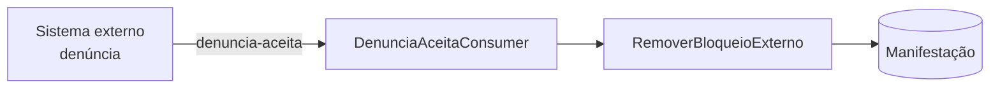

# Workflows e consumidores de eventos

Voltar: [[01-Sistemas/PARTICIPA-DF/Backend/PARTICIPA-DF-Backend-Index|Índice do Backend]] · Relacionado: [[01-Sistemas/PARTICIPA-DF/Backend/01-Visao-Geral/PARTICIPA-DF-Backend-Arquitetura|Arquitetura]], [[01-Sistemas/PARTICIPA-DF/Backend/01-Visao-Geral/PARTICIPA-DF-Backend-Jobs-Agendados|Jobs-Agendados]]

## Objetivo
Servir de índice dos casos de uso orquestrados por passos (workflows) e dos eventos de mensageria consumidos. O detalhe de cada fluxo de negócio fica nos lotes 4 e 5.

## Evidências
Registros `AddWorkFlow<…>` e `ConfigurePubSub(...).AddConsumer<…>` em `Startup.ConfigureServices`; classes dos workflows e do consumidor em `sources`. Commit `4901ad5`.

## Informações confirmadas

### Workflows registrados (12)
| Workflow | Módulo | Passos |
|---|---|---|
| `RegistrarManifestacaoWorkflow` | Ouvidoria | ✅ Validar → RecuperarDadosIA → RecuperarDadosBd → BloquearSolicitacaoZeladoria → ValidarIdentificacao → CriarManifestacao → AtualizarPrazos → AdicionarArquivos → AdicionarAtributosComplementares → RecuperarDadosLocalFatoBd → GravarManifestacao → GravarMetadadosManifestacao → NotificarManifestante → GravarArquivos → Finalizar |
| `RegistrarManifestacaoOperadorWorkflow` | Ouvidoria | ❓ passos não lidos |
| `RegistrarManifestacaoIntegradaWorkflow` | Ouvidoria | ❓ passos não lidos |
| `ReclassificarManifestacaoWorkflow` | Ouvidoria | ✅ Validar → RecuperarDadosBd → ValidarPermissao → RecuperarDadosReclassificacaoParcial → RecuperarDadosReclassificacaoIntegral → CriarReclassificacao → AdicionarAtributosComplementares → CriarTramite → PersistirDadosBd → NotificarManifestante |
| `ConsultarModeloAssuntoIAWorkflow` | Ouvidoria | ❓ passos não lidos |
| `ConsultarPorTermoWorkflowSO` | Ouvidoria | ❓ passos não lidos |
| `ExportarManifestacoesCsvCaixaEntradaWorkFlow` | Ouvidoria | ❓ passos não lidos |
| `RegistrarPedidoAutorWorkflow` | SIC | ❓ passos não lidos |
| `RegistrarPedidoOperadorWorkflow` | SIC | ❓ passos não lidos |
| `VincularPedidoSeiWorkflow` | SIC | ✅ Setup → RecuperarDadosBd → CriarProcessoSei → GerarPedidoPDFSei → CriarDocumento → NotificarSolicitante |
| `ConsultarPorTermoWorkflowSIC` | SIC | ❓ passos não lidos |
| `ExportarPedidosCsvCaixaEntradaWorkFlow` | SIC | ❓ passos não lidos |

- ✅ Existe também a classe `ExportarPedidosCaixaEntradaWorkFlow` (pasta `Pdf`) **sem** `AddWorkFlow` em `Startup` (🔶 workflow não ativo ou registrado de outra forma).
- ✅ `VincularPedidoSeiRequest` tem um `IRequestExceptionHandler` registrado (`ExceptionHandler`).

### Consumidores de eventos (RabbitMQ via `CGDF.DotNet.SDK.PubSub`)
| Fila / tópico | Consumidor | Efeito |
|---|---|---|
| `denuncia-aceita` | `DenunciaAceitaConsumer` | ✅ envia `RemoverBloqueioExterno` para a manifestação (`DenunciaId`), justificativa "Denúncia aceita pela COACI (identificador processual)" |
| `denuncia-recusada` | `DenunciaRecusadaConsumer` | ❓ não lido |

- ✅ Configuração de consumo: `RabbitMqPubSubSettings.ConsumerSettings` (`MaxProcessingAttempts`, `PrefetchCount`); health check `RabbitMQ`.
- 🔶 `Id` da denúncia é tratado como `Id` de manifestação (`Manifestacao = new CommandID<long>(DenunciaId)`).

## Inferências e limitações
- 🔶 Quem publica `denuncia-aceita` e `denuncia-recusada` não está no código; provável sistema de denúncias (o consumidor cita COACI): ❓. Entra no lote 7 (Mapa de Integrações).
- 🔶 Pelo nome, `BloquearSolicitacaoZeladoria` impede o registro de certas solicitações; regra não lida.

## Relacionamentos
- [[01-Sistemas/PARTICIPA-DF/Backend/01-Visao-Geral/PARTICIPA-DF-Backend-Glossario|Glossário]]

## Pendências e próximo passo
- Lotes 4 e 5: ler os passos dos workflows marcados ❓ e criar notas de fluxo.
- Lote 7: ler `DenunciaRecusadaConsumer` e registrar a integração de eventos.
