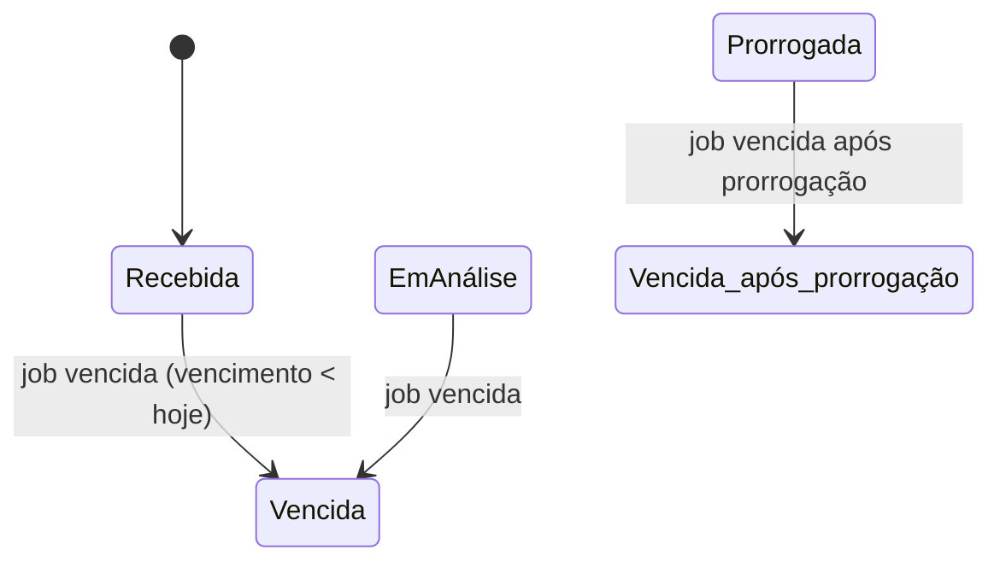
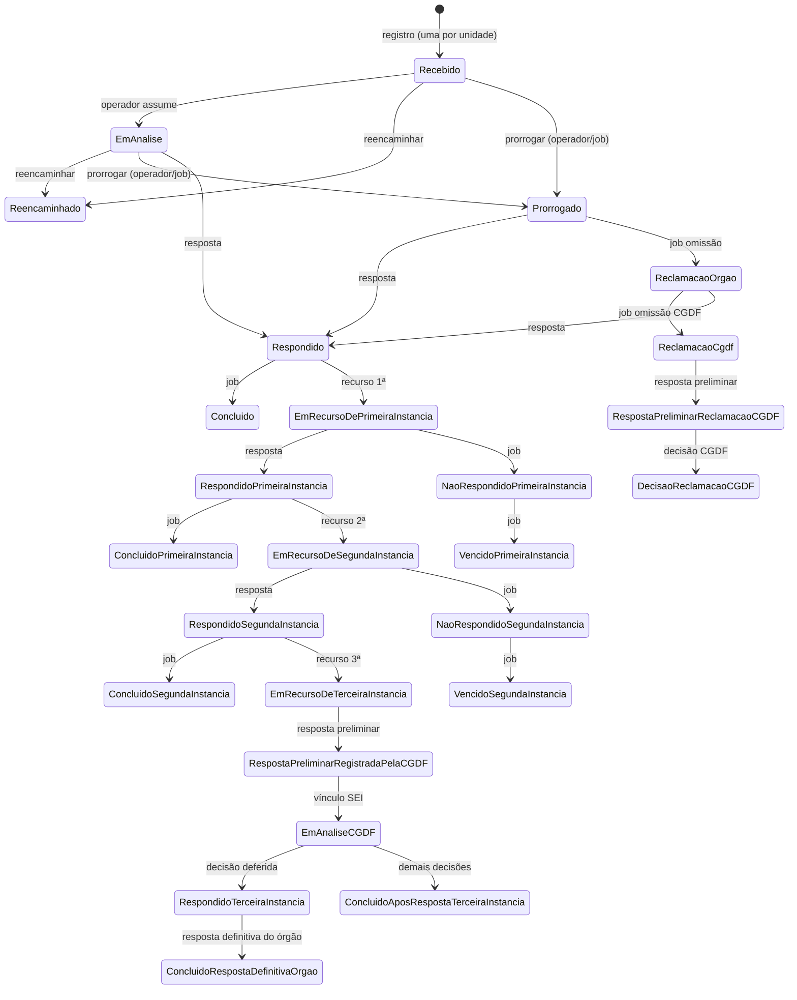
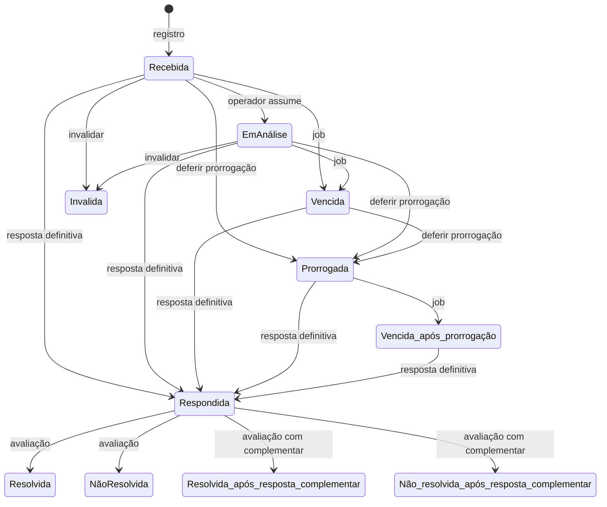

# Enums e estados

Voltar: [[01-Sistemas/PARTICIPA-DF/Backend/PARTICIPA-DF-Backend-Index|Índice do Backend]] · Relacionado: [[01-Sistemas/PARTICIPA-DF/Backend/02-Dominio/PARTICIPA-DF-Backend-Modelo-de-Dominio|Modelo-de-Dominio]], [[01-Sistemas/PARTICIPA-DF/Backend/03-Modulos/PARTICIPA-DF-Backend-Jobs-Agendados|Jobs-Agendados]]

## Objetivo
Catalogar os enums do domínio (com seus valores) e as transições de estado **visíveis nos jobs e consultas**. As demais transições (comandos de resposta, recurso, tramitação) serão acrescentadas nos lotes 4 e 5.

## Evidências
Arquivos de `Domain/Enums` dos três projetos e as entidades `SituacaoManifestacao`/`SituacaoPedido`, commit `4901ad5`. Os ids são os valores gravados nas tabelas de situação (`SituacaoManifestacao(enum)` grava `Id = (long)enum`).

## Informações confirmadas

### Ouvidoria
| Enum | Valores |
|---|---|
| `SituacaoManifestacaoEnum` | 1 Recebida · 2 EmAnálise · 3 Respondida · 4 NãoResolvida · 5 Resolvida · 6 Vencida · 7 Prorrogada · 8 Invalida · 9 Vencida_após_prorrogação · 10 Não_resolvida_após_resposta_complementar · 11 Resolvida_após_resposta_complementar |
| `ClassificacaoManifestacaoEnum` | 1 Denúncia · 2 Reclamação · 3 Solicitação · 4 Sugestão · 5 Informação · 6 Elogio · 999 Indefinida |
| `TipoEntradaEnum` (classe) | `CENTRAL_162` (01001), `CENTRAL_160` (01002), `OUVDF` (04001), `PARTICIPADF` (04008): códigos de canal |
| `AcaoTramiteEnum` | 1 Responder · 2 Apurar · 3 CorrigirFluxo · 4 EncaminharRespostaApuracao · 5 TramitarEntreSeccionais |
| `AcaoManifestacaoEnum` | siglas de ações na caixa de entrada (ex.: `DTL_MNF` detalhar, `RPT_DFN` resposta definitiva, `RPT_PRL` preliminar, `RPT_CMP` complementar, `RGT_PRV` providência, `TRM_MNF` tramitar, `PRG_PRZ` prorrogação, `CMP_MNF` complementar manifestação) |
| `SituacaoProrrogacaoDePrazoEnum` | 1 Solicitada · 2 Deferida · 3 Indeferida |
| `TipoRespostaEnum` | Preliminar · Definitiva · Complementar |
| `StatusAnaliseIAEnum` | EmConformidade · NaoConformidade · EmConformidadeRec · NaoConformidadeRec · Reprovado |
| outros | `AtributoFormatoEnum`, `CategoriaPerfilCidadaoEnum`, `ResultadoSolicitacaoAvaliacaoEnum`, `SatisfacaoEnum`, `SexoEnum`, `AcaoParaRemoverNotificacaoEnum`, `TipoQuestaoEnum` |

### SIC
| Enum | Valores |
|---|---|
| `SituacaoPedidoEnum` | 1 Recebido · 2 EmAnalise · 3 Prorrogado · 4 Respondido · 5 EmRecursoDePrimeiraInstancia · 6 RespondidoPrimeiraInstancia · 7 NaoRespondidoPrimeiraInstancia · 8 EmRecursoDeSegundaInstancia · 9 RespondidoSegundaInstancia · 10 NaoRespondidoSegundaInstancia · 11 EmRecursoDeTerceiraInstancia · 12 RespostaPreliminarRegistradaPelaCGDF · 13 EmAnaliseCGDF · 14 RespondidoTerceiraInstancia · 15 ConcluidoRespostaDefinitivaOrgao · 16 Reencaminhado · 17 ReclamacaoOrgao · 18 ReclamacaoCgdf · 19 RespostaPreliminarReclamacaoCGDF · 20 DecisaoReclamacaoCGDF · 21 Concluido · 22 ConcluidoPrimeiraInstancia · 23 ConcluidoSegundaInstancia · 24 ConcluidoAposRespostaTerceiraInstancia · 26 VencidoPrimeiraInstancia · 27 VencidoSegundaInstancia |
| `InstanciaRecursoEnum` | 1 Primeira · 2 Segunda · 3 Terceira |
| `TipoRespostaEnum` | 1 RespostaPedido · 2 RespostaRecursoPrimeiraInstancia · 3 RespostaRecursoSegundaInstancia · 4 RespostaPreliminarRecursoTerceiraInstancia · 5 RespostaDefinitiva · 6 RespostaPreliminarNotificacaoOmissaoResposta |
| `TipoDecisaoEnum` | 1 Indeferido · 2 Deferido · 3 ParcialmenteDeferido · 4 NaoConhecimento · 5 PerdaDeObjeto · 6 PerdaDeObjetoParcial |
| `TipoNotificacaoOmissaoRespostaEnum` | 1 à Unidade · 2 à CGDF |
| `GrauSigiloEnum` | 1 Restrito · 2 Publico |
| `TipoEntradaEnum` | 1 Internet · 2 Balcão |
| `TipoDocumentoEnum` | G · R |
| outros | `AcaoPedidoEnum` (siglas de ações, ex.: `DTL_PDD`, `RPT_PDD`, `RPT_RPI`, `RPT_RSI`, `RPP_RTI`, `RPP_NOR`, `RPD_PDD`), `TipoClassificacaoRespostaEnum`, `AtributoFormatoOpt`, `CriterioOrdenacaoEnum`, `OrdenacaoColunaPedidoEnum`, `FormatoExportacaoPedido`, `GrupoDadosPedidoEnum`, `TipoQuestaoEnum` |

### Shared
| Enum | Valores |
|---|---|
| `ModuloEnum` | 1 SERVICO_OUVIDORIA · 2 SERVICO_INFORMACAO_CIDADAO |
| `TipoOperadorEnum` | SO · SIC |
| `TipoUnidadeEnum` | 1 OuvidoriaGeral · 2 ControleDeQualidade · 3 UnidadeDeOuvidoria · 4 UnidadeFinalistica · 5 COACI · 6 UnidadeSicSuperior |
| `UnidadesSuperioresEnum` | `CGDF = 01089` · `OGDF = 01` |
| `MotivacaoBloqueioUsuarioEnum` | 1 CPF_DADOS_INCONSISTENTES · 2 CPF_INEXISTENTE · 3 FALECIMENTO · 4 CNPJ_INEXISTENTE · 5 CNPJ_DADOS_INCONSISTENTES · 6 CNPJ_BAIXADO |
| `TipoBloqueioUsuarioEnum` | Parcial · Total |
| `OrigemCadastroUsuarioEnum` | AutoCadastro · Operador |
| `TipoEntidadeEnum` | 1 IniciativaPrivada · 2 OrgaoPublico · 3 EntidadeEspecial e códigos de natureza jurídica (1015 em diante) |
| `FuncionalidadeEnum` | 64 valores: SO 1 a 50, SIC 201 a 220 (ver [[01-Sistemas/PARTICIPA-DF/Backend/08-Seguranca/PARTICIPA-DF-Backend-Seguranca-e-Autorizacao|Seguranca-e-Autorizacao]]) |
| outros | `SexoCidadaoEnum`, `TipoPessoaEnum`, `TipoTelefoneEnum` |

### Grupos de situação (Ouvidoria)
`EmAtendimento` = Recebida, EmAnálise, Prorrogada, Vencida, Vencida_após_prorrogação · `NoPrazo` = Recebida, EmAnálise · `PrazoVencido` = Vencida, Vencida_após_prorrogação · `Resolvida` = Resolvida, Resolvida_após_resposta_complementar · `NaoResolvida` = NãoResolvida, Não_resolvida_após_resposta_complementar.

### Transições observadas (apenas por jobs)

- ✅ Jobs de pedidos (corrigido no lote 5): `Prorrogado` → `ReclamacaoOrgao` (omissão à unidade); `ReclamacaoOrgao` → `ReclamacaoCgdf` (omissão à CGDF); `EmRecursoDe1ª/2ªInstancia` → `NaoRespondido1ª/2ªInstancia`; e as conclusões por prazo. O diagrama completo do pedido está abaixo.

### Máquina de estados do pedido (completada no lote 5)

- ✅ Fontes: grep dos comandos de `ServicoInformacaoCidadao/Domain/Commands` e handlers lidos nos lotes 5. Detalhes e ressalvas em [[01-Sistemas/PARTICIPA-DF/Backend/05-Fluxos/PARTICIPA-DF-Backend-Fluxo-Registro-de-Pedido|Fluxo-Registro-de-Pedido]], [[01-Sistemas/PARTICIPA-DF/Backend/05-Fluxos/PARTICIPA-DF-Backend-Fluxo-Recursos-e-Instancias|Fluxo-Recursos-e-Instancias]] e [[01-Sistemas/PARTICIPA-DF/Backend/05-Fluxos/PARTICIPA-DF-Backend-Fluxo-Omissao-de-Resposta|Fluxo-Omissao-de-Resposta]].
- 🔶 As setas "recurso" a partir de `Respondido…` simplificam as condições de prazo (ver permissões).

### Máquina de estados da manifestação (completada no lote 4)

- ✅ Origens e destinos conforme `Manifestacao.ValidarFluxoDeSituacao` (usada só na avaliação) e nos comandos de resposta, atribuição, prorrogação e invalidação. `Invalida` aceita 10 origens (todas menos ela mesma). Detalhes e ressalvas em [[01-Sistemas/PARTICIPA-DF/Backend/05-Fluxos/PARTICIPA-DF-Backend-Fluxo-Tramitacao-e-Resposta|Fluxo-Tramitacao-e-Resposta]] e [[01-Sistemas/PARTICIPA-DF/Backend/04-Regras-de-Negocio/PARTICIPA-DF-Backend-Regra-Prazo-e-Prorrogacao|Regras-de-Prazo-e-Prorrogacao]].
- 🔶 As setas "invalidar" a partir dos demais estados (Respondida, avaliadas, Vencida, Prorrogada…) foram omitidas do desenho por clareza; o código as permite.

## Inferências e limitações
- 🔶 `SituacaoPedidoEnum` pula o valor 25: pode ser uma situação removida ou reservada.
- 🔶 `TipoEntradaEnum` de Ouvidoria é uma classe com `enum Opt` e códigos em texto: `PARTICIPADF` e `OUVDF` são **canais de entrada** distintos; isso sugere que "Participa DF" é um canal/nome de produto, mas a relação com a solução `OuvDF` não está documentada (ver [[01-Sistemas/PARTICIPA-DF/Backend/99-Controle/PARTICIPA-DF-Backend-Pendencias|Pendências]]).
- 🔶 `TipoEntradaEnum` no SIC (Internet, Balcão) e na Ouvidoria (canais) têm semânticas diferentes com o mesmo nome.
- 🔶 `StatusAnaliseIAEnum`: significado de "Rec" (recurso?) não confirmado.
- ❓ `RegistrarRecursoSegundaInstancia`/`RegistrarRespostaRecursoSegundaInstancia` e `RegistrarRespostaPreliminarNotificacaoOmissaoResposta` não foram lidos; as transições respectivas vêm da referência às situações (grep).

## Relacionamentos
- [[01-Sistemas/PARTICIPA-DF/Backend/01-Visao-Geral/PARTICIPA-DF-Backend-Glossario|Glossário]]

## Pendências e próximo passo
- Lote 8: revisar o desenho das transições com o time.
