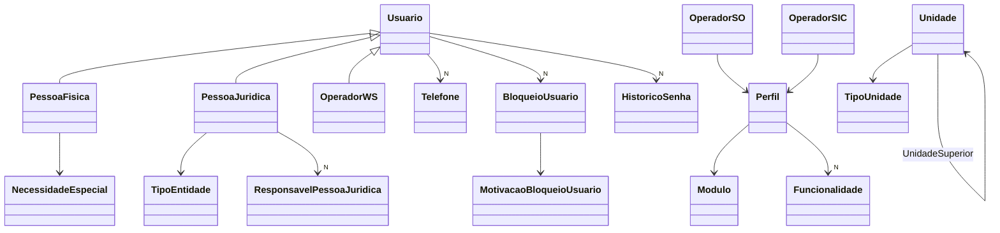
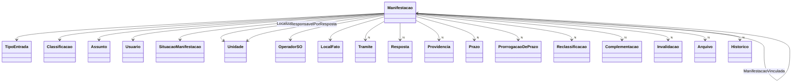
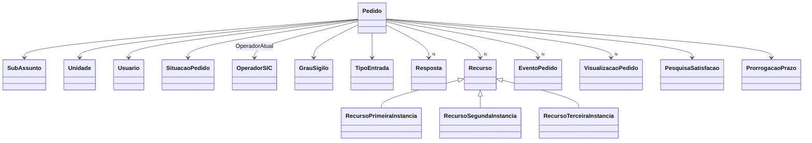

# Modelo de domínio

Voltar: [[01-Sistemas/PARTICIPA-DF/Backend/PARTICIPA-DF-Backend-Index|Índice do Backend]] · Relacionado: [[01-Sistemas/PARTICIPA-DF/Backend/02-Dominio/PARTICIPA-DF-Backend-Enums-e-Estados|Enums-e-Estados]], [[01-Sistemas/PARTICIPA-DF/Backend/02-Dominio/PARTICIPA-DF-Backend-Banco-e-Mapeamentos|Banco-e-Mapeamentos]], [[01-Sistemas/PARTICIPA-DF/Backend/03-Modulos/Usuarios-Operadores-Perfis|Usuarios-Operadores-Perfis]]

## Objetivo
Descrever as entidades, os objetos de valor e os relacionamentos do domínio por módulo. Regras de negócio e fluxos ficam nos lotes 4 e 5.

## Evidências
Entidades dos três projetos (`sources`), commit `4901ad5`. Foram lidos integralmente `Usuario`, `PessoaFisica`, `PessoaJuridica`, `Unidade`, `Perfil`, os operadores, `BloqueioUsuario`, `Prazo` (Ouvidoria e Shared) e `SituacaoManifestacao`/`SituacaoPedido`; os campos de `Manifestacao` e `Pedido`; os demais apenas pelo nome. Quantidade: Shared 34 classes, Ouvidoria 36, SIC 40.

## Informações confirmadas

### Shared: identidade e organização

- ✅ `Usuario` (abstrata na prática): `Login`, `Email`, `Senha` (valor + `Salt`), `DataRegistro`, `DataAtualizacao`, `DataUltimoLogin`, `RedefinirSenha`.
- ✅ `PessoaFisica`: `CPF`, `Nome`, `NomeTratamento`, `DataNascimento`, `NomeMae`, `TipoNecessidadeEspecial`; o `Login` é o CPF. Nome e nome da mãe com mínimo de 3 caracteres; data de nascimento entre 1000 anos atrás e agora.
- ✅ `PessoaJuridica`: `CNPJ`, `RazaoSocial`, `NomeFantasia`, `TipoEntidade`, `ResponsaveisPessoaJuridica`; o `Login` é o CNPJ.
- ✅ `Unidade`: `Id` **string** hierárquico (cada filha recebe o id da superior + 3 dígitos sequenciais), `Descricao`, `NomeExibicao`, `UnidadeSuperior`, `TipoUnidade`, `CodigoSiGRH`, `CodigoSIGGO`, `AtivoModuloSO`, `AtivoModuloSIC`. `IsUnidadePermitidaSIC` = tipo `UnidadeDeOuvidoria` e ativa no SIC.
- ✅ Outras entidades de Shared: `Cidadao`, `Estrangeiro`, `Endereco`, `FaixaDeRenda`, `FaixaDeTempoDeResidencia`, `FormacaoAcademica`, `RacaCor`, `SexoCidadao`, `TipoTelefone`, `ArquivoContaUsuario`, `Politica`, `PoliticaUsuario`, `LogAuditoria`, `TokenCancelado`, `UsuarioFalecido`.
- ✅ Objetos de valor em Shared: `CNPJ`, `Prazo` (início/término, início anterior ao término), `Periodo`, `FeriadoInfo`, `UsuarioHashData`. CPF, `Email`, `Senha` e `Descritor` vêm do SDK.

### Ouvidoria: `Manifestacao`

- ✅ Campos de `Manifestacao`: `Sequencial`, `Token`, `Protocolo`, `Abertura`, `Vencimento`, `Relato` (`Descritor`), `Identificada`, `VisualizadaNaUnidadeAtual`, `BloqueadaExternamente`, `ManifestacaoVinculadaReferencia`, mais as coleções do diagrama, `AtributosComplementares`, `HistoricoDeVisualizacoes`, `RespostasQuestionario` e `UltimoTramite`.
- ✅ `Prazo` (entidade da Ouvidoria): `QtdDias`, `Data` (referência + dias), `BloquearCaixaDeEntrada`, `MarcarManifestacaoComoVencida`, `AcaoParaRemoverNotificacao`, `DescricaoDaNotificacao`, `Pendente`. `BaixarPrazo()` zera `Pendente` e `MarcarManifestacaoComoVencida`.
- ✅ `SituacaoManifestacao` oferece grupos: `EmAtendimento`, `NoPrazo` (Recebida, EmAnálise), `PrazoVencido`, `Resolvida`, `NaoResolvida`, `Avaliada`, `Reavaliada`, `GrupoAvaliadas`.
- ✅ Demais entidades da Ouvidoria: `Tema`, `Assunto`, `Classificacao`, `TipoEntrada`, `RegiaoAdministrativa`, `MapaInterativo`, `MetadadosManifestacao`, `AnaliseIA`, `SolicitacaoAvaliacao`, `ResultadoSolicitacaoAvaliacao`, `Formulario`/`Questao`/`Alternativa`/`RespostaQuestionario`, `Atributo`/`AtributoComplementar`, `Estatistica`, `FeriadoSic`, `PerfilCidadao`, `NotificacaoDePrazo`, `AcaoTramite`, `AcaoParaRemoverNotificacao`.

### SIC: `Pedido` e recursos

- ✅ Campos de `Pedido`: `Data`, `DataEntrada`, `Protocolo`, `Sequencial`, `AnoPedido`, `Texto`, `AnonimatoDadosManifestante`, `Lote`, `Prazo` e `PrazoVigente` (componentes), `Arquivos`, `AtributosComplementares`.
- ✅ `SituacaoPedido.EmFluxoTerceiraInstancia()`: true para `EmRecursoDeTerceiraInstancia`, `EmAnaliseCGDF`, `RespostaPreliminarRegistradaPelaCGDF`, `ReclamacaoCgdf` e `RespostaPreliminarReclamacaoCGDF`.
- ✅ Demais entidades do SIC: `Decisao`, `DecisaoRecursoTerceiraInstancia`, `DecisaoNotificacaoOmissaoRespostaCGDF`, `NotificacaoOmissaoResposta`, `JustificativaRecurso`, `Instancia`, `ClassificacaoResposta`, `TipoClassificacaoResposta`, `TipoDecisao`, `TipoResposta`, `TipoNotificacaoOmissaoResposta`, `FormularioSIC`, `Questao`/`Alternativa`/`AlternativaQuestao`, `Feriado`, `VinculoPedidoSEI`, `PesquisaSatisfacao`/`RespostaPesquisaSatisfacao`, `Assunto`/`SubAssunto`, `Tramite`/`AcaoTramite`, `Arquivo`, `Atributo`.
- ✅ `Tramite`, `Arquivo`, `Assunto`, `TipoEntrada`, `Questao`, `Alternativa` e `Resposta` existem **nos dois módulos** com definições próprias (nomes repetidos em namespaces diferentes).

## Inferências e limitações
- 🔶 `RecursoOld` indica uma versão anterior do modelo de recurso mantida no domínio.
- 🔶 `Cidadao`, `Estrangeiro` e `PessoaFisica` convivem: a relação exata entre elas (perfil socioeconômico do cidadão?) não foi lida.
- 🔶 `PessoaFisica` usa `new Senha(senha, 3)` e `PessoaJuridica` usa `new Senha(senha)`: diferença de parâmetro não explicada (❓ SDK).
- 🔶 `PessoaJuridica.Atualizar(...)` tem um `//todo` e sempre adiciona um novo responsável.
- ❓ Regras internas de `Manifestacao` (433 linhas), `Pedido` (300), recursos, prorrogação e reclassificação: lotes 4 e 5.
- ❓ Entidades lidas só pelo nome: ver "Informações confirmadas" (lista sem detalhe de campos).

## Relacionamentos
- [[01-Sistemas/PARTICIPA-DF/Backend/01-Visao-Geral/PARTICIPA-DF-Backend-Glossario|Glossário]]

## Pendências e próximo passo
- Lote 4: aprofundar `Manifestacao`, `Tramite`, `Prazo`, `ProrrogacaoDePrazo`, `Reclassificacao`.
- Lote 5: aprofundar `Pedido`, `Recurso*`, `Decisao*`, `NotificacaoOmissaoResposta`.
