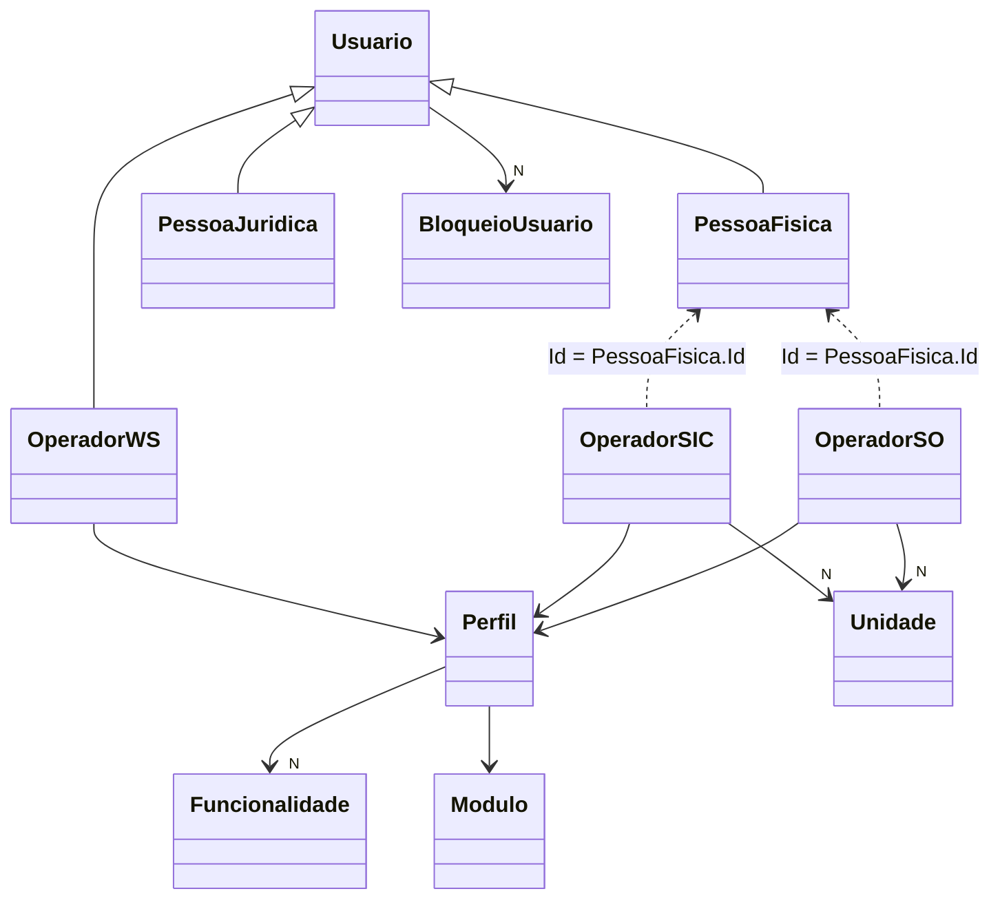

# Usuários, operadores e perfis

Voltar: [[01-Sistemas/PARTICIPA-DF/Backend/PARTICIPA-DF-Backend-Index|Índice do Backend]] · Relacionado: [[01-Sistemas/PARTICIPA-DF/Backend/06-Seguranca/PARTICIPA-DF-Backend-Seguranca-e-Autorizacao|Seguranca-e-Autorizacao]], [[01-Sistemas/PARTICIPA-DF/Backend/03-Modulos/Bloqueio-de-Usuario|Bloqueio-de-Usuario]], [[01-Sistemas/PARTICIPA-DF/Backend/04-Fluxos/PARTICIPA-DF-Backend-Fluxo-Autenticacao|Fluxo-Autenticacao]]

## Objetivo
Documentar a capacidade de gestão de identidades do sistema: quem são os usuários (cidadãos, pessoas jurídicas e operadores), como os perfis dão acesso e quais endpoints e comandos existem. O modelo completo de dados fica no lote 3.

## Evidências
Controllers e entidades em `sources`, commit `4901ad5`. Cobertura `parcial`: cadastros de pessoa física/jurídica, unidades e perfis foram lidos pela superfície (rotas, atributos de autorização e entidades), não regra a regra.

## Informações confirmadas

### Modelo

- ✅ `Usuario`: `Login`, `Email`, `Senha`, `DataUltimoLogin`, `RedefinirSenha`, telefones, bloqueios e histórico de senhas. Especializações `PessoaFisica`, `PessoaJuridica` e `OperadorWS` (✅ por herança em `OperadorWS`; PF e PJ: herança a confirmar no lote 3, 🔶).
- ✅ `OperadorSO` e `OperadorSIC` reutilizam o `Id` da `PessoaFisica` (`Id = PessoaFisica.Id`): operador é uma pessoa física com papel.
- ✅ `OperadorSO`: `UnidadePadrao`, lista de `Unidades`, `Perfil`, `Ativo`. `OperadorSIC`: `UnidadeAtual` (não "padrão"), `Unidades`, `Perfil`, `Ativo`.
- ✅ `OperadorWS`: `NomeSistema`, `Perfil`, `Unidade`, `DataExpiracao` (1 ano após a criação). Representa um sistema integrado.
- ✅ `Perfil`: `Descricao` (mínimo 3 caracteres), `Compartilhado`, `Ativo`, `Modulo` e `Funcionalidades`. Só aceita funcionalidade do mesmo módulo. `IsPerfilPermitidoSIC` = módulo SIC e ativo.
- ✅ Regras de unidade: o operador SO só pode ter como padrão uma unidade ativa em SO ou SIC (`IsUnidadePadraoValid`); o SIC não faz essa checagem em `AlterarUnidadeAtual`.
- ✅ `OperadorSIC.IsUnidadeAtualSuperiorSic()`: a unidade atual é do tipo `UnidadeSicSuperior`.
- ✅ `TipoOperadorEnum`: `SO`, `SIC`.
- ✅ Bloquear e desbloquear: ver [[01-Sistemas/PARTICIPA-DF/Backend/03-Modulos/Bloqueio-de-Usuario|Bloqueio-de-Usuario]].

### Endpoints por controller (rotas e acesso)
| Controller | Base | Acesso | Capacidades |
|---|---|---|---|
| `SecurityController` | `/security` | misto | login, logout, is-auth, notify/retrieve, check/challenge (ver segurança) |
| `UsuarioController` | `/usuario` | `[Authorize]` na classe | alterar/recuperar/concluir recuperação de senha; `id`, `por-nome`, `por-login` (`OperadorSO`/`OperadorSIC`); `bloquear`/`desbloquear` (`OperadorSO`); `motivacao-bloqueio-usuario`; `detalhar`; `profile`; `excluir-conta`; consulta do usuário autenticado (anônima) |
| `v2/UsuarioController` | `/v2/usuario` | idem | `ConsultarUsuarioAutenticadoV2` |
| `OperadorSICController` | `/operador-sic` | `[Authorize]` | cadastrar, atualizar, ativar, desativar, `alterar-unidade-atual`, consultar por id/CPF, unidades, permissões, existência |
| `OperadorSOController` | `/operador-so` | papel `OperadorSO` | gravar, `id`, `listar`, `existe`, unidades, consultar por unidade, permissões, `alterar-unidade`, `operador-ws` (anônimo) |
| `PerfilSICController` | `/acesso-informacao/perfil-sic` | `[Authorize]` | gravar, listar, por id, funcionalidades, ativos |
| `PerfilSOController` | `/perfil-so` | papel `OperadorSO` | gravar, listar, id, funcionalidades, ativos |
| `PessoaFisicaController` | `/pessoa-fisica` | `[Authorize]`, com cadastro e existência anônimos | cadastrar (`LogAudit`), por operador, atualizar, desbloquear dados inconsistentes |
| `PessoaJuridicaController` | `/pessoa-juridica` | `[Authorize]`, vários anônimos | cadastrar, atualizar, por operador (papéis SO/SIC), por CNPJ, validar CNPJ, tipos de entidade, responsável e histórico |
| `UnidadeController` | `/unidade` | misto | gravar SO, listar SO/SIC, ativar/desativar SIC, ouvidorias ativas, subordinadas (SO e SIC por papel) |
| `PoliticaController` | `/politica` | `[Authorize]` | política vigente (anônima), aceitar vigente (`LogAudit`) |
| `IntegracaoController` | `/v1` | papel `OperadorWS` | consultar PF por CPF, criar PF (para sistemas integrados) |

### Comandos de domínio (Shared)
Autenticação e senha: `AutenticarUsuario`, `AlterarSenha`, `RecuperarSenha`, `ConcluirRecuperacaoSenha`, `CancelarToken`, `NotificarAutenticacao`. Cadastros: `CadastrarPessoaFisica/Juridica`, `AtualizarPessoaFisica/Juridica`, `AtualizarResponsavelPessoaJuridica`, `GravarCidadao`, `GravarOperadorSIC/SO/WS`, `GravarPerfilSIC/SO`, `GravarUnidadeSO`. Estado: `AtivarOperadorSIC`, `DesativarOperadorSIC`, `AtivarUnidadeSIC`, `DesativarUnidadeSIC`, `AlterarUnidadeAtual`, `AlterarUnidadePadrao`, `BloquearUsuario`, `DesbloquearUsuario*`, `DesabilitarOperador*ComAcessoExpirado`, `DesabilitarOperadorSoComSenhaExpiradaSO`. Política: `AceitarPoliticaDeSeguranca`. Conta: `SolicitarExclusaoContaUsuario`, `ExcluirContaUsuario`. Auditoria: `GravarLogAuditoria`.

### Regras verificadas
- ✅ Perfil: descrição mínima de 3 caracteres e funcionalidade só do mesmo módulo.
- ✅ Operador SO/SIC exige pessoa física, unidade e perfil não nulos.
- ✅ `OperadorSO.Atualizar` reinicia a lista de unidades (`Unidades = new List<Unidade>()`); 🔶 as unidades extras precisam ser reinseridas depois.
- ✅ `OperadorSIC.Atualizar` substitui `Unidades` pela lista recebida.
- ✅ Operadores ativos recebem exigência de senha complexa; os demais usuários, simples.
- ✅ Operador inativo após 90 dias sem login ([[01-Sistemas/PARTICIPA-DF/Backend/01-Visao-Geral/PARTICIPA-DF-Backend-Jobs-Agendados|Jobs-Agendados]]).

## Inferências e limitações
- 🔶 Cadastro de cidadão é anônimo (autoatendimento) e o de operador exige operador; `OrigemCadastroUsuarioEnum` (`AutoCadastro`, `Operador`) indica as duas origens.
- 🔶 Os endpoints de `OperadorSICController` só têm `[Authorize]` (qualquer usuário autenticado); a restrição por funcionalidade, se existir, está nos handlers (não lidos).
- 🔶 `PerfilSICController` idem.
- ❓ Cadastros de PF/PJ (validações de CPF/CNPJ, integração com PeoplesCheck), `Unidade` (tipos e hierarquia) e `Politica`: lote 3 e lote 7.
- ❓ Regra de `excluir-conta` e `SolicitarExclusaoContaUsuario`.

## Relacionamentos
- [[01-Sistemas/PARTICIPA-DF/Backend/01-Visao-Geral/PARTICIPA-DF-Backend-Glossario|Glossário]] · [[01-Sistemas/PARTICIPA-DF/Backend/01-Visao-Geral/PARTICIPA-DF-Backend-Arquitetura|Arquitetura]]

## Pendências e próximo passo
- Lote 3: modelo de domínio completo (PF/PJ, Unidade, Política) e mapeamentos.
- Lote 6: catálogo de endpoints com payloads.
