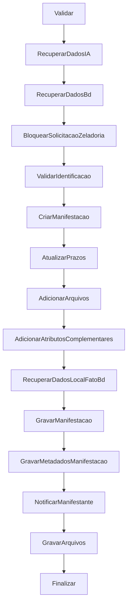

# Fluxo de registro de manifestação

Voltar: [[01-Sistemas/PARTICIPA-DF/Backend/PARTICIPA-DF-Backend-Index|Índice do Backend]] · Relacionado: [[01-Sistemas/PARTICIPA-DF/Backend/03-Modulos/Manifestacao|Manifestacao]], [[01-Sistemas/PARTICIPA-DF/Backend/03-Modulos/Regras-de-Prazo-e-Prorrogacao|Regras-de-Prazo-e-Prorrogacao]], [[01-Sistemas/PARTICIPA-DF/Backend/01-Visao-Geral/PARTICIPA-DF-Backend-Workflows-e-Consumidores|Workflows-e-Consumidores]]

## Objetivo
Descrever o registro de uma manifestação nas três variantes (manifestante, operador, integrada) e o resultado de cada passo.

## Evidências
`RegistrarManifestacaoWorkflow` e passos em `SharedSteps/`, `Context`, `Manifestacao` (construtor), `CalculadoraPrazoService`; commit `4901ad5`. Foram lidos os passos `CriarManifestacao`, `AtualizarPrazos`, `BloquearSolicitacaoZeladoria` e `ValidarIdentificacao`; os demais (`Validar`, `RecuperarDadosIA`, `RecuperarDadosBd` de cada variante, `AdicionarArquivos`, `GravarManifestacao`, `GravarMetadadosManifestacao`, `NotificarManifestante`, `GravarArquivos`, `Finalizar`) só pelo nome.

## Informações confirmadas

### Entradas
| Variante | Endpoint | Acesso | Workflow |
|---|---|---|---|
| Manifestante | `POST servico-ouvidoria/manifestacao` | anônimo (cidadão pode registrar sem login; ver anonimato) | `RegistrarManifestacaoWorkflow` |
| Operador | `POST …/manifestacao/por-operador` | autenticado | `RegistrarManifestacaoOperadorWorkflow` (passos ❓) |
| Integrada | `POST …/manifestacao/integrada` | anônimo | `RegistrarManifestacaoIntegradaWorkflow` (passos ❓) |
Os três aceitam corpo de até 40.000.000 bytes (`RequestSizeLimit`) e gravam auditoria (`LogAudit`).

### Passos do workflow do manifestante

1. ✅ **BloquearSolicitacaoZeladoria**: se a política `IsSolicitacaoZeladoria(classificação, assunto)` é satisfeita, rejeita com "Não é permitido solicitar serviços de zeladoria pelo Participa-DF".
2. ✅ **ValidarIdentificacao**: se a classificação não permite anonimato e a manifestação não é identificada, rejeita com "A manifestação não permite anonimato. Revise os dados".
3. ✅ **CriarManifestacao**: calcula o prazo (`PrazoManifestacaoPadrao` dias, ver regras de prazo), cria `Manifestacao` (valida relato 3–13.000, classificação, assunto, tipo de entrada, usuário se identificada), registra a situação `Recebida` no histórico com o operador (variante operador) ou o usuário.
4. ✅ **Construtor**: unidade inicial = `Classificacao.UnidadeTramiteInicial` ou, se nula, a do `Assunto`; `ResponsavelPorResposta` = unidade inicial; `Abertura = DateTime.Now`; `Vencimento` = fim do prazo; `Token` = SHA-256 de relato, data, hora/minuto, classificação e assunto.
5. ✅ **AtualizarPrazos**: copia para a manifestação todos os `NotificacaoDePrazo` **ativos** e **sem** "marcar como vencida", criando `Prazo`s a partir da abertura (`QtdDias` depois da data de abertura).
6. ✅ **NotificarManifestante**: envia e-mail ao manifestante (passo lido só pelo nome; template `nova-manifestacao.html`, 🔶).
7. ✅ Quando `Usuario.Email` existe, o e-mail é enviado; sem e-mail, ver `PodeReceberEmail()` ([[01-Sistemas/PARTICIPA-DF/Backend/03-Modulos/Manifestacao|Manifestacao]]).

### Respostas de erro
Os passos devolvem `ErrorResponse` com notificações (`400`, via `ProcessCommand`). Quando a validação de anonimato falha, o passo grava um log de aviso com contexto.

## Inferências e limitações
- 🔴 `ValidarIdentificacao` inclui o **relato** do cidadão (`Relato`) no contexto do log de aviso: o relato pode conter dados pessoais ou sensíveis, e o log é enviado ao Loki (ver [[01-Sistemas/PARTICIPA-DF/Backend/01-Visao-Geral/PARTICIPA-DF-Backend-Arquitetura|Arquitetura]]). Riscos de privacidade para o lote 8.
- 🔶 `RecuperarDadosIA` indica consulta ao serviço Iza durante o registro (ordem: antes do banco); o que ele define (classificação sugerida?) é ❓ (lote 7).
- 🔶 Zeladoria: a regra bloqueia o registro por "Participa-DF". Isso confirma que "Participa-DF" é um canal que não atende zeladoria; a regra interna da política está no `PolicyManagement` (não lida).
- 🔶 A variante anônima com "identificada = false" não grava `Usuario`; a variante identificada exige que o usuário exista.
- ❓ Passos das variantes operador e integrada; contrato da integração (quem chama `integrada`).

## Relacionamentos
- [[01-Sistemas/PARTICIPA-DF/Backend/04-Fluxos/PARTICIPA-DF-Backend-Fluxo-Tramitacao-e-Resposta|Fluxo-Tramitacao-e-Resposta]]

## Pendências e próximo passo
- Ler os passos pendentes e a política de zeladoria; registrar a integração `integrada` no lote 7.
