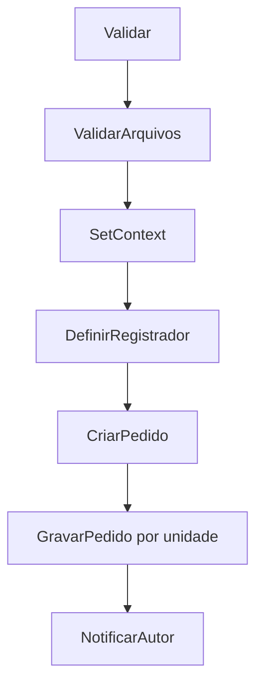
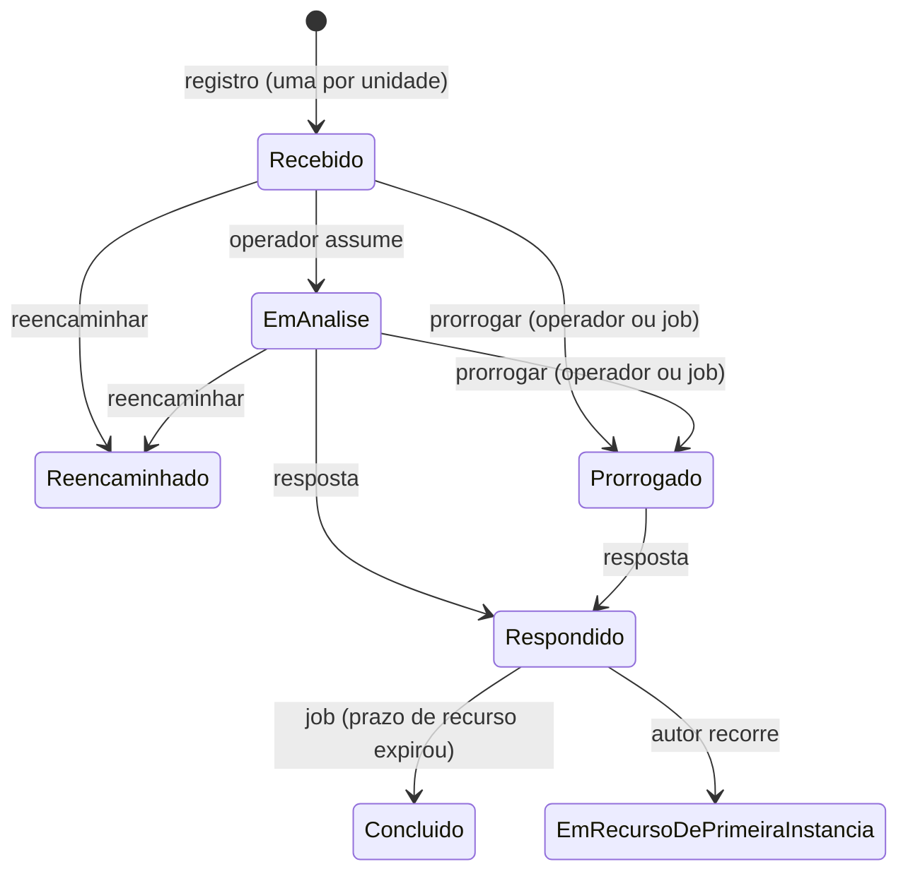

# Fluxo de registro e resposta de pedido

Voltar: [[01-Sistemas/PARTICIPA-DF/Backend/PARTICIPA-DF-Backend-Index|Índice do Backend]] · Relacionado: [[01-Sistemas/PARTICIPA-DF/Backend/03-Modulos/Pedido-e-Recurso|Pedido-e-Recurso]], [[01-Sistemas/PARTICIPA-DF/Backend/04-Fluxos/PARTICIPA-DF-Backend-Fluxo-Recursos-e-Instancias|Fluxo-Recursos-e-Instancias]], [[01-Sistemas/PARTICIPA-DF/Backend/03-Modulos/Regras-de-Prazo-do-SIC|Regras-de-Prazo-do-SIC]]

## Objetivo
Descrever o registro de um pedido de acesso à informação (pelo autor ou pelo operador), sua distribuição às unidades, a atribuição a um operador, o reencaminhamento e a primeira resposta.

## Evidências
`RegistrarPedidoAutorWorkflow` e `…OperadorWorkflow`, `SetContext`, `CriarPedido`, `GravarPedido`, handlers de resposta, atribuição e reencaminhamento; commit `4901ad5`. Não lidos: `Validar`, `ValidarArquivos`, `DefinirRegistrador`, `NotificarAutor`, `GravarArquivosEmDisco` e `AtribuirPedidoParaOperadorHandler`.

## Informações confirmadas

### Registro

1. ✅ Entradas: `POST acesso-informacao/pedido` (autor) e `…/pedido/por-operador` (operador em nome do cidadão), ambas com limite de 40.000.000 bytes, `[Authorize]` e `LogAudit`.
2. ✅ `SetContext`: gera um **lote** (GUID em maiúsculas), carrega o subassunto, o tipo de entrada e o autor; situação inicial `Recebido`; grau de sigilo `Publico` se `IsPublico`, senão `Restrito`; data = `IApplicationDateTime.Current`; **prazo** = `QtdDiadPrazoPedido` dias (ver [[01-Sistemas/PARTICIPA-DF/Backend/03-Modulos/Regras-de-Prazo-do-SIC|Regras-de-Prazo-do-SIC]]).
3. ✅ `CriarPedido`: cria o `Pedido` base (texto 3 a 8.000, assunto, usuário e tipo de entrada obrigatórios).
4. ✅ `GravarPedido`: para **cada unidade** de `request.Unidades`, abre uma transação, **clona** o pedido (`Pedido.Clonar`, com `Lote`, unidade, situação `Recebido` e `PrazoVigente = Prazo` original), copia os arquivos, salva e publica o evento `PedidoRegistrado`.
5. ✅ A resposta devolve o `Lote` (um autor pode acompanhar os pedidos das várias unidades pelo lote: `POST …/pedido/consultar-por-lote`).

### Atribuição e reencaminhamento
- ✅ `AtribuirPedidoParaOperador` referencia as situações `Recebido`, `EmAnalise` e `Reencaminhado` (handler não lido; 🔶 move `Recebido`/`Reencaminhado` para `EmAnalise` ao assumir, como na Ouvidoria).
- ✅ `ReencaminharPedido`: cria um `Tramite` (unidade de origem → destino, motivação, operador, situação `Reencaminhado`); recusa se já existe, na unidade de destino, pedido do mesmo `Lote` ("Pedido com o mesmo teor está em andamento no órgão de destino"); altera a unidade do pedido, zera o operador atual (`AtualizarSituacao(tramite)`) e atualiza a situação.
- ✅ `POST …/pedido/remover-operador-atual` devolve o pedido à caixa de entrada da unidade (`RemoverOperadorAtual`).

### Resposta do pedido (`POST …/pedido/registrar-resposta`, papel `OperadorSIC`)
1. ✅ Carrega pedido, classificação de resposta, operador e calcula o novo prazo (`QtdDiasPrazoParaRecorrer` dias a partir de hoje).
2. ✅ Verifica a situação (`ConsultarSituacaoResposta`: a classificação de resposta escolhida deve ser válida para a situação atual) e a permissão `RPT_PDD`.
3. ✅ Cria a `Resposta` (tipo `RespostaPedido`, classificação, operador, unidade atual), define o prazo de resposta, atualiza o `PrazoVigente` para o prazo de recorrer e muda a situação para `Respondido`.
4. ✅ Salva os arquivos anexos (um comando por arquivo) e atualiza o grau de sigilo.
5. ✅ Após a transação, envia ao autor o e-mail `resposta-pedido.html`.

(Recursos e omissão: [[01-Sistemas/PARTICIPA-DF/Backend/04-Fluxos/PARTICIPA-DF-Backend-Fluxo-Recursos-e-Instancias|Fluxo-Recursos-e-Instancias]] e [[01-Sistemas/PARTICIPA-DF/Backend/04-Fluxos/PARTICIPA-DF-Backend-Fluxo-Omissao-de-Resposta|Fluxo-Omissao-de-Resposta]].)

## Inferências e limitações
- 🔶 Cada unidade é gravada em uma transação separada; uma falha na terceira unidade deixa as duas primeiras gravadas (sem desfazer) e o e-mail do autor pode não sair.
- 🔶 `_mediator.Publish(new PedidoRegistrado ...)` não tem `await` no passo `GravarPedido`.
- 🔶 `ReencaminharPedidoHandler` não consulta a permissão `RRE_PDD` nem o papel além do atributo do endpoint; ver [[01-Sistemas/PARTICIPA-DF/Backend/03-Modulos/Pedido-e-Recurso|Pedido-e-Recurso]].
- 🔶 `RegistrarRespostaPedidoHandler` guarda `_pedido` em campo de instância para o e-mail pós-execução (transiente? ❓).
- ❓ Regras de `Validar`, `ValidarArquivos` (tipos e tamanhos) e `NotificarAutor`; efeito do evento `PedidoRegistrado` (quem o consome).

## Relacionamentos
- [[01-Sistemas/PARTICIPA-DF/Backend/02-Dominio/PARTICIPA-DF-Backend-Enums-e-Estados|Enums-e-Estados]]

## Pendências e próximo passo
- Ler `AtribuirPedidoParaOperador` e os consumidores de `PedidoRegistrado` (lote 6/7).
