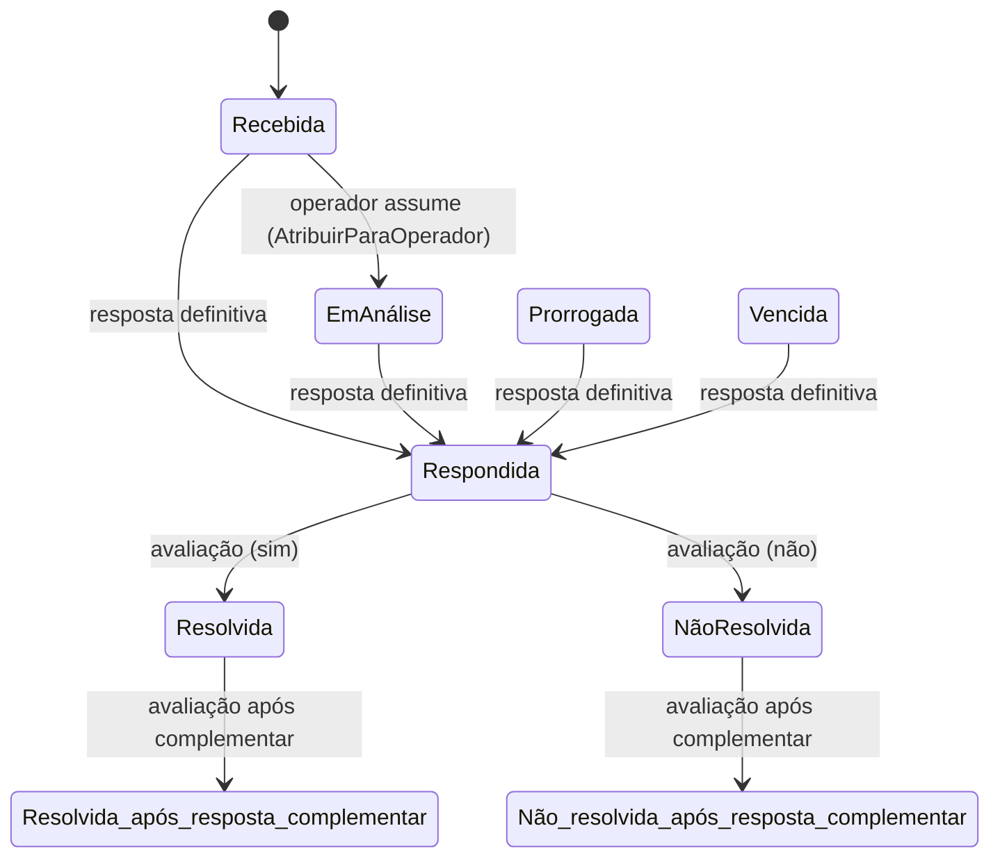

# Fluxo de tramitação, resposta e avaliação

Voltar: [[01-Sistemas/PARTICIPA-DF/Backend/PARTICIPA-DF-Backend-Index|Índice do Backend]] · Relacionado: [[01-Sistemas/PARTICIPA-DF/Backend/03-Modulos/Manifestacao|Manifestacao]], [[01-Sistemas/PARTICIPA-DF/Backend/04-Fluxos/PARTICIPA-DF-Backend-Fluxo-Registro-de-Manifestacao|Fluxo-Registro]], [[01-Sistemas/PARTICIPA-DF/Backend/02-Dominio/PARTICIPA-DF-Backend-Enums-e-Estados|Enums-e-Estados]]

## Objetivo
Descrever o atendimento depois do registro: atribuição, tramitação entre unidades, respostas (preliminar, definitiva, complementar), esclarecimentos e a avaliação do cidadão.

## Evidências
Handlers e entidades em `sources`, commit `4901ad5`. Não foram lidos `RegistrarProvidencia`, `RegistrarSolicitacaoDeAvaliacao`, pesquisa de satisfação e e-mails específicos.

## Informações confirmadas

### Visão geral

(Transições de prazo, prorrogação e invalidação: [[01-Sistemas/PARTICIPA-DF/Backend/03-Modulos/Regras-de-Prazo-e-Prorrogacao|Regras-de-Prazo-e-Prorrogacao]] e [[01-Sistemas/PARTICIPA-DF/Backend/03-Modulos/Reclassificacao-e-Invalidacao|Reclassificacao-e-Invalidacao]].)

### 1. Tramitação (`POST …/tramite`, papel `OperadorSO`)
1. ✅ Exige operador e manifestação existentes e a permissão `TRM_MNF`.
2. ✅ Ação de **retorno**: o destino é calculado (`ConsultarDestinoTramiteRetorno`); ação de **avanço**: o destino vem no comando.
3. ✅ Cria o `Tramite` (origem = localização atual, destino, operador, ação, motivação).
4. ✅ `Manifestacao.AddTramite`: muda `LocalizacaoAtual` e `UltimoTramite`; atualiza `ResponsavelPorResposta` para o destino quando a ação é `Responder`, ou quando a origem era a responsável e a ação não é `Apurar`; levanta `ManifestacaoTramitadaEvent`.
5. ✅ Remove o operador corrente e desmarca "visualizada na unidade"; publica os eventos de domínio.
6. ✅ Resposta: nome da unidade de destino.
- Ações de trâmite: 1 `Responder`, 2 `Apurar`, 3 `CorrigirFluxo`, 4 `EncaminharRespostaApuracao`, 5 `TramitarEntreSeccionais`.
- ✅ **Tramitação seccional** (`POST …/tramite/seccional`): exige `TRM_SEC` (prazo restante > 9 dias, `TramitarEntreSeccionais`); usa sempre a ação `Responder`.

### 2. Atribuição ao operador
✅ Ao abrir/assumir (`AtribuirParaOperador`, exige `DTL_MNF`): se a manifestação está na unidade do operador e sem operador, atribui; se `Recebida`, passa a `EmAnálise`; marca como visualizada na unidade; registra a primeira visualização da unidade no `HistoricoDeVisualizacao`.

### 3. Respostas
| Resposta | Permissão | Efeito na manifestação | E-mail ao manifestante |
|---|---|---|---|
| Preliminar (`POST …/resposta/preliminar`) | `RPT_PRL` | baixa só os prazos cuja ação de remoção é "resposta preliminar"; **não** muda a situação | `resposta-preliminar.html` (se pode receber e-mail) |
| Definitiva (`…/definitiva`) | `RPT_DFN` | situação → `Respondida` (histórico do operador); baixa todos os prazos pendentes | `resposta-definitiva.html`, com aviso da pesquisa de satisfação |
| Complementar (`…/complementar`) | `RPT_CMP` | não muda a situação (já respondida) | `resposta-complementar.html` |
Toda resposta cria uma `Resposta` (texto, tipo, operador, unidade padrão do operador).

### 4. Esclarecimentos e complementações
- ✅ `POST …/complementacao/solicitar` (papel `OperadorSO`, `CMP_MNF`): cria `Complementacao` (questionamento) e envia e-mail "Precisamos de mais informações".
- ✅ `POST …/complementacao/responder`: o manifestante responde (`ResponderEsclarecimento` → `Complementacao.Responder`).
- ✅ `POST …/complementacao/pro-ativa`: o manifestante complementa por conta própria; limite de **3** complementações pró-ativas por manifestação e só com a manifestação em atendimento.
- ✅ `PossuiQuestionamentoPendente` = alguma complementação não pró-ativa sem data de esclarecimento.

### 5. Avaliação do atendimento (`POST …/manifestacao/avaliar`)
✅ Exige que a manifestação tenha alguma resposta. Resultado: `Resolvida` ou `NãoResolvida` se **não** há resposta complementar; `Resolvida_após_resposta_complementar` ou `Não_resolvida_após_resposta_complementar` se há. Usa `AlterarSituacaoPara`, que valida a origem da transição (tabela abaixo) e registra o histórico em nome do usuário.

### Validação de transições (`ValidarFluxoDeSituacao`)
| Destino | Origens aceitas |
|---|---|
| EmAnálise | Recebida |
| Respondida | Recebida, EmAnálise, Vencida, Prorrogada, Vencida_após_prorrogação |
| Resolvida / NãoResolvida | Respondida |
| Prorrogada | Recebida, EmAnálise, Vencida |
| Resolvida_/Não_resolvida_após_resposta_complementar | Respondida, NãoResolvida, Resolvida |
| Invalida | qualquer situação de atendimento ou já respondida/avaliada (10 origens) |

## Inferências e limitações
- 🔶 **Só `AlterarSituacaoPara` valida a transição** (usada pela avaliação). `AtualizarSituacao` (usada em resposta definitiva, atribuição, prorrogação e invalidação) não valida; as regras de origem dessas ações dependem das permissões consultadas antes.
- 🔶 `AvaliarAtendimento` não verifica quem avalia (só que a manifestação foi respondida); a restrição ao próprio manifestante, se existe, está fora do handler (controller ou ação não lida).
- 🔶 `ResponderEsclarecimento` busca a complementação por id sem checar que pertence ao usuário (o handler não compara o dono).
- 🔶 Os handlers de resposta guardam `manifestacao` em um campo da instância para usar no pós-execução; correto se o handler é transiente.
- 🔶 `RegistrarRespostaDefinitiva` soma erros de permissão às notificações, mas cria a `Resposta` antes de checar `IsValid` (o `if (!command.IsValid) return` impede salvar).
- ❓ Transição `Respondida` → `Resolvida` pelo cidadão sem avaliação (prazo de avaliação automático): não encontrei job.
- ❓ `RegistrarSolicitacaoDeAvaliacao`, `AvaliacaoPorOperadorController`, pesquisa de satisfação: não lidos.

## Relacionamentos
- [[01-Sistemas/PARTICIPA-DF/Backend/01-Visao-Geral/PARTICIPA-DF-Backend-Jobs-Agendados|Jobs-Agendados]] · [[01-Sistemas/PARTICIPA-DF/Backend/06-Seguranca/PARTICIPA-DF-Backend-Seguranca-e-Autorizacao|Seguranca-e-Autorizacao]]

## Pendências e próximo passo
- Confirmar quem pode avaliar e o que acontece sem avaliação; ler as solicitações de avaliação e a pesquisa de satisfação (lote 6).
