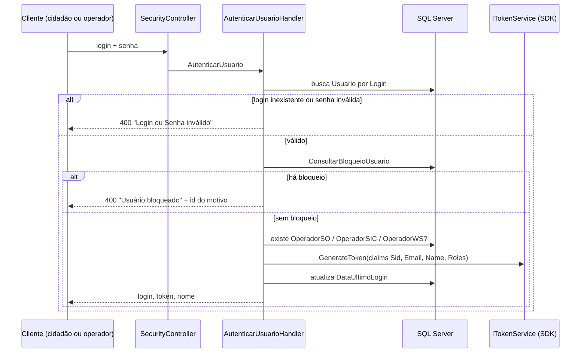
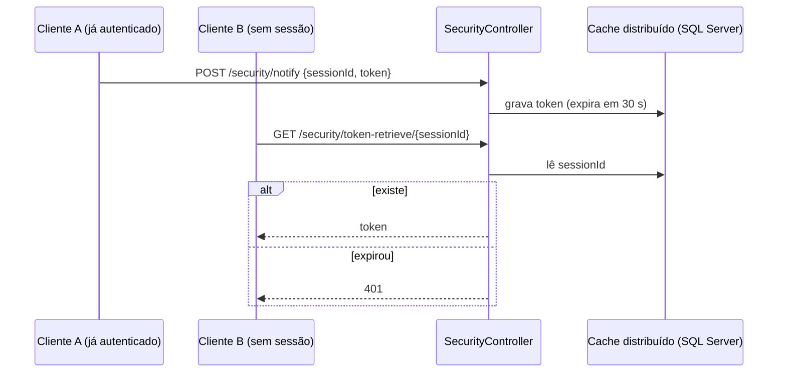

# Fluxo de autenticação e senha

Voltar: [[01-Sistemas/PARTICIPA-DF/Backend/PARTICIPA-DF-Backend-Index|Índice do Backend]] · Relacionado: [[01-Sistemas/PARTICIPA-DF/Backend/08-Seguranca/PARTICIPA-DF-Backend-Seguranca-e-Autorizacao|Seguranca-e-Autorizacao]], [[01-Sistemas/PARTICIPA-DF/Backend/04-Regras-de-Negocio/Bloqueio-de-Usuario|Bloqueio-de-Usuario]]

## Objetivo
Descrever passo a passo, com atores e estados, o login, o login assistido por sessão, o logout e a recuperação/alteração de senha.

## Evidências
Handlers e controllers em `sources`, commit `4901ad5`. Cobertura `completa` para o que está no repositório; o comportamento do SDK (geração e validação do JWT) é ❓.

## Informações confirmadas

### 1. Login (`POST /security/auth`)

1. ✅ Validação de entrada: senha e login obrigatórios (`AutenticarUsuario.Validate`); a senha é `[JsonIgnore]` na serialização do comando (não vai para o log de auditoria).
2. ✅ Mensagem única para login ou senha inválidos.
3. ✅ A verificação de bloqueio acontece **depois** da validação da senha.
4. ✅ Papéis incluídos conforme a existência do registro de operador (independente de o operador estar ativo: o handler não consulta `Ativo`; 🔶 a desativação precisa ser tratada em outro ponto, como as consultas ou o job).

### 2. Login assistido por sessão

- ✅ `notify` exige autenticação; `token-retrieve` é anônimo.
- 🔶 Uso provável: autenticar um segundo cliente a partir de uma sessão já iniciada (ex.: retorno de um login externo). O consumidor não está neste repositório (❓).

### 3. Logout
`GET /security/logout`: se há cabeçalho `Authorization`, grava o token em `TokenCancelado`; sem cabeçalho devolve `200`. ✅ A verificação do token cancelado (`ValidateTokenFilter`) não está ligada no repositório (🔶 ver nota de segurança).

### 4. Recuperação de senha
1. ✅ `POST /usuario/recuperar-senha` (anônimo): localiza o usuário pelo login (CPF/CNPJ). Se não existe, erro "Não foi possível localizar um usuário com o …". Se existe, responde com o e-mail **mascarado** e envia o e-mail "Recupere sua senha" pelo MailService.
2. ✅ O link contém `id` e `dtexp` criptografados (`JsonEncryptConverter`) e vale **30 minutos**.
3. ✅ `POST /usuario/concluir-recuperacao-senha` (anônimo): descriptografa a data (erro "Operação inválida" se falhar), recusa se vencida, calcula o fator de complexidade e chama `Usuario.AtualizarSenha`.
4. 🔶 `RecuperarSenhaHandler` não trata `usuario.Email` nulo: o trecho que tratava isso está comentado (bloco antigo).
5. 🔶 Em `ConcluirRecuperacaoSenhaHandler` o aviso de link expirado é adicionado, mas a validação de complexidade e a troca continuam a rodar; o resultado depende de `command.IsValid` na saída do handler.

### 5. Alteração de senha (`POST /usuario/alterar-senha`, autenticado)
✅ Confere a senha atual; calcula a complexidade (simples para cidadão, complexa para operador ativo); recusa a senha igual à atual ou às anteriores; grava o histórico via `HistoricoSenha` (🔶 `AtualizarHistoricoDeSenha` está comentado).

### Estados do usuário relevantes ao fluxo
| Estado | Efeito no login |
|---|---|
| Sem bloqueio | autentica |
| Com `BloqueioUsuario` | recusa e informa o motivo ([[01-Sistemas/PARTICIPA-DF/Backend/04-Regras-de-Negocio/Bloqueio-de-Usuario|Bloqueio-de-Usuario]]) |
| `RedefinirSenha = true` | ✅ campo existe e é limpo ao trocar a senha; ❓ onde o cliente é forçado a trocar |

## Inferências e limitações
- ❓ Geração, assinatura e validade do token (SDK).
- 🔶 Os pontos sinalizados aqui são analisados em [[01-Sistemas/PARTICIPA-DF/Backend/08-Seguranca/PARTICIPA-DF-Backend-Seguranca-e-Autorizacao|Seguranca-e-Autorizacao]].

## Relacionamentos
- [[01-Sistemas/PARTICIPA-DF/Backend/03-Modulos/Usuarios-Operadores-Perfis|Usuarios-Operadores-Perfis]]

## Pendências e próximo passo
- Confirmar com o time o uso do login assistido e a exigência de troca de senha (`RedefinirSenha`).
- Lote 7: documentar MailService e PeoplesCheck como integrações.
