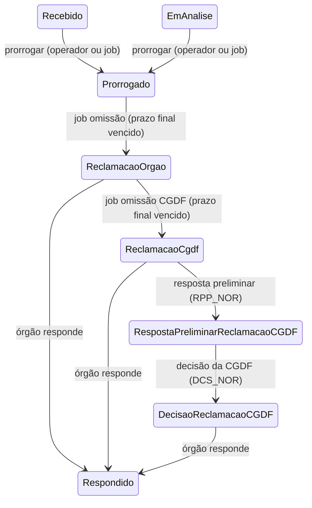

# Fluxo de prorrogação e omissão de resposta

Voltar: [[01-Sistemas/PARTICIPA-DF/Backend/PARTICIPA-DF-Backend-Index|Índice do Backend]] · Relacionado: [[01-Sistemas/PARTICIPA-DF/Backend/03-Modulos/PARTICIPA-DF-Backend-Modulo-Pedido-e-Recurso|Pedido-e-Recurso]], [[01-Sistemas/PARTICIPA-DF/Backend/03-Modulos/PARTICIPA-DF-Backend-Jobs-Agendados|Jobs-Agendados]], [[01-Sistemas/PARTICIPA-DF/Backend/04-Regras-de-Negocio/PARTICIPA-DF-Backend-Regra-Prazo-do-SIC|Regras-de-Prazo-do-SIC]]

## Objetivo
Descrever o que acontece quando a unidade não responde um pedido no prazo: prorrogação (manual ou automática), notificação de omissão ao órgão, escalonamento à CGDF e decisão.

## Evidências
Jobs `ProrrograrPrazoPedidoVencidoJob`, `RegistrarNotificacaoDeOmissaoDeRespostaJob` e `…CGDFJob`, handlers de prorrogação e de notificação, consultas de pedidos em omissão; commit `4901ad5`. Não lidos: `RegistrarRespostaPreliminarNotificacaoOmissaoResposta` e a parte final dos handlers de e-mail.

## Informações confirmadas

(Este desenho mistura gatilhos manuais e automáticos; "Respondido" depende da permissão `RPT_PDD` nas situações de reclamação.)

### 1. Prorrogação
- ✅ **Manual** (`POST pedido/prorrogar-prazo`): ação `PRG_PDD` (operador atual na unidade; pedido sem prorrogação anterior, no prazo vigente, em `EmAnalise` ou `Recebido`). Novo prazo = `QtdDiasPrazoProrrogacao` dias contados do término do prazo **original** do pedido; situação → `Prorrogado`; cria `ProrrogacaoPrazo` (justificativa do operador); e-mail ao autor (`prorrogacao-prazo.html`).
- ✅ **Automática** (job `prorrogar-prazo-pedidos-vencidos`): para pedidos com prazo vigente expirado e não respondidos, o operador automático (`IdOperadoSICAutomatico`) prorroga com a justificativa configurada (`JustificativaProrrogacaoAutomatica`). Se o pedido já foi prorrogado (`Pedido.ProrrogarPrazo`), apenas registra o aviso e não altera.

### 2. Omissão de resposta à unidade
- ✅ Job `registrar-notificacao-omissao-resposta`: pedidos em `Prorrogado` com `PrazoFinal` anterior à data → `RegistrarNotificacaoOmissaoResposta` cria a notificação (tipo "à unidade") e leva o pedido a `ReclamacaoOrgao` (em nome do operador automático).
- ✅ Depois, uma notificação por unidade a todos os operadores daquela unidade (`ConsultarEmailOperadorPorUnidade`, template `notificacao-omissao-resposta.html`) listando os protocolos.

### 3. Omissão de resposta à CGDF
- ✅ Job `registrar-notificacao-omissao-resposta-cgdf`: pedidos em `ReclamacaoOrgao` com `PrazoFinal` vencido → `RegistrarNotificacaoOmissaoRespostaCGDF` cria a notificação (tipo "à CGDF") dirigida à **unidade SIC superior**, leva o pedido a `ReclamacaoCgdf` com prazo de `QtdDiasPrazoNotificacaoCGDF` dias e envia e-mail ao cidadão.
- ✅ Em seguida o job envia uma única notificação aos operadores da unidade superior com todos os protocolos.
- ✅ A unidade superior responde com **resposta preliminar** (`RPP_NOR`, situação `ReclamacaoCgdf`, operador de unidade SIC superior com `ResponderOmissaoResposta`) → `RespostaPreliminarReclamacaoCGDF` (🔶 pelo nome do comando) e depois **decisão** (`DCS_NOR`, `ManifestarOmissaoRespostaCGDF`, tipo de decisão) → `DecisaoReclamacaoCGDF`; só uma decisão por notificação ("já possui uma Decisão").
- ✅ Nas três situações de reclamação o órgão pode ainda responder o pedido (`RPT_PDD`), mesmo fora do prazo.

### 4. Disparo manual
- ✅ `NotificacaoController` oferece `POST …/notificacao/registrar-omissao-resposta`, `…/registrar-omissao-resposta-cgdf`, `…/omissao-resposta-cgdf/registrar-resposta` e `…/registrar-decisao`, com `LogAudit` e sem `[Authorize]`.

## Inferências e limitações
- 🔴 Os endpoints de `NotificacaoController` não declaram `[Authorize]`; se a autenticação não for global, qualquer pessoa poderia disparar notificações ou decisões (❓ confirmar no SDK; registrar no lote 8).
- 🔶 `ProrrogarPrazoPedido` (manual) altera `PrazoVigente` **antes** de `Pedido.ProrrogarPrazo` verificar se já houve prorrogação, e não confere a validade da entidade no fim (só a do comando): uma segunda prorrogação poderia mudar o prazo antes de ser recusada (depende da transação).
- 🔶 As consultas de omissão (`ConsultarPedidosOmissaoResposta*`) usam `PrazoFinalMenorQue(Data)` e a **situação** como critério; é a mudança de situação para `ReclamacaoOrgao`/`ReclamacaoCgdf` que evita notificar o mesmo pedido de novo.
- 🔶 Os handlers engolem exceções e só registram em log (o job termina sem erro visível mesmo quando um pedido falha).
- 🔶 `NotificarOperadoresDaUnidadeAcercaDeOmissaoResposta` descarta (com aviso) os pedidos que não pertencem à unidade informada.
- ❓ Quem usa os endpoints manuais; e-mails exatos; canal "ReclamacaoCgdf" no lado do cidadão.

## Relacionamentos
- [[01-Sistemas/PARTICIPA-DF/Backend/05-Fluxos/PARTICIPA-DF-Backend-Fluxo-Recursos-e-Instancias|Fluxo-Recursos-e-Instancias]]

## Pendências e próximo passo
- Confirmar a exigência de autenticação em `NotificacaoController` (lote 2/8) e o uso manual.
