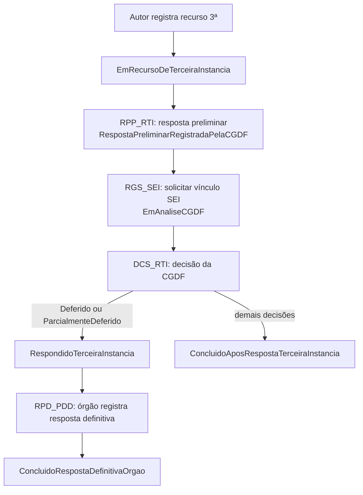
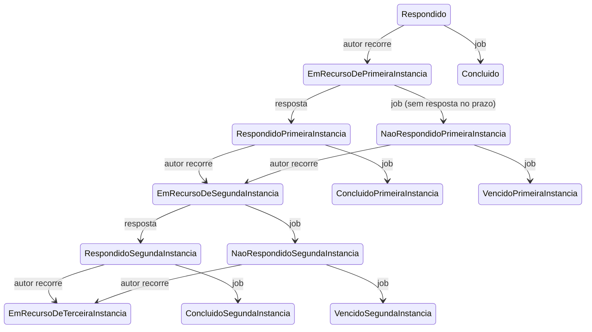

# Fluxo de recursos em três instâncias

Voltar: [[01-Sistemas/PARTICIPA-DF/Backend/PARTICIPA-DF-Backend-Index|Índice do Backend]] · Relacionado: [[01-Sistemas/PARTICIPA-DF/Backend/03-Modulos/Pedido-e-Recurso|Pedido-e-Recurso]], [[01-Sistemas/PARTICIPA-DF/Backend/05-Fluxos/PARTICIPA-DF-Backend-Fluxo-Registro-de-Pedido|Fluxo-Registro-de-Pedido]], [[01-Sistemas/PARTICIPA-DF/Backend/04-Regras-de-Negocio/Regras-de-Prazo-do-SIC|Regras-de-Prazo-do-SIC]]

## Objetivo
Descrever a sequência de recursos (1ª, 2ª e 3ª instâncias), as respostas, a decisão da CGDF e o vínculo com o SEI, com os estados e prazos.

## Evidências
Controller e handlers em `sources`, commit `4901ad5`. Não lidos: `RegistrarRecursoSegundaInstancia`, `RegistrarRespostaRecursoSegundaInstancia` (assumidos análogos à 1ª instância pelo padrão do código, 🔶), `SolicitarVinculoSei`, `RegistrarRespostaDefinitivaPedido` e os passos `Setup`, `RecuperarDadosBd`, `GerarPedidoPDFSei`, `NotificarSolicitante` do vínculo.

## Informações confirmadas

### Recurso de 1ª instância
1. ✅ `POST acesso-informacao/recurso/primeira-instancia/registrar` (autor). Exige a ação `RGS_RPI`: o autor, sem recurso de 1ª, com pedido `Respondido` e **dentro do prazo vigente** (prazo de recorrer).
2. ✅ O recurso exige uma **justificativa** (cadastro `JustificativaRecurso`) e uma motivação; prazo do recurso = `QtdDiasPrazoParaResponder` dias; situação → `EmRecursoDePrimeiraInstancia`; `PrazoVigente` = prazo do recurso; anexos opcionais.
3. ✅ E-mail ao autor: `recurso-cidadao-primeira-instancia.html`.
4. ✅ Resposta (`…/primeira-instancia/registrar-resposta`, `OperadorSIC`): ação `RPT_RPI` (operador atual, na unidade, `EmRecursoDePrimeiraInstancia`, prazo do recurso vigente, funcionalidade `ResponderRecurso1aInstancia`) e classificação de resposta própria de recurso. Cria `Resposta` (tipo `RespostaRecursoPrimeiraInstancia`), `PrazoVigente` = prazo de recorrer (`QtdDiasPrazoParaRecorrer`), situação → `RespondidoPrimeiraInstancia`; e-mail `resposta-recurso-primeira-instancia.html`.

### Recurso de 2ª instância
- ✅ Ação `RGS_RSI`: autor, com recurso de 1ª; (1ª respondida e no prazo) **ou** (1ª não respondida e no prazo vigente). Situação → `EmRecursoDeSegundaInstancia`; resposta → `RespondidoSegundaInstancia` (🔶 padrão idêntico ao da 1ª).

### Recurso de 3ª instância (CGDF)

1. ✅ `RGS_RTI`: autor, com 2ª e sem 3ª; (2ª respondida e no prazo) ou (2ª não respondida, no prazo e com prazo da 2ª anterior ao prazo vigente). Prazo = `QtdDiasPrazoRecursoTerceiraInstancia`.
2. ✅ `RPP_RTI` (`…/terceira-instancia/registrar-resposta-preliminar`): operador com `ResponderRecurso3aInstancia`, operador atual, situação `EmRecursoDeTerceiraInstancia`; usa a classificação de resposta configurada (`IdClassificacaoRespostaPreliminarRTI`); situação → `RespostaPreliminarRegistradaPelaCGDF` e **`PrazoVigente = null`** (sem prazo para o cidadão).
3. ✅ `RGS_SEI` (`POST pedido/registrar-pedido-sei`): operador com `ResponderRecurso3aInstancia` em pedido com recurso de 3ª e situação `RespostaPreliminarRegistradaPelaCGDF`; `SolicitarVinculoSei` leva o pedido a `EmAnaliseCGDF` e dispara o workflow `VincularPedidoSeiWorkflow`.
4. ✅ **Vínculo SEI** (workflow): Setup → RecuperarDadosBd → **CriarProcessoSei** → **GerarPedidoPDFSei** → **CriarDocumento** → NotificarSolicitante. Se o pedido já tem processo SEI, apenas junta novo documento; senão cria o processo (tipo de procedimento e unidade de 3ª instância vêm de `IntegracaoSicSeiSettings`), com nível de acesso **público**, e junta o PDF do pedido como documento externo (tipo "R"), com remetente configurado. O vínculo (`VinculoPedidoSEI`) guarda id e número do processo e o documento de referência.
5. ✅ `DCS_RTI` (`…/terceira-instancia/registrar-decisao`): operador com `ManifestarRecurso3aInstanciaCGDF`, operador atual, unidade **SIC superior**, sem decisão, situação `EmAnaliseCGDF`. Tipos de decisão: Indeferido, Deferido, ParcialmenteDeferido, NãoConhecimento, PerdaDeObjeto, PerdaDeObjetoParcial. Deferido/parcial → `RespondidoTerceiraInstancia`; qualquer outro → `ConcluidoAposRespostaTerceiraInstancia`.
6. ✅ `RPD_PDD` (`…/pedido/registrar-resposta-definitiva`): o órgão responde após decisão deferida (ou parcial); situação → `ConcluidoRespostaDefinitivaOrgao`.

### Prazos expirados de recurso (jobs)
- ✅ `ProrrogarPrazoRecursoNaoRespondido`: pedido em `EmRecursoDePrimeiraInstancia` (ou `Segunda`) cujo prazo do recurso coincide com o prazo vigente → situação `NaoRespondidoPrimeiraInstancia` (ou `Segunda`), novo prazo para recorrer, e-mail ao autor (`ausencia-resposta-recurso.html`, 🔶), em nome do operador automático.
- ✅ `ConcluirPedidoRespondidoComPrazoDeRecursoExpirado` (prazo vigente zerado): `Respondido` → `Concluido`; `RespondidoPrimeira` → `ConcluidoPrimeira`; `RespondidoSegunda` → `ConcluidoSegunda`; `NaoRespondidoPrimeira` → `VencidoPrimeiraInstancia`; `NaoRespondidoSegunda` → `VencidoSegundaInstancia`.

## Inferências e limitações
- 🔶 Regra do recurso de 2ª e 3ª instâncias contém `todo` e trechos comentados; a lógica de prazos "Não respondido" difere entre 2ª e 3ª.
- 🔶 `ProrrogarPrazoRecursoNaoRespondido` só age quando `Recurso.Prazo.DataTermino == PrazoVigente.DataTermino` e ignora os demais; engole exceções (log).
- 🔶 O processo SEI é criado com nível de acesso **público** e o PDF do pedido é anexado: o pedido pode conter dados pessoais; confirmar com o time a regra de sigilo (relação com o `GrauSigilo` do pedido) — ver lote 7/8.
- 🔶 Os handlers guardam usuário e recurso em campos (`_usuario`, `_recursoPrimeiraInstancia`) para o e-mail.
- ❓ Duração real dos prazos (chaves de configuração, valores não lidos); papel do `VisualizarDadosAutorRestricaoAnonimato`; arquivos exigidos em cada etapa.

## Relacionamentos
- [[01-Sistemas/PARTICIPA-DF/Backend/05-Fluxos/PARTICIPA-DF-Backend-Workflows-e-Consumidores|Workflows-e-Consumidores]] · [[01-Sistemas/PARTICIPA-DF/Backend/05-Fluxos/PARTICIPA-DF-Backend-Fluxo-Omissao-de-Resposta|Fluxo-Omissao-de-Resposta]]

## Pendências e próximo passo
- Lote 7: documentar a integração SEI (cliente, contrato, nível de acesso).
