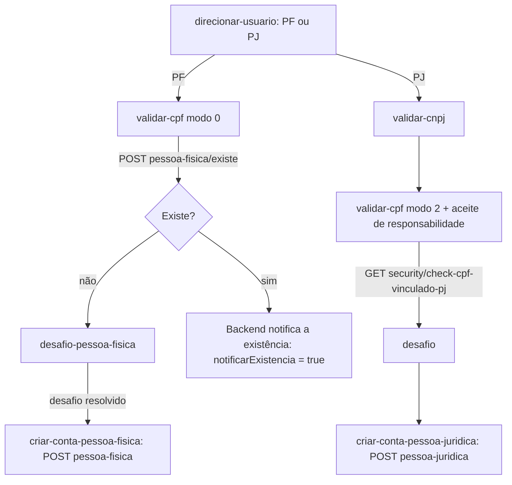

# Frontend Cidadão — fluxo de cadastro e manutenção de conta

Voltar: [[01-Sistemas/PARTICIPA-DF/Frontend-Cidadao/PARTICIPA-DF-Frontend-Cidadao-Index|Índice do Frontend Cidadão]] · Backend: [[01-Sistemas/PARTICIPA-DF/Backend/03-Modulos/Usuarios-Operadores-Perfis|Usuarios-Operadores-Perfis]]

## Objetivo
Descrever como o cidadão cria conta (pessoa física ou jurídica), atualiza dados e vincula CPF a CNPJ.

## Evidências
Arquivos em `sources`, commit `d250804`. Cobertura `parcial`: lidas as telas de validação de CPF, desafio, criação de PF e as chamadas das demais.

## Informações confirmadas

- ✅ **PF:** `validar-cpf` verifica se o CPF já tem conta (`pessoa-fisica/existe`) e as tentativas (`security/count-try`); o desafio pessoal (`security/check`/`security/challenge`) precede o formulário; o cadastro envia `POST pessoa-fisica` (inclui `necessidadeEspecial`; senha com opções de visibilidade e aceite da política LGPD em modal).
- ✅ **PJ:** `validar-cnpj` (`pessoa-juridica/existe`, `security/check`, `security/count-try`), depois `validar-cpf` em modo PJ com `aceiteResponsabilidade` obrigatório (`requiredTrue`) e `security/check-cpf-vinculado-pj?cpf&cnpj&aceiteResponsabilidade`. O cadastro usa `GET pessoa-juridica/tipo-entidade` e `POST pessoa-juridica`.
- ✅ **Manutenção:** `conta/atualizar-dados` lê `GET usuario/detalhar` e grava em `pessoa-fisica/atualizar` ou `pessoa-juridica/atualizar`; `historico-cpf-vinculado` lista `pessoa-juridica/historico-responsavel`; a troca do CPF responsável usa o modo 4 do desafio (`pessoa-juridica/atualizar-responsavel`).
- ✅ **Home:** exibe um aviso às empresas de que é obrigatório vincular um CPF válido ao CNPJ.
- ✅ Todos os modos usam `ValidarCPFEnum` e `returnUrl` (ver [[01-Sistemas/PARTICIPA-DF/Frontend-Cidadao/02-Fluxos/PARTICIPA-DF-Frontend-Cidadao-Fluxo-Autenticacao|Fluxo-Autenticacao]]).
- ✅ CPF/CNPJ são formatados e "limpos" por `FormataDocumentoService` antes de ir à URL (`security/count-try?data=`, `security/check?data=`): o documento trafega em **query string**.

## Inferências e limitações
- 🔶 As regras de validação do CPF/CNPJ (algoritmo) e de força de senha estão em validadores locais não lidos; o backend valida de novo (PeoplesCheck, ver [[01-Sistemas/PARTICIPA-DF/Backend/07-Integracoes/PARTICIPA-DF-Backend-Integracoes-Externas|Integrações externas do Backend]]).
- ❓ O que o backend faz ao receber `notificarExistencia: true` (por exemplo, enviar e-mail ao titular) não está neste repositório; conferir no Backend.
- ❓ Telas `mensagem-conta`, `direcionar-usuario` e `atualizar-dados/:id` não foram lidas em detalhe.

## Relacionamentos
- [[01-Sistemas/PARTICIPA-DF/Frontend-Cidadao/04-Seguranca/PARTICIPA-DF-Frontend-Cidadao-Seguranca-e-Sessao|Seguranca-e-Sessao]] · [[01-Sistemas/PARTICIPA-DF/Frontend-Cidadao/03-API-e-Integracoes/PARTICIPA-DF-Frontend-Cidadao-Chamadas-de-API|Chamadas-de-API]]

## Pendências e próximo passo
- [[01-Sistemas/PARTICIPA-DF/Frontend-Cidadao/99-Controle/PARTICIPA-DF-Frontend-Cidadao-Pendencias|Pendências]].
