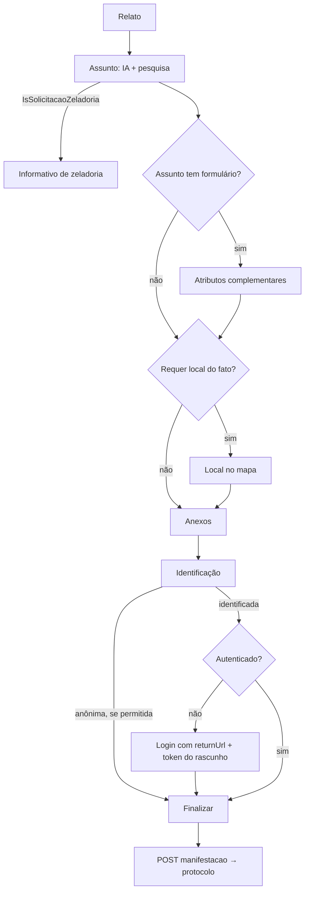

# Frontend Cidadão — fluxo de registro de manifestação

Voltar: [[01-Sistemas/PARTICIPA-DF/Frontend-Cidadao/PARTICIPA-DF-Frontend-Cidadao-Index|Índice do Frontend Cidadão]] · Backend: [[01-Sistemas/PARTICIPA-DF/Backend/05-Fluxos/PARTICIPA-DF-Backend-Fluxo-Registro-de-Manifestacao|Fluxo-Registro-de-Manifestacao do Backend]]

## Objetivo
Descrever as etapas de tela do registro de manifestação de ouvidoria (fluxo padrão e fluxo "integrado") e as chamadas que cada etapa faz.

## Evidências
Arquivos em `sources`, commit `d250804`. Cobertura `parcial`: lidos o roteamento, o gerenciador de estado, o assunto, a identificação, a finalização, o upload e o mapa; os formulários de relato, complementares e local do fato foram lidos só por chamadas.

## Informações confirmadas

### Etapas (rota `registro-manifestacao`)
| # | Rota | Função | Chamadas ao backend |
|---|---|---|---|
| 1 | `relato` | Texto do relato (máx. 13.000 caracteres no fluxo integrado) | — |
| 2 | `assunto` | Sugestões por IA e pesquisa por palavra-chave | `POST servico-ouvidoria/ia/assunto` (relato), `GET servico-ouvidoria/assunto/por-palavra-chave/{termo}`, `POST servico-ouvidoria/ia/classificacao` |
| 3 | `form-complementar` | Atributos do formulário do assunto (só se o assunto tem `FormularioId`) | `POST servico-ouvidoria/formulario/por-assunto` |
| 4 | `local-fato` | Mapa e região administrativa (só se o assunto `RequerLocalFato`) | `GET servico-ouvidoria/regiao-administrativa` e o serviço de geolocalização ([[01-Sistemas/PARTICIPA-DF/Frontend-Cidadao/07-Integracoes/PARTICIPA-DF-Frontend-Cidadao-Integracoes-Externas\|Integrações externas]]) |
| 5 | `anexos` | Arquivos | `POST servico-ouvidoria/arquivo/validar` |
| 6 | `identificacao` | Identificada ou anônima | `POST servico-ouvidoria/ia/classificacao` |
| 7 | `resumo` | Conferência | — |
| 8 | `finalizar` | Envio e protocolo | `POST servico-ouvidoria/manifestacao`, `POST servico-ouvidoria/manifestacao/resumo`, `POST servico-ouvidoria/manifestacao/exportar-pdf-manifestante` |

### Regras visíveis no frontend
- ✅ **Rascunho:** o `ManifestacaoStateManager` guarda o `RegistroManifestacao` em `localStorage` (`manifestacao-store`) a cada etapa; `getHashCode()` é o MD5 do JSON do rascunho. `novaManifestacao()` (home) apaga o rascunho.
- ✅ **Zeladoria:** se `ia/classificacao` responde `IsSolicitacaoZeladoria`, o navegador vai para `static/informativo-zeladoria` (o rascunho não é enviado).
- ✅ **Anonimato:** `PermitirAnonimato` vem de `ia/classificacao`; é forçado a `false` quando a manifestação é vinculada a outra (`manifestacaoVinculada`).
- ✅ **Identificação sem sessão:** `avancarIdentificado()` consulta `is-auth`; se não autenticado, leva ao login com `returnUrl = <rota atual>?token=<hash do rascunho>`. Na volta, `identificarPosRetorno` só finaliza se o hash do rascunho atual for igual ao `token` (evita finalizar um rascunho alterado).
- ✅ **Anexos:** cada arquivo é lido em base64 no navegador, o tamanho é validado em `arquivo/validar` e há limite de 4 (MB) por arquivo e no total (soma guardada em `localStorage`, chave `chaveManifestacaoUpload`; unidade em MB calculada a partir de KB/1000).
- ✅ **Finalização:** `FinalizarRegistroManifestacao` envia o rascunho no construtor da página; sucesso apaga o rascunho, limpa os arquivos e busca o resumo. Sem `relato`, volta para o início. O comprovante em PDF vem de `exportar-pdf-manifestante` (abre em nova janela).

### Fluxo integrado (`registro-manifestacao-integrada/:tipoEntrada/:classificacao/:assunto`)
- ✅ O `ManifestacaoResolver` busca o assunto por `servico-ouvidoria/assunto/id`; `tipo-entrada/id` e `classificacao/id` buscam os demais. Pula as etapas de assunto, formulário e local, e envia por `POST servico-ouvidoria/manifestacao/integrada`.

## Inferências e limitações
- 🔶 O fluxo integrado serve a canais que já conhecem tipo de entrada, classificação e assunto (a lista dos canais emissores não está neste repositório). Confrontar com `TipoEntradaEnum` do backend ([[01-Sistemas/PARTICIPA-DF/Backend/02-Dominio/PARTICIPA-DF-Backend-Enums-e-Estados|Enums-e-Estados]]).
- 🔶 O limite de 4 está em MB conforme a unidade calculada; o backend valida de novo em `arquivo/validar`.
- ❓ Envio duplicado: o POST de finalização ocorre no construtor; não há trava aparente contra recarga da página `finalizar`.
- ❓ Telas `relato`, `form-complementar` e `local-fato` não foram lidas em detalhe.

## Relacionamentos
- [[01-Sistemas/PARTICIPA-DF/Backend/03-Modulos/PARTICIPA-DF-Backend-Modulo-Manifestacao|Manifestação (módulo do Backend)]] · [[01-Sistemas/PARTICIPA-DF/Frontend-Cidadao/05-Fluxos/PARTICIPA-DF-Frontend-Cidadao-Fluxo-Caixa-de-Entrada|Caixa de entrada]] · [[01-Sistemas/PARTICIPA-DF/Frontend-Cidadao/05-Fluxos/PARTICIPA-DF-Frontend-Cidadao-Fluxo-Autenticacao|Autenticação]]
- [[01-Sistemas/PARTICIPA-DF/Frontend-Cidadao/07-Integracoes/PARTICIPA-DF-Frontend-Cidadao-Chamadas-de-API|Chamadas-de-API]]

## Pendências e próximo passo
- [[01-Sistemas/PARTICIPA-DF/Frontend-Cidadao/99-Controle/PARTICIPA-DF-Frontend-Cidadao-Pendencias|Pendências]].
