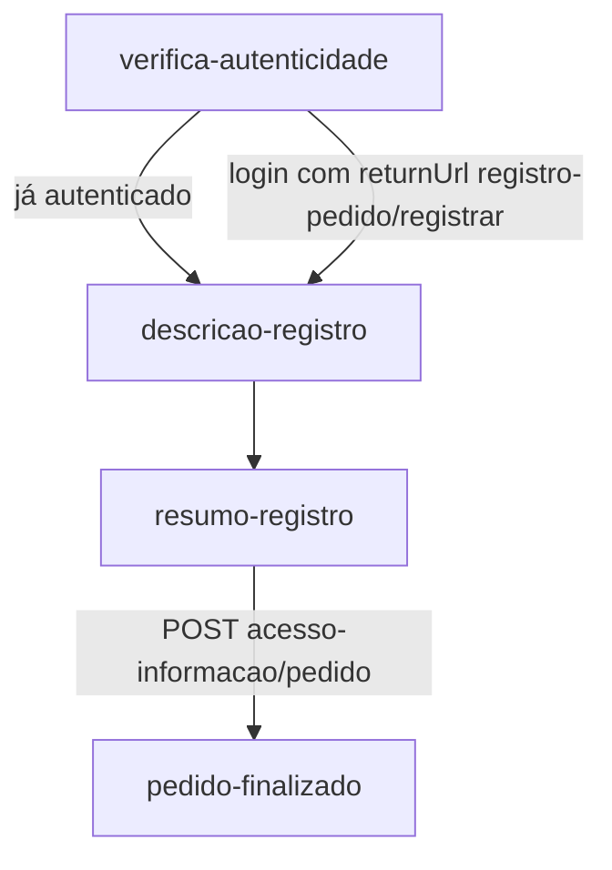

# Frontend Cidadão — fluxo de registro de pedido (SIC)

Voltar: [[01-Sistemas/PARTICIPA-DF/Frontend-Cidadao/PARTICIPA-DF-Frontend-Cidadao-Index|Índice do Frontend Cidadão]] · Backend: [[01-Sistemas/PARTICIPA-DF/Backend/05-Fluxos/PARTICIPA-DF-Backend-Fluxo-Registro-de-Pedido|Fluxo-Registro-de-Pedido do Backend]]

## Objetivo
Descrever as telas do registro de pedido de acesso à informação.

## Evidências
Arquivos em `sources`, commit `d250804`. Cobertura `parcial`: o componente de anexos de pedido e os modelos não foram lidos em detalhe.

## Informações confirmadas

- ✅ `verifica-autenticidade` consulta `is-auth`; autenticado segue direto para `registrar`; senão oferece o login com `returnUrl`.
- ✅ As três telas de `registrar` têm `AuthGuard`: **o pedido exige conta** (diferente da manifestação, que aceita anonimato).
- ✅ `descricao-registro`: formulário com `texto` e `assunto` obrigatórios e `anonimatoDadosManifestante`; carrega `GET acesso-informacao/assunto` e `POST acesso-informacao/pedido/unidades`; o usuário escolhe um ou mais órgãos (lista "disponíveis" ↔ "selecionados") e anexa arquivos (`acesso-informacao/arquivo/validar`).
- ✅ `resumo-registro` envia `POST acesso-informacao/pedido`. `pedido-finalizado` consulta `POST acesso-informacao/pedido/consultar-por-lote` (por `Lote`) e permite baixar o comprovante (`exportar-pedido-usuario`).
- ✅ O rascunho do pedido é mantido em `localStorage` (serviço `PedidoStateManager`, arquivo de nome duplicado `pedido-state-manager.service.ts.service.ts`).

## Inferências e limitações
- 🔶 O uso de `Lote` e de `consultar-por-lote` indica que um registro com vários órgãos gera vários pedidos (um por órgão), mas isso não foi confirmado nesta análise; ver [[01-Sistemas/PARTICIPA-DF/Backend/03-Modulos/Pedido-e-Recurso|Pedido-e-Recurso]].
- ❓ Regras de validação de anexos de pedido (limites).

## Relacionamentos
- [[01-Sistemas/PARTICIPA-DF/Frontend-Cidadao/05-Fluxos/PARTICIPA-DF-Frontend-Cidadao-Fluxo-Caixa-de-Entrada|Caixa de entrada]] (acompanhamento e recursos) · [[01-Sistemas/PARTICIPA-DF/Frontend-Cidadao/07-Integracoes/PARTICIPA-DF-Frontend-Cidadao-Chamadas-de-API|Chamadas-de-API]]

## Pendências e próximo passo
- [[01-Sistemas/PARTICIPA-DF/Frontend-Cidadao/99-Controle/PARTICIPA-DF-Frontend-Cidadao-Pendencias|Pendências]].
