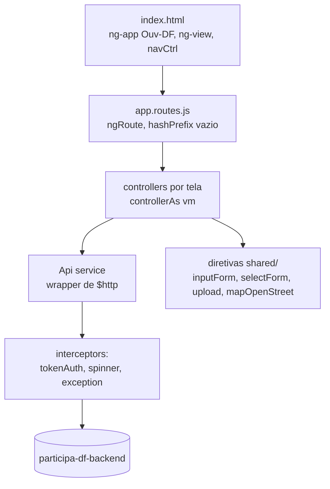

# Frontend Ouvidoria — arquitetura

Voltar: [[01-Sistemas/PARTICIPA-DF/Frontend-Ouvidoria/PARTICIPA-DF-Frontend-Ouvidoria-Index|Índice do Frontend Ouvidoria]] · Rotas: [[01-Sistemas/PARTICIPA-DF/Frontend-Ouvidoria/01-Visao-Geral/PARTICIPA-DF-Frontend-Ouvidoria-Rotas-e-Telas|Rotas-e-Telas]]

## Objetivo
Descrever a estrutura da SPA AngularJS: módulo, camadas, interceptors, serviços compartilhados e padrão de controllers.

## Evidências
Arquivos em `sources`, commit `9d8ecdb`. Cobertura `parcial`: controllers de dashboards e de cadastro foram lidos por amostra.

## Informações confirmadas

### Estrutura

- ✅ **Módulo único** `Ouv-DF` (`app/app.module.js`) com dependências `ngRoute`, `spinner`, `exception`, `toastr`, `chart.js`, `ngFileUpload`, `cp.ngConfirm`, `ngCookies`, entre outras. Os módulos `spinner` e `exception` são locais.
- ✅ **Organização por pasta funcional** em `app/`: `manifestacao/` (caixa de entrada, registro, prorrogação, avaliação, busca, impressão), `gerencial/`, `conta/`, `dashboard/`, `auth/`, `nav/`, `shared/`, `upload/`, `open-street-map/`.
- ✅ **Padrão de controller**: `app.controller('xCtrl', function (Api, ...) { var vm = this; ... })` com `controller: 'xCtrl as vm'` na rota; telas de lista repetem o mesmo esqueleto (`modelFilter`, `getData(pageNumber)`, `resetFilters`, `removeFilters`, `page`, `onDetail`). Controllers antigos usam `$scope` e serviços `*API`.
- ✅ **Sem gerenciador de módulos**: o Gulp concatena `app/**/*.js` (ordem alfabética/de glob) em `scripts.js` e as bibliotecas de `assets/lib` em `libs.js`; os templates `.html` viram `app/views-dist.js` (`$templateCache`, módulo `Ouv-DF`).

### Camada de acesso à API
- ✅ `Api` (`app/api.service.js`): `GET`, `POST` (relativos a `configService.urlApi`) e `GETe`, `POSTe` (URL absoluta, usados para o serviço de localização). Define `Content-Type: application/json`. Só há `GET` e `POST`; não há `PUT`/`DELETE`.
- ✅ `configService` é uma constante gerada pelo Gulp a partir de `api.config.json` (`urlApi`, `urlApiCgdfLocalization`). Ver [[01-Sistemas/PARTICIPA-DF/Frontend-Ouvidoria/01-Visao-Geral/PARTICIPA-DF-Frontend-Ouvidoria-Perfis-e-Ambientes|Perfis-e-Ambientes]].
- ✅ `$httpProvider.defaults.headers.common/post/put/patch` são zerados em `app.module.js`; os cabeçalhos vêm do `Api` e do interceptor.

### Interceptors (`$httpProvider.interceptors`)
| Interceptor | Arquivo | Efeito |
|---|---|---|
| `tokenAuthInterceptor` | `app/token-auth-interceptor.js` | em requisições à `urlApi`: adiciona `application-key` e, havendo token, `Authorization: Bearer`; em 401/403 consulta `configuration/front-end-urls` e redireciona o navegador para `Login` |
| `spinnerInterceptor` | `app/spinner/spinner.js` | contador de requisições; mostra o modal `#spinner`; `params.noSpinner` suprime |
| `exceptionInterception` | `app/exception/app-exception-module.js` | limpa erros a cada requisição; em 400 emite `badRequest` (lista `Notifications` ou `Message`); em 500 abre o modal `#modalException` com o código de rastreamento; em 401/403 faz `$location.path('/')` |

### Estado compartilhado
- ✅ Token JWT em `localStorage` (`tokenStorage`, chave `auth_token_ouv_df`); filtros da caixa de entrada em `localStorage` (`storageService`, chave `current-view`).
- ✅ Comunicação entre controllers por eventos de `$rootScope`: `authenticate`, `confirmAuth`, `alternarUnidade`, `badRequest`, `error500`, `loader_show/hide`.
- ✅ O menu (`navCtrl`) fica em `index.html`, fora do `ng-view`; consulta `security/is-auth`, o usuário (`v2/usuario/false/true`) e as permissões (`operador-so/consultar-permissoes`) e monta os itens conforme `PesquisarManifestacao`, `VisualizarPaineis`, `GerenciarSistema` e `PermissoesDeGerenciamento`.

### Diretivas compartilhadas
`inputForm`, `selectForm`, `multiselectForm`, `textAreaForm` (campos de formulário), `atrComplementar` (atributos complementares dinâmicos), `ngEnter`, `upload` (anexos, usa `Api` e `$ngConfirm`) e `mapOpenStreet` (mapa e geocodificação). Serviços de mapa: `MapService` e `mapOLService`.

## Inferências e limitações
- 🔶 A navegação por permissão é só visual: o bloqueio efetivo depende do backend (as rotas de `app.routes.js` não têm guarda). Ver [[01-Sistemas/PARTICIPA-DF/Frontend-Ouvidoria/08-Seguranca/PARTICIPA-DF-Frontend-Ouvidoria-Seguranca-e-Sessao|Seguranca-e-Sessao]].
- Há uma convivência de dois estilos (controllers `vm` com `Api` e controllers `$scope` com serviços `*API` que não estão definidos no repositório); ver [[01-Sistemas/PARTICIPA-DF/Frontend-Ouvidoria/09-Qualidade/PARTICIPA-DF-Frontend-Ouvidoria-Debitos-Tecnicos|Débitos técnicos]].

## Relacionamentos
- [[01-Sistemas/PARTICIPA-DF/Frontend-Ouvidoria/01-Visao-Geral/PARTICIPA-DF-Frontend-Ouvidoria-Stack-e-Dependencias|Stack-e-Dependencias]] · [[01-Sistemas/PARTICIPA-DF/Frontend-Ouvidoria/07-Integracoes/PARTICIPA-DF-Frontend-Ouvidoria-Chamadas-de-API|Chamadas-de-API]] · [[01-Sistemas/PARTICIPA-DF/Frontend-Ouvidoria/08-Seguranca/PARTICIPA-DF-Frontend-Ouvidoria-Seguranca-e-Sessao|Seguranca-e-Sessao]]

## Pendências e próximo passo
- Ler as diretivas `shared/` e `upload` em detalhe (regras de validação e limites de anexo). Ver [[01-Sistemas/PARTICIPA-DF/Frontend-Ouvidoria/99-Controle/PARTICIPA-DF-Frontend-Ouvidoria-Pendencias|Pendências]].
