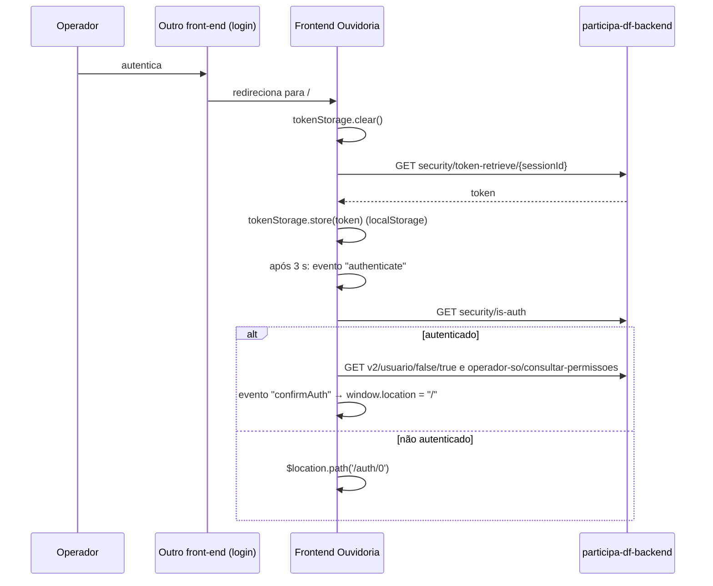

# Frontend Ouvidoria — fluxo de autenticação

Voltar: [[01-Sistemas/PARTICIPA-DF/Frontend-Ouvidoria/PARTICIPA-DF-Frontend-Ouvidoria-Index|Índice do Frontend Ouvidoria]] · Segurança: [[01-Sistemas/PARTICIPA-DF/Frontend-Ouvidoria/05-Seguranca/PARTICIPA-DF-Frontend-Ouvidoria-Seguranca-e-Sessao|Seguranca-e-Sessao]] · Outro lado do login: [[01-Sistemas/PARTICIPA-DF/Frontend-Cidadao/02-Fluxos/PARTICIPA-DF-Frontend-Cidadao-Fluxo-Autenticacao|Fluxo-Autenticacao do Frontend Cidadão]]

## Objetivo
Descrever como o operador entra no frontend de Ouvidoria e como a sessão é mantida e encerrada.

## Evidências
Arquivos em `sources`, commit `9d8ecdb`. O frontend **não tem tela de login**: a autenticação é delegada a outro front-end (login assistido por `sessionId`). Cobertura `parcial`: o lado que gera o `sessionId` (outro repositório/backend) não foi lido aqui.

## Informações confirmadas

1. ✅ **Entrada**: rota `/auth/:sessionId` (`authCtrl`). Limpa o token local e, se há `sessionId`, chama `security/token-retrieve/{sessionId}` e guarda o resultado em `localStorage` (`auth_token_ouv_df`). Sem `sessionId`, apenas limpa.
2. ✅ **Validação**: `navCtrl` (menu em `index.html`) chama `security/is-auth` (com `noSpinner`) ao carregar, exceto quando o caminho contém `auth`. Se verdadeiro: mostra o menu, carrega usuário e permissões e emite `confirmAuth`; se falso: `/auth/0`.
3. ✅ **Pós-autenticação**: `authCtrl` ouve `confirmAuth` e faz `window.location.href = "/"` (recarrega a SPA).
4. ✅ **Requisições**: o `tokenAuthInterceptor` envia `Authorization: Bearer <token>` e `application-key` para a `urlApi`.
5. ✅ **Sessão expirada/negada**: em 401/403 o interceptor consulta `configuration/front-end-urls` e redireciona o navegador para a URL `Login`. Em paralelo, o interceptor de exceções faz `$location.path('/')`.
6. ✅ **Logout** (`navCtrl.logout`): consulta `configuration/front-end-urls`, vai para `<Principal>/pages/logout` e limpa o `localStorage`. Não chama endpoint de cancelamento de token no backend.
7. ✅ **Troca de unidade**: `operador-so/alterar-unidade` (`UnidadePadrao`), recarrega o usuário, emite `alternarUnidade` (caixa de entrada e telas gerenciais recarregam) e volta para `/`.

### Controller de login sem uso
`app/login/login-ctrl.js` (`loginCtrl`) chamaria `security/auth` com um login e uma senha **fixos no código**; `login.html` está vazio e **não existe rota** para ele em `app.routes.js`. Valores omitidos. Ver [[01-Sistemas/PARTICIPA-DF/Frontend-Ouvidoria/06-Qualidade/PARTICIPA-DF-Frontend-Ouvidoria-Debitos-Tecnicos|Débitos técnicos]].

## Inferências e limitações
- 🔶 O `sessionId` é gerado pelo outro front-end/backend após `security/notify` (como no Frontend Cidadão, que redireciona para `#/auth/<sessionId>`); aqui só se vê o consumo.
- 🔶 O frontend decodifica o primeiro segmento do token (`atob` + JSON) em `tokenStorage.token()`, o que sugere um formato próprio; o formato real não foi verificado.
- ❓ Tempo de expiração do token e renovação: não há tratamento no frontend.

## Relacionamentos
- [[01-Sistemas/PARTICIPA-DF/Frontend-Ouvidoria/05-Seguranca/PARTICIPA-DF-Frontend-Ouvidoria-Seguranca-e-Sessao|Seguranca-e-Sessao]] · [[01-Sistemas/PARTICIPA-DF/Frontend-Ouvidoria/04-API-e-Integracoes/PARTICIPA-DF-Frontend-Ouvidoria-Chamadas-de-API|Chamadas-de-API]] · Backend: [[01-Sistemas/PARTICIPA-DF/Backend/04-Fluxos/PARTICIPA-DF-Backend-Fluxo-Autenticacao|Fluxo-Autenticacao do Backend]]

## Pendências e próximo passo
- Confirmar quem emite o `sessionId` e se o token é cancelado no logout. Ver [[01-Sistemas/PARTICIPA-DF/Frontend-Ouvidoria/99-Controle/PARTICIPA-DF-Frontend-Ouvidoria-Pendencias|Pendências]].
