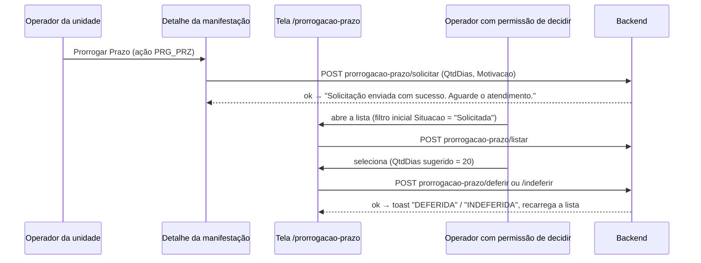

# Frontend Ouvidoria — prorrogação de prazo

Voltar: [[01-Sistemas/PARTICIPA-DF/Frontend-Ouvidoria/PARTICIPA-DF-Frontend-Ouvidoria-Index|Índice do Frontend Ouvidoria]] · Origem da solicitação: [[01-Sistemas/PARTICIPA-DF/Frontend-Ouvidoria/02-Fluxos/PARTICIPA-DF-Frontend-Ouvidoria-Fluxo-Caixa-de-Entrada-e-Detalhamento|Caixa-de-Entrada-e-Detalhamento]]

## Objetivo
Descrever o pedido e a decisão de prorrogação do prazo de resposta de uma manifestação.

## Evidências
Arquivos em `sources`, commit `9d8ecdb`. As regras de prazo (quantos dias, quantas vezes, quem decide) são do backend e não aparecem no frontend, salvo o valor sugerido abaixo.

## Informações confirmadas

- ✅ **Solicitação**: no detalhe, o menu "Prorrogar Prazo" só aparece se `vm.acoes.PRG_PRZ`; o modal envia `QtdDias` e `Motivacao` (limite de 2400 caracteres no campo) a `prorrogacao-prazo/solicitar`.
- ✅ **Lista de decisão** (`/prorrogacao-prazo`, `prorrogacaoDePrazoCtrl`): colunas Protocolo, Data, Situação da Manifestação, Localização Atual, Solicitante e Situação; filtros por situação (`prorrogacao-prazo/situacoes`) e nome do solicitante; abre já filtrando `Situacao = 'Solicitada'`.
- ✅ **Decisão**: `onDetail` fixa `prorrogacao.QtdDias = 20` (valor padrão do frontend) e abre o modal; os botões chamam `deferir` ou `indeferir` com o objeto da prorrogação. O modal é aberto/fechado com `.show()`/`.hide()` do jQuery.
- ❓ O menu "Prorrogações de Prazo" aparece no menu "Gerenciar" apenas se o backend o incluir em `PermissoesDeGerenciamento`; a permissão exata não é nomeada no frontend.
- ❓ Se o operador pode alterar `QtdDias` antes de deferir: depende do template (o valor inicial é 20).

## Inferências e limitações
- 🔶 O padrão de 20 dias coincide com prazos usuais de ouvidoria, mas a regra legal e o limite estão no backend; não confirmado.

## Relacionamentos
- Backend: [[01-Sistemas/PARTICIPA-DF/Backend/03-Modulos/Regras-de-Prazo-e-Prorrogacao|Regras-de-Prazo-e-Prorrogacao]]
- [[01-Sistemas/PARTICIPA-DF/Frontend-Ouvidoria/04-API-e-Integracoes/PARTICIPA-DF-Frontend-Ouvidoria-Chamadas-de-API|Chamadas-de-API]] · [[01-Sistemas/PARTICIPA-DF/Frontend-Ouvidoria/03-Modulos/PARTICIPA-DF-Frontend-Ouvidoria-Modulo-Gerencial|Modulo-Gerencial]] (notificação de prazo)

## Pendências e próximo passo
- Confirmar no backend a regra de prorrogação (dias, limite, quem decide). Ver [[01-Sistemas/PARTICIPA-DF/Frontend-Ouvidoria/99-Controle/PARTICIPA-DF-Frontend-Ouvidoria-Pendencias|Pendências]].
