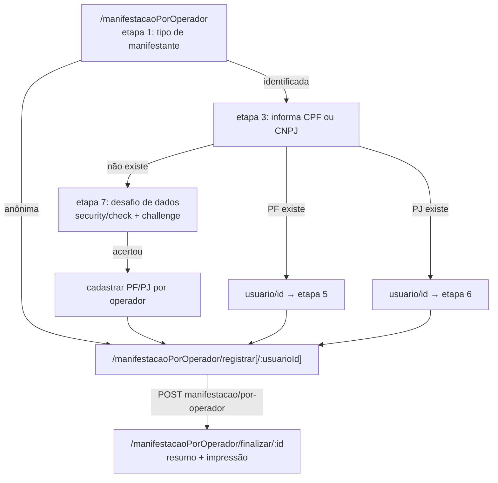

# Frontend Ouvidoria — registro de manifestação por operador

Voltar: [[01-Sistemas/PARTICIPA-DF/Frontend-Ouvidoria/PARTICIPA-DF-Frontend-Ouvidoria-Index|Índice do Frontend Ouvidoria]] · Conta do manifestante: [[01-Sistemas/PARTICIPA-DF/Frontend-Ouvidoria/03-Modulos/PARTICIPA-DF-Frontend-Ouvidoria-Modulo-Conta-por-Operador|Modulo-Conta-por-Operador]] · Equivalente do cidadão: [[01-Sistemas/PARTICIPA-DF/Frontend-Cidadao/02-Fluxos/PARTICIPA-DF-Frontend-Cidadao-Fluxo-Registro-de-Manifestacao|Registro-de-Manifestacao (Cidadão)]]

## Objetivo
Descrever como o operador registra uma manifestação em nome de um cidadão (atendimento presencial/telefônico), do ponto de vista do frontend.

## Evidências
Arquivos em `sources`, commit `9d8ecdb`. Cobertura `parcial`: o HTML de registro (~11 KB) foi lido por campos principais; as regras do desafio (perguntas) vêm do backend.

## Informações confirmadas

### 1. Identificar o manifestante (`manifestacaoPorOperadorCtrl`)
- ✅ Etapas numéricas em `$scope.etapa` (1 início; 3 informar documento; 4 CNPJ inválido; 5 PF encontrada; 6 PJ encontrada; 7 desafio; 8 cadastrar).
- ✅ **PF**: `POST pessoa-fisica/existe`. Existe → `usuario/id` (por `cpfCnpj`) e etapa 5. Não existe → fluxo de criação de conta PF com desafio. `400` sinaliza cadastro bloqueado (mensagem de `Notifications[0]`); `404` → cidadão não encontrado.
- ✅ **PJ**: `GET security/check?data=<cnpj>` e `POST pessoa-juridica/existe`; existe → `usuario/id` (etapa 6, com histórico de CPF vinculado em `pessoa-juridica/historico-responsavel-por-operador`); não existe → etapa 8. Para criar/desbloquear PJ exige CPF vinculado: `GET security/check-cpf-vinculado-pj?cpf=&cnpj=&aceiteResponsabilidade=` e a **declaração de responsabilidade** (`aceiteDeclaracaoResponsabilidade`).
- ✅ **Desafio de dados cadastrais** (`fluxoDesafio`: 0 criação PF, 1 desbloqueio PF, 2 criação PJ, 3 desbloqueio PJ, 4 alteração de CPF da PJ): `GET security/check?data=` devolve um desafio com dois campos de texto (comprimento definido pelo servidor, máscara `A…A`) e uma data; a resposta vai em `POST security/challenge` (`challenge.id`, `keys[]`). Acertando, o backend devolve os dados oficiais (nome, nome da mãe, data de nascimento; ou razão social, nome fantasia e tipo de entidade), usados para pré-preencher o cadastro.
- ✅ **Limite de tentativas**: `GET security/count-try?data=`; se o contador for maior que 2, o frontend exibe "ultrapassou o número de tentativas… volte em 24 horas" e volta para `/`. A contagem e o bloqueio são do backend.
- ✅ **Desbloqueio por dados inconsistentes**: usuário com bloqueio de motivação `Id` 1 (PF) ou 5 (PJ) → `pessoa-fisica/desbloquear-dados-inconsistentes` / `pessoa-juridica/desbloquear-dados-inconsistentes` (PJ envia também o CPF vinculado). O significado de 1 e 5 vem do backend (ver pendências).
- ✅ A decisão sobre o desafio e a criação de conta vive no navegador (`$scope`), e os dados pessoais pré-preenchidos seguem pela **URL** ao formulário de cadastro (ver [[01-Sistemas/PARTICIPA-DF/Frontend-Ouvidoria/05-Seguranca/PARTICIPA-DF-Frontend-Ouvidoria-Seguranca-e-Sessao|Seguranca-e-Sessao]]).

### 2. Registrar (`registrarManifestacaoPorOperadorCtrl`)
- ✅ Identificada se `usuarioId > 0` (carrega `usuario/id` por id); caso contrário, anônima.
- ✅ Tipos de entrada: `GET servico-ouvidoria/tipo-entrada/com-agrupamento?ativo=true`.
- ✅ **Assunto**: busca por palavra-chave (3+ caracteres, `assunto/por-palavra-chave/{texto}`, sem spinner) ou **sugestão por IA** a partir do relato (`POST servico-ouvidoria/ia/assunto`, `{relato}`); ao escolher o assunto carrega o formulário de **atributos complementares** (`formulario/por-assunto`), renderizado pela diretiva `atrComplementar`.
- ✅ **Relato**: até 13000 caracteres (`maxlength`, com contador regressivo).
- ✅ **Local do fato**: diretiva `mapOpenStreet` preenche região administrativa, latitude, longitude e descrição do endereço antes do envio; usa o serviço de localização (ver [[01-Sistemas/PARTICIPA-DF/Frontend-Ouvidoria/04-API-e-Integracoes/PARTICIPA-DF-Frontend-Ouvidoria-Integracoes-Externas|Integracoes-Externas]]).
- ✅ **Anexos** (diretiva `upload`): o nome é normalizado (sem acentos/símbolos); antes de a manifestação existir (`manifestacaoId == 0`), cada arquivo é validado por `POST arquivo/validar` (`Nome`, `Tamanho` em KB, `Volumes` com os tamanhos já anexados — o servidor valida o total) e guardado em memória como **base64**; depois de existir, envio por `arquivo/enviar`. Download por `POST arquivo/download` (retorna `ContentType`, `FileStream`, `FileName`); remoção por `arquivo/excluir-por-operador` (recarrega a página).
- ✅ Envio: `POST servico-ouvidoria/manifestacao/por-operador`; sucesso → `/manifestacaoPorOperador/finalizar/{Id}`; `400` → rola ao topo (erros exibidos pelo `customException`).

### 3. Finalizar (`finalizarManifestacaoPorOperadorCtrl`)
✅ `POST manifestacao/resumo` com o `Id` e botão de impressão (`exportar-pdf-operador`, PDF em base64 aberto em nova janela).

## Inferências e limitações
- 🔶 `pesquisarCnpj` encadeia `.then(Api.POST(...))` (a segunda chamada é disparada imediatamente, não após o `check`), então a verificação `security/check` e `pessoa-juridica/existe` correm em paralelo. Ver [[01-Sistemas/PARTICIPA-DF/Frontend-Ouvidoria/06-Qualidade/PARTICIPA-DF-Frontend-Ouvidoria-Debitos-Tecnicos|Débitos técnicos]].
- 🔶 Os códigos de motivação 1 e 5 e as regras do desafio devem ser conferidos com [[01-Sistemas/PARTICIPA-DF/Backend/03-Modulos/Bloqueio-de-Usuario|Bloqueio-de-Usuario]] (a mesma convenção aparece no Frontend Cidadão).
- 🔶 A sugestão de assunto por IA provavelmente chega ao serviço `Iza` pelo backend; não verificado deste lado.

## Relacionamentos
- Backend: [[01-Sistemas/PARTICIPA-DF/Backend/04-Fluxos/PARTICIPA-DF-Backend-Fluxo-Registro-de-Manifestacao|Fluxo-Registro-de-Manifestacao do Backend]]
- [[01-Sistemas/PARTICIPA-DF/Frontend-Ouvidoria/02-Fluxos/PARTICIPA-DF-Frontend-Ouvidoria-Fluxo-Caixa-de-Entrada-e-Detalhamento|Caixa-de-Entrada-e-Detalhamento]] · [[01-Sistemas/PARTICIPA-DF/Frontend-Ouvidoria/03-Modulos/PARTICIPA-DF-Frontend-Ouvidoria-Modulo-Gerencial|Modulo-Gerencial]] (formulários e assuntos)

## Pendências e próximo passo
- Confirmar as regras do desafio e dos limites de anexo no backend. Ver [[01-Sistemas/PARTICIPA-DF/Frontend-Ouvidoria/99-Controle/PARTICIPA-DF-Frontend-Ouvidoria-Pendencias|Pendências]].
