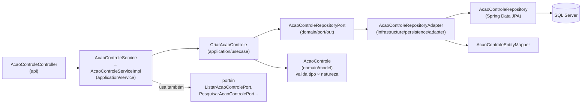

# Arquitetura (hexagonal / ports & adapters)

Voltar: [[01-Sistemas/SICI/Backend/SICI-Backend-Index|Índice do Backend]] · Relacionado: [[01-Sistemas/SICI/Backend/01-Visao-Geral/SICI-Backend-Stack-e-Dependencias|Stack-e-Dependencias]], [[01-Sistemas/SICI/Backend/02-Dominio/SICI-Backend-Modelo-de-Dominio|Modelo-de-Dominio]]

## Camadas ✅
Pacote raiz: `br.gov.df.cg.sici`

| Camada | Pacote | Classes | Conteúdo |
|---|---|---|---|
| Entrada (driving adapter) | `api` | 25 | Controllers REST por módulo, `config/SecurityConfig`, `config/OpenSwagger`, `security/*` (conversor JWT, handlers 401/403, `AuthController`) |
| Aplicação | `application` | 185 | `usecase/*` (regras orquestradas), `service/*` (fachadas `XxxService` + `XxxServiceImpl`), `contracts/request|response|result` (DTOs), `mapper` (MapStruct DTO↔domínio), `exception` (+ `GlobalExceptionHandler`), `utils` (hash, HMAC, QR, romanos, imagem) |
| Domínio | `domain` | 92 | `model` (29 entidades de domínio + `valueObjects`), `enums` (7), `port/in` (interfaces de casos de uso), `port/out` (23 portas de repositório/autenticação) |
| Saída (driven adapters) | `infrastructure` | 122 | `persistence/entity` (32 entidades JPA), `persistence/repository` (25 Spring Data), `persistence/adapter` (25 implementações de `port/out`), `mapper` (28, entidade↔domínio), `external` (Keycloak), `projection` |

## Fluxo típico de uma requisição ✅
Exemplo rastreado: cadastro de Ação de Controle.

Evidências: `api/acaoControle/AcaoControleController.java` (depende de `AcaoControleService`), `application/service/AcaoControle/AcaoControleServiceImpl.java` (depende de `CriarAcaoControle`, portas `in` e `out`), `infrastructure/persistence/adapter/AcaoControleRepositoryAdapter.java` (`implements AcaoControleRepositoryPort`).

## Padrões observados ✅
- **Duplo mapeamento**: DTO ↔ domínio (`application/mapper`) e domínio ↔ entidade JPA (`infrastructure/mapper`). O domínio não é anotado com JPA.
- **Fábricas estáticas no domínio**: `OrdemServico.criar(...)`, `Subci.criar/reconstituir`, `AcaoControle.criar(...)`.
- **Regras de transição no domínio**: `EStatusOrdemServico.statusPermitidos()`, `OrdemServico.alterarStatusOs(...)`.
- **Transações** declaradas nos use cases (`@Transactional` em `SalvarOrdemServico`, `AssinarOrdemServico` com `rollbackFor = Exception.class`, etc.) e em alguns adapters.

## Desvios do modelo hexagonal ✅
| Desvio | Evidência |
|---|---|
| `application` importa `infrastructure` (≈10 classes) | ex.: `application/service/ordemServico/OrdemServicoServiceImpl.java`, `application/service/comum/PdfService.java`, `application/usecase/auditor/AtualizarPerfisAuditorUseCase.java`, `application/exception/GlobalExceptionHandler.java` |
| `domain` importa Spring | `domain/port/in/unidadeAuditada/ListarUnidadeAuditadaPort.java`, `domain/port/out/OrdemServicoGenericaRepositoryPort.java` |
| Use case nem sempre implementa porta `in` | `CriarAcaoControle` é classe concreta sem interface; `SalvarOrdemServico implements SalvarOrdemServicoPort` |
| Use case dependendo de implementação concreta | `AssinarOrdemServico` injeta `ProrrogacaoOrdemServicoServiceImpl` |
| Lógica no controller | `OrdemServicoController.gerarRelatorioPdf` (≈120 linhas) |
| Classes vazias de esqueleto | `infrastructure/external/ExternalClass`, `infrastructure/exception/advice/AdviceClass`, `infrastructure/exception/error/ErrorClass` |
| Camada de serviço + use case redundantes | `XxxService`/`XxxServiceImpl` muitas vezes só delega para use cases |

Detalhamento e priorização em [[01-Sistemas/SICI/Backend/09-Qualidade/SICI-Backend-Debitos-Tecnicos|Debitos-Tecnicos]].

## Módulos funcionais
🔶 Agrupamento derivado dos subpacotes de `api`, `application/usecase` e `domain/port/in`:
Ação de Controle · POAC · Ordem de Serviço (+ fases, prorrogação, cancelamento) · OS Genérica · Assinatura · SUBCI · Auditor/Perfil · Coordenador · Cadastros auxiliares (área executora, objetivo PPA, programa de governo, unidade auditada, unidade de auditoria interna) · Segurança.
