# Banco de dados e migrations

Voltar: [[01-Sistemas/SICI/Backend/00-Backend-Index|Índice do Backend]] · Relacionado: [[01-Sistemas/SICI/Backend/02-Dominio/Modelo-de-Dominio|Modelo-de-Dominio]], [[01-Sistemas/SICI/Backend/02-Dominio/Enums-e-Estados|Enums-e-Estados]], [[01-Sistemas/SICI/Backend/01-Visao-Geral/Perfis-e-Ambientes|Perfis-e-Ambientes]]

> Banco: **SQL Server** (schema `dbo`). Migrations Flyway em `src/main/resources/db/migrations` (V1–V57).
> Cobertura parcial: os seeders `V2__seeders.sql` e `V55__seeders_unidade_auditada.sql` **não foram lidos** (podem conter dados reais).

## Modelo relacional atual (derivado das entidades JPA) ✅

```mermaid
erDiagram
    TB_POAC ||--o{ TB_ACAO_CONTROLE : ID_POAC
    TB_UNIDADE_AUDITORIA_INTERNA ||--o{ TB_ACAO_CONTROLE : ""
    TB_UNIDADE_AUDITORIA_INTERNA ||--o{ TB_AREA_EXECUTORA : ""
    TB_UNIDADE_AUDITORIA_INTERNA ||--o{ TB_AUDITOR : ""
    TB_AREA_EXECUTORA ||--o{ TB_ACAO_CONTROLE : ""
    TB_PROGRAMA_GOVERNO ||--o{ TB_ACAO_CONTROLE : ""
    TB_PROGRAMA_GOVERNO ||--o{ TB_OBJETIVO_PPA : ""
    TB_ACAO_CONTROLE ||--o{ TB_ACAO_CONTROLE_NATUREZA : ""
    TB_ACAO_CONTROLE ||--o{ TB_ACAO_CONTROLE_UNIDADE_AUDITADA : ""
    TB_UNIDADE_AUDITADA ||--o{ TB_ACAO_CONTROLE_UNIDADE_AUDITADA : ""
    TB_ACAO_CONTROLE ||--o{ TB_ACAO_CONTROLE_OBJETIVO_PPA : ""
    TB_OBJETIVO_PPA ||--o{ TB_ACAO_CONTROLE_OBJETIVO_PPA : ""

    TB_ACAO_CONTROLE ||--o{ TB_ORDEM_SERVICO : ""
    TB_TIPO_ORDEM_SERVICO ||--o{ TB_ORDEM_SERVICO : ""
    TB_ORDEM_SERVICO_CANCELAMENTO ||--o{ TB_ORDEM_SERVICO : ID_CANCELAMENTO_OS
    TB_ACAO_CONTROLE ||--o{ TB_ORDEM_SERVICO_CANCELAMENTO : ""
    TB_ORDEM_SERVICO ||--o{ TB_AUDITOR_TB_ORDEM_SERVICO : ""
    TB_AUDITOR ||--o{ TB_AUDITOR_TB_ORDEM_SERVICO : ""
    TB_ORDEM_SERVICO ||--o| TB_COORDENADOR_TB_ORDEM_SERVICO : ""
    TB_ORDEM_SERVICO ||--o{ TB_FASE_ORDEM_SERVICO : ""
    TB_FASE ||--o{ TB_FASE_ORDEM_SERVICO : ""
    TB_DESCRICAO_FASE_ACAO ||--o{ TB_FASE_ORDEM_SERVICO : ""
    TB_ORDEM_SERVICO ||--o{ TB_PRORROGACAO_ORDEM_SERVICO : ""
    TB_FASE ||--o{ TB_PRORROGACAO_ORDEM_SERVICO : ""

    TB_ORDEM_SERVICO_GENERICA ||--o{ TB_ARTIGO_ORDEM_SERVICO_GENERICA : ""
    TB_ORDEM_SERVICO_GENERICA ||--o{ TB_ANEXO_ORDEM_SERVICO_GENERICA : ""
    TB_ORDEM_SERVICO_GENERICA ||--o{ TB_DESCRICAO_FASE_OS_GENERICA : ""
    TB_ORDEM_SERVICO_GENERICA ||--o{ TB_AUDITOR_TB_ORDEM_SERVICO_GENERICA : ""
    TB_ORDEM_SERVICO_GENERICA ||--o| TB_COORDENADOR_TB_ORDEM_SERVICO_GENERICA : ""
    TB_AREA_EXECUTORA ||--o{ TB_ORDEM_SERVICO_GENERICA : ""

    TB_TIPO_DOCUMENTO ||--o{ TB_DOCUMENTO : ""
    TB_DOCUMENTO ||--o{ TB_DOCUMENTO_ASSINADO : ""
    TB_DOCUMENTO_ASSINADO ||--o{ TB_ASSINATURA : ""
    TB_AUDITOR ||--o{ TB_ASSINATURA : ""
    TB_PERFIL ||--o{ TB_ASSINATURA : ""
    TB_ASSINATURA ||--|| TB_NUMERACAO_ORDEM_SERVICO_ASSINADA : ""

    TB_AUDITOR ||--o{ TB_AUDITOR_PERFIL : ""
    TB_PERFIL ||--o{ TB_AUDITOR_PERFIL : ""
    TB_AUDITOR ||--o{ TB_SUBCI : ""
    TB_SUBCI ||--o{ TB_SUBCI_SUBSTITUTO : ""
    TB_AUDITOR ||--o{ TB_SUBCI_SUBSTITUTO : ID_AUDITOR_SUBSTITUTO
```

## Entidade JPA → tabela ✅
| Entidade (`infrastructure/persistence/entity`) | Tabela | Destaques de mapeamento |
|---|---|---|
| `AcaoControleEntity` | `TB_ACAO_CONTROLE` | `@ElementCollection` naturezas → `TB_ACAO_CONTROLE_NATUREZA`; `@ManyToMany` unidades auditadas e objetivos PPA; enums por **ordinal** |
| `OrdemServicoEntity` | `TB_ORDEM_SERVICO` | `@ManyToMany` auditores via `TB_AUDITOR_TB_ORDEM_SERVICO`; `@OneToOne` coordenador via `TB_COORDENADOR_TB_ORDEM_SERVICO`; `@ManyToOne` cancelamento (`ID_CANCELAMENTO_OS`); status por ordinal |
| `AuditorOrdemServicoEntity` (+ `...IdEntity`) | `TB_AUDITOR_TB_ORDEM_SERVICO` | `@EmbeddedId`; colunas `IN_ATIVO`, OS de exclusão, datas de designação/exclusão |
| `CoordenadorEntity` | `TB_COORDENADOR_TB_ORDEM_SERVICO` | `@MapsId` na OS; `IN_ATIVO`, `ID_OS_SUBSTITUICAO` |
| `FaseOrdemServicoEntity` (+ `...IdEntity`) | `TB_FASE_ORDEM_SERVICO` | chave composta OS + fase |
| `ProrrogacaoOrdemServicoEntity` | `TB_PRORROGACAO_ORDEM_SERVICO` | FKs `FK_PRORROGACAO_OSI`, `FK_PRORROGACAO_FASE` |
| `OrdemServicoCancelamentoEntity` | `TB_ORDEM_SERVICO_CANCELAMENTO` | ação de controle, justificativa, data |
| `OrdemServicoGenericaEntity` | `TB_ORDEM_SERVICO_GENERICA` | auditores, coordenador, artigos, descrições, anexos, área executora |
| `CoordenadorOsGenericaEntity` | `TB_COORDENADOR_TB_ORDEM_SERVICO_GENERICA` | `@MapsId` |
| `Artigo…`, `Anexo…`, `DescricaoFaseOsGenerica…Entity` | `TB_ARTIGO_…`, `TB_ANEXO_…`, `TB_DESCRICAO_FASE_OS_GENERICA` | `@ManyToOne` para a OS genérica |
| `DocumentoEntity` | `TB_DOCUMENTO` | `@Lob TX_CONTEUDO` (PDF), `TX_HASH`, `TX_HASH_VERIFICADOR`, `ID_DOCUMENTO_RELACIONADO` (sem FK; polimórfico por `ID_TIPO_DOCUMENTO`) |
| `DocumentoAssinadoEntity` | `TB_DOCUMENTO_ASSINADO` | FK para documento |
| `AssinaturaEntity` | `TB_ASSINATURA` | auditor, perfil, documento assinado; `TX_HASH` |
| `NumeracaoOrdemServicoAssinadaEntity` | `TB_NUMERACAO_ORDEM_SERVICO_ASSINADA` | ano, sequencial, número formatado, `@OneToOne` assinatura |
| `AuditorEntity` | `TB_AUDITOR` | `@ManyToMany` perfis via `TB_AUDITOR_PERFIL`; `DS_LOGIN` |
| `SubciEntity` / `SubciSubstitutoEntity` | `TB_SUBCI` / `TB_SUBCI_SUBSTITUTO` | |
| Referência | `TB_POAC`, `TB_FASE`, `TB_DESCRICAO_FASE_ACAO`, `TB_PERFIL`, `TB_PROGRAMA_GOVERNO`, `TB_OBJETIVO_PPA`, `TB_TIPO_DOCUMENTO`, `TB_TIPO_ORDEM_SERVICO`, `TB_UNIDADE_AUDITADA`, `TB_UNIDADE_AUDITORIA_INTERNA`, `TB_AREA_EXECUTORA` | |

## Constraints relevantes ✅
| Constraint | Efeito | Migration |
|---|---|---|
| `UX_SUBCI_UNICO_TITULAR_ATIVO` (índice único filtrado `WHERE STATUS_TITULAR = 1`) | no máximo **um SUBCI titular** | V17 |
| `CK_SUBCI_SUBSTITUTO_DATAS` | consistência de datas do substituto | V18 |
| `UK_ASSINATURA_DOCUMENTO_AUDITOR` (`ID_DOCUMENTO_ASSINADO, ID_AUDITOR, ID_PERFIL`) | um auditor/perfil assina o documento uma vez | V41 |
| `UK_TB_DOCUMENTO_ID_DOCUMENTO` | | V43 |
| `UK_NUMERACAO_ASSINATURA` | uma numeração por assinatura | V44 |
| `UNIQUE` em código da ação | código único | V1 |

## Linha do tempo das migrations ✅
| Faixa | Tema |
|---|---|
| V1 | Schema inicial: POAC, ação de controle (+ natureza, unidade auditada), programa/objetivo PPA, fase e descrição de fase, tipo de OS, OS, auditor × OS, fase × OS, UAI, área executora, auditor |
| V2 | Seeders (não lido) |
| V3–V8 | Datas na fase da OS; descrição de fase normalizada para ids (fase/tipo/natureza) com migração de dados (V5) e remoção das colunas texto (V6); tipo de OS CANCELAMENTO (V7) |
| V9–V10 | Coordenador da OS; justificativa de cancelamento (removida depois na V22) |
| V11–V19 | SUBCI e substitutos; tipo de documento; primeira versão de assinatura com hash verificador (V13–V15); status da OS (`ID_STATUS SMALLINT DEFAULT 1`) e motivo de devolução (V16) |
| V20–V22 | Numeração de OS assinada (com unique UAI+ano+seq); prorrogação; tabela de cancelamento |
| V23–V25 | Perfis e login do auditor (base da autorização); POAC ligado à ação; renomeações |
| V26–V37 | **OS Genérica** (tabela, auditores, coordenador, artigos, descrições); tipos GENERICA e SUBSTITUICAO; `IN_ATIVO` no coordenador |
| V38–V45 | **Refatoração da assinatura**: conteúdo e hash migram para `TB_DOCUMENTO` → `TB_DOCUMENTO_ASSINADO` → `TB_ASSINATURA`; perfil na assinatura; numeração recriada (V44) |
| V46–V47, V56–V57 | Substituição de coordenador; ativo/exclusão do auditor na OS; datas de designação/exclusão |
| V48 | Ação × objetivos PPA vira N:N (com migração de dados) |
| V49–V53 | Observação da OS; campos e anexos da OS genérica; `DT_CRIACAO` → `DATETIME2(3)`; objetivo da ação até 500 caracteres |
| V54–V55 | Unidade auditada com `IN_ATIVO` + seeder |

## Pontos de atenção
- ✅ **V44 faz `DROP TABLE IF EXISTS`** na tabela de numeração e a recria **sem** as colunas de OS/OS genérica/UAI e **sem** a unique `UAI + ANO + SEQUENCIAL` que existia na V20. Se aplicada sobre dados existentes, a numeração anterior é perdida.
- ✅ **Sequencial é por ano, não por UAI**: `NumeracaoRepositoryAdapter.buscarMaiorSequencialPorUaiEAno` ignora `idUai` e chama `NumeracaoRepository.findMaxSequencialByAno` (`max(numSequencial) where anoExercicio = :ano`). O nome do método e da porta promete "por UAI e ano".
- 🔶 **Risco de número duplicado**: o próximo número é `max + 1` (`NumeracaoRepositoryPort.obterProximoSequencialPorUaiEAno`), sem lock e sem unique no banco. Duas assinaturas simultâneas podem receber o mesmo número oficial.
- ✅ `NumeracaoRepositoryAdapter.buscarPorOrdemServico` sempre retorna `Optional.empty()`. É usado como fallback em `NumeracaoServiceImpl` e `OrdemServicoServiceImpl`.
- ✅ V14 e V15 adicionam a mesma coluna `TX_HASH_VERIFICADOR` (protegidas por `IF COL_LENGTH ... IS NULL`); depois a coluna é removida na V38.
- ✅ Flyway desligado em hom/prod e `ddl-auto=validate` — ver [[01-Sistemas/SICI/Backend/01-Visao-Geral/Perfis-e-Ambientes|Perfis-e-Ambientes]].
- ✅ Enums persistidos por ordinal — ver [[01-Sistemas/SICI/Backend/02-Dominio/Enums-e-Estados|Enums-e-Estados]].
- ✅ Nomes de FK gerados automaticamente pelo Hibernate na V1 (ex.: `FKel0cjj6...`), indicando que o script inicial foi exportado de um schema criado pelo ORM.
