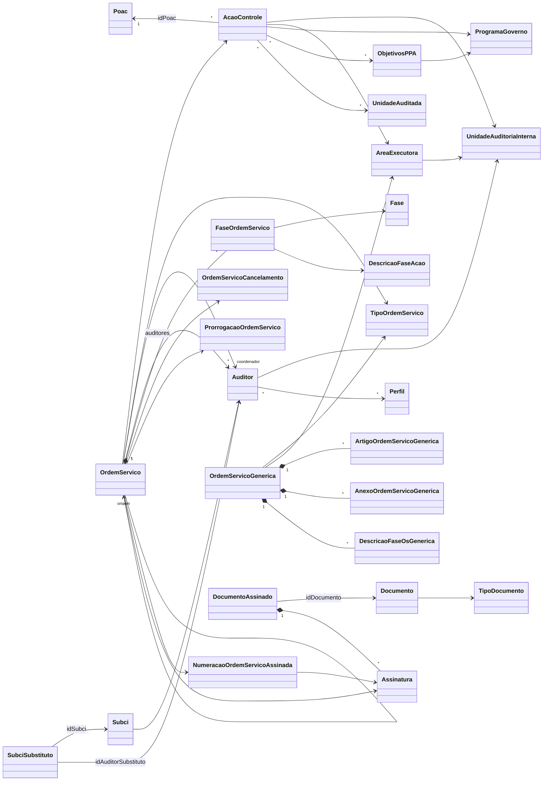

# Modelo de domínio

Voltar: [[01-Sistemas/SICI/Backend/00-Backend-Index|Índice do Backend]] · Relacionado: [[01-Sistemas/SICI/Backend/02-Dominio/Enums-e-Estados|Enums-e-Estados]], [[01-Sistemas/SICI/Backend/02-Dominio/Banco-e-Migrations|Banco-e-Migrations]], [[01-Sistemas/SICI/Backend/01-Visao-Geral/Arquitetura-Hexagonal|Arquitetura-Hexagonal]], [[01-Sistemas/SICI/Backend/01-Visao-Geral/Glossario|Glossario]]

> 29 classes em `domain/model` + 3 records em `domain/model/valueObjects`. O domínio é "puro" (sem anotações JPA); a persistência usa entidades espelho em `infrastructure/persistence/entity` — ver [[01-Sistemas/SICI/Backend/02-Dominio/Banco-e-Migrations|Banco-e-Migrations]].

## Visão geral ✅

## Agregados e responsabilidades

### Planejamento
| Classe | Campos principais | Comportamento | Evidência |
|---|---|---|---|
| `Poac` | nome, ano, datas de cadastro/início/fim | `criar(...)` | `Poac.java` |
| `AcaoControle` | código, idPoac, UAI, ano, área executora, descrição, objetivo, `ETipoAcao`, `List<ENaturezaAcao>`, `ESituacao`, unidades auditadas, programa de governo, objetivos PPA, `EClassificacaoAcao`, membros, dias úteis, esforço total, data de cadastro, `status` (ativo) | `criar`, `atualizar`, `alterarSituacaoAC`, `gerarCodigo`, `inativarAcaoControle`, valida tipo × natureza | `AcaoControle.java` |

### Ordem de Serviço (OS)
| Classe | Campos principais | Comportamento | Evidência |
|---|---|---|---|
| `OrdemServico` | tipo, ação de controle, dtCriação, cancelamento, motivo de devolução, observação, `EStatusOrdemServico`, auditores, coordenador, fases, numeração, assinatura, prorrogação, **OS de origem** | `criar`, `criarOsCancelamento`, `alterarStatusOs`, `cancelar`, `atualizar`, `atualizarExclusao`, `possuiFase`, `validarCriacao`, `validarCriacaoComBaseNasOrdens` | `OrdemServico.java` |
| `FaseOrdemServico` | OS, fase, descrição da fase, datas início/fim, duração | `of(...)` | `FaseOrdemServico.java` |
| `ProrrogacaoOrdemServico` | OS, fase, datas, duração, observação | `criar` (valida datas e duração > 0), `atualizar`, consolidações (`obterDataInicioConsolidada`, `obterDataFimConsolidada`, `obterDuracaoTotal`) | `ProrrogacaoOrdemServico.java` |
| `OrdemServicoCancelamento` | ação de controle, justificativa, data | `criar`, `comId`, `atualizarJustificativa` | `OrdemServicoCancelamento.java` |
| `AuditorOrdemServico` | OS, auditor, ativo, OS de exclusão, data início designação/exclusão | `criar(...)` | `AuditorOrdemServico.java` |
| `Coordenador` | OS, auditor coordenador, ativo | `criar(...)` | `Coordenador.java` |

### OS Genérica
| Classe | Campos principais | Evidência |
|---|---|---|
| `OrdemServicoGenerica` | status, tipo, dtCriação, descrições de fase, **osVinculada** (texto), motivo de devolução, observação, identificador, auditores, coordenador, artigos, anexos, área executora; `alterarStatusOs` | `OrdemServicoGenerica.java` |
| `ArtigoOrdemServicoGenerica` / `AnexoOrdemServicoGenerica` | número (`short`) + descrição | arquivos homônimos |
| `DescricaoFaseOsGenerica` | descrição livre + datas + duração | `DescricaoFaseOsGenerica.java` |

### Documento e assinatura
| Classe | Campos principais | Comportamento | Evidência |
|---|---|---|---|
| `Documento` | documento relacionado (id polimórfico), `TipoDocumento`, data, conteúdo (bytes), hash verificador | `criar`, `hashConfere()` (SHA-256 do conteúdo) | `Documento.java` |
| `DocumentoAssinado` | documento, data, lista de assinaturas | `criar`, `registrarAssinatura(DadosAssinatura)` | `DocumentoAssinado.java` |
| `Assinatura` | auditor, perfil (id e nome), data, hash | `criar` (valida campos obrigatórios), `validarHash`, `doMesmoAuditor` | `Assinatura.java` |
| `NumeracaoOrdemServicoAssinada` | ano de exercício, sequencial, número formatado, OS ou OS genérica, assinatura, UAI | `criar`, `criarParaGenerica`, `formatarNumero` | `NumeracaoOrdemServicoAssinada.java` |

Detalhes do fluxo: [[01-Sistemas/SICI/Backend/03-Modulos/Assinatura-Digital|Assinatura-Digital]] e [[01-Sistemas/SICI/Backend/04-Fluxos/Fluxo-Assinatura-OS|Fluxo-Assinatura-OS]] (lote 4).

### Pessoas e papéis
| Classe | Campos | Evidência |
|---|---|---|
| `Auditor` | nome, login, matrícula, ativo, UAI, perfis | `Auditor.java` (`criar`, `of`, `resumo`) |
| `Perfil` | nome, descrição | `Perfil.java` |
| `Subci` | auditor, `statusTitular` | `Subci.java` |
| `SubciSubstituto` | SUBCI, auditor substituto, data início/fim (imutável) | `SubciSubstituto.java` |

### Cadastros de referência
`UnidadeAuditoriaInterna` (nome, sigla) · `AreaExecutora` (nome, sigla, código, UAI) · `UnidadeAuditada` (código, descrição) · `ProgramaGoverno` (código, descrição) · `ObjetivosPPA` (código, descrição, programa) · `Fase` (nome) · `DescricaoFaseAcao` (fase × tipo de ação × natureza → texto) · `TipoOrdemServico` (descrição, ativa) · `TipoDocumento`.

### Value objects (records) ✅
| Record | Uso |
|---|---|
| `DadosAssinatura(idAuditor, nomeAuditor, idPerfil, nomePerfil, dataAssinatura)` | entrada para `Assinatura.criar` |
| `DadosUsuarioAutenticado(sub, preferredUsername, name, ..., email, emailVerified)` | resposta do userinfo do Keycloak |
| `TokenAutenticacao(accessToken, expiresIn, refreshToken, ...)` | resposta do token endpoint do Keycloak |

## Invariantes implementadas no domínio ✅
| Regra | Onde |
|---|---|
| Só pode existir **uma OS de ABERTURA não cancelada** por ação | `OrdemServico.validarAberturaUnica` → `DuplicidadeAberturaException` |
| ABERTURA exige coordenador | `OrdemServico.validarCoordenadorObrigatorio` |
| DESIGNAÇÃO/EXCLUSÃO: não pode informar coordenador **e** membros ao mesmo tempo | `OrdemServico.validarDesignacao` |
| Qualquer OS que não seja ABERTURA exige uma ABERTURA existente, não cancelada e **assinada** | `OrdemServico.validarCriacaoComBaseNasOrdens` |
| Transição de status segue a máquina de estados; DEVOLVIDA exige motivo; CANCELADA é final | `OrdemServico.alterarStatusOs`, `OrdemServicoGenerica.alterarStatusOs`, `EStatusOrdemServico.statusPermitidos` |
| Tipo de ação restringe naturezas | `AcaoControle.validarNaturezaAcaoControle` — ver [[01-Sistemas/SICI/Backend/02-Dominio/Enums-e-Estados|Enums-e-Estados]] |
| Prorrogação: fim ≥ início e duração > 0 | `ProrrogacaoOrdemServico.criar` |
| Assinatura exige documento, auditor, perfil e nomes | `Assinatura.criar` |
| Hash da assinatura = SHA-256 de `idAuditor|idPerfil|dataAssinatura` | `Assinatura.calcularHashAssinatura` |

## Observações e inconsistências ✅
- **Dependências invertidas**: o domínio importa camadas externas:
  - `OrdemServico` → `application.exception.RegraNegocioException`, `DuplicidadeAberturaException`
  - `AcaoControle` → `application.contracts.request.AcaoControleRequest`
  - `Auditor` → `infrastructure.persistence.entity.UnidadeAuditoriaInternaEntity`
  - portas `in` de OS, OS Genérica e Ação de Controle recebem/retornam DTOs de `application.contracts`
- `OrdemServico.id(Integer)` sempre retorna `null`.
- `OrdemServico.cancelar` monta `fasesReconectadas` e descarta o resultado (a OS cancelada sai sem fases).
- `AcaoControle.alterarSituacaoAC(acaoControle, situacao)` ignora o primeiro parâmetro e reatribui os campos a si mesmos; o efeito real é só mudar `situacao`.
- 🔶 O hash da `Assinatura` não usa segredo nem o conteúdo do documento: é reproduzível por quem conhece os ids e a data. A integridade do conteúdo fica com `Documento.hashConfere` e o código verificador HMAC (detalhar no lote 4).
- Campo `Perfil.Descricao` com inicial maiúscula (fora da convenção Java).
- Mistura de estilos: algumas classes são imutáveis (`AuditorOrdemServico`, `SubciSubstituto`), outras têm setters públicos (`OrdemServico.setAssinatura`).
