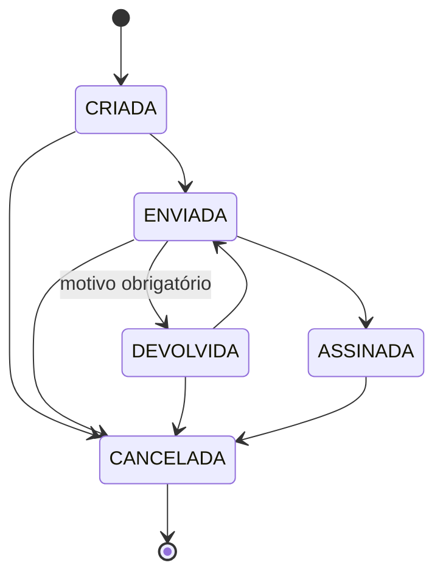
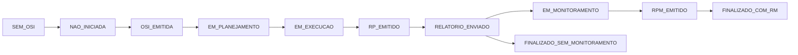

# Enums e estados

Voltar: [[01-Sistemas/SICI/Backend/SICI-Backend-Index|Índice do Backend]] · Relacionado: [[01-Sistemas/SICI/Backend/02-Dominio/SICI-Backend-Modelo-de-Dominio|Modelo-de-Dominio]], [[01-Sistemas/SICI/Backend/02-Dominio/SICI-Backend-Banco-e-Migrations|Banco-e-Migrations]], [[01-Sistemas/SICI/Backend/05-Fluxos/Fluxo-Ciclo-de-Vida-OS|Fluxo-Ciclo-de-Vida-OS]]

## Status da OS — `EStatusOrdemServico` ✅
Usado por `OrdemServico` e `OrdemServicoGenerica`. Transições em `EStatusOrdemServico.statusPermitidos()`.

| Status | id (enum) | ordinal (gravado no banco) |
|---|---|---|
| CRIADA | 1 | 0 |
| ENVIADA | 2 | 1 |
| DEVOLVIDA | 3 | 2 |
| ASSINADA | 4 | 3 |
| CANCELADA | 5 | 4 |

- ✅ A assinatura só aceita o status ASSINADA (`AssinarOrdemServico.resolverStatusAssinatura`).
- ✅ Uma OS CANCELADA não pode ser alterada (`OrdemServico.alterarStatusOs`).

## Modelo da OS — `EModeloOrdemServico` ✅
Mapeia `TipoOrdemServico.idTipoOrdemServico` via `fromId`.

| Modelo | id | Template de PDF | Observação |
|---|---|---|---|
| ABERTURA | 1 | `aberturaOrdemServico.html` | uma ativa por ação; exige coordenador |
| DESIGNACAO | 2 | `designacaoOrdemServico.html` | inclui membros ou coordenador (não ambos) |
| EXCLUSAO | 3 | `exclusaoOrdemServico.html` | retira membros ou coordenador (não ambos) |
| PRORROGACAO | 4 | `prorrogacaoOrdemServico.html` | estende fase da ABERTURA |
| CANCELAMENTO | 5 | `cancelamentoOrdemServico.html` | perfis restritos (sem AUDITOR) |
| SUBSTITUICAO | 6 | `substituicaoOrdemServico.html` | substituição de coordenador |
| GENERICA | 7 | `genericaOrdemServico.html` | OS sem ação de controle |

Também existe `erroOrdemServico.html` (🔶 template de fallback). Os ids 5, 6 e 7 são inseridos por migrations (V7, V37, V31).

## Ação de controle

### Tipo × Natureza ✅
Regra em `AcaoControle.validarNaturezaAcaoControle`:

| `ETipoAcao` (id) | Naturezas permitidas (`ENaturezaAcao`) | Cardinalidade |
|---|---|---|
| AUDITORIA (1) | CONFORMIDADE, DESEMPENHO, GOVERNANCA | 1 ou mais |
| CONSULTORIA (2) | GESTAO_RISCOS **ou** PROGRAMA_INTEGRIDADE | exatamente 1 |
| INSPECAO (3) | CONFORMIDADE | exatamente 1 |

⚠️ A mensagem de erro da Auditoria diz "Conformidade, Desempenho ou **Riscos**", mas o conjunto aceito contém **Governança**. Ver [[01-Sistemas/SICI/Backend/99-Controle/SICI-Backend-Pendencias|Pendencias]].

`ENaturezaAcao`: CONFORMIDADE (1), DESEMPENHO (2), GOVERNANCA (3), GESTAO_RISCOS (4), PROGRAMA_INTEGRIDADE (5), cada uma com descrição legível.

### Classificação — `EClassificacaoAcao` ✅
PROGRAMADA · RESERVA · NAO_PROGRAMADA (sem id explícito).

### Situação — `ESituacao` ✅
Sequência de marcos da ação (sem transições codificadas no enum):

🔶 A ordem do fluxo foi inferida da ordem de declaração e dos nomes; o código não valida transições de situação. O ramo para `FINALIZADO_SEM_MONITORAMENTO` também é inferência.

## Outros ✅
- `ETipoRelatorio`: ORDEM_SERVICO (1), ORDEM_SERVICO_GENERICA (2) — tipo usado para localizar o PDF assinado (`OrdemServicoController.gerarRelatorioPdf` → `assinaturaService.obterPorRelacionadoETipo`).

## ⚠️ Persistência por ordinal
Todas as colunas de enum usam `@Enumerated(EnumType.ORDINAL)`:
- `AcaoControleEntity`: `tipoAcao` (`ID_TIPO_ACAO`), `naturezasAcao` (`TB_ACAO_CONTROLE_NATUREZA.ID_NATUREZA_ACAO`), `situacao` (`ID_SITUACAO`), `classificacaoAcao` (`ID_CLASSIFICACAO_ACAO`)
- `OrdemServicoEntity.status` e `OrdemServicoGenericaEntity.status` (`ID_STATUS`)

Consequências:
1. ✅ O valor gravado (0-based) **difere do `id` do enum** (1-based). Ex.: ASSINADA tem id 4 e é gravada como 3.
2. ✅ Reordenar ou inserir constantes no meio de qualquer enum corrompe silenciosamente os dados existentes.
3. 🔶 `V16` criou `TB_ORDEM_SERVICO.ID_STATUS` com `DEFAULT 1`, que pelo ordinal significa **ENVIADA**, não CRIADA. Linhas pré-existentes na época da migration podem ter ficado como ENVIADA.
4. 🔶 Consultas SQL nativas, relatórios ou integrações que leiam `ID_STATUS` diretamente precisam usar o ordinal, não o id.
