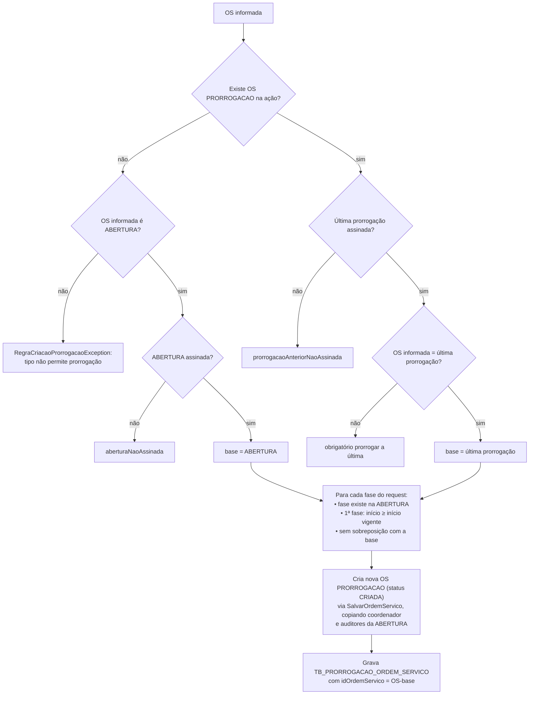
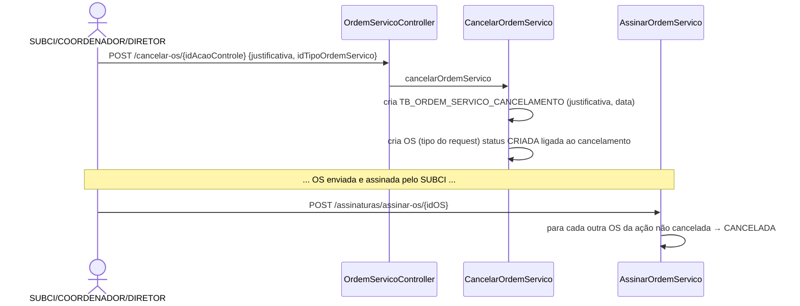

# Prorrogação e cancelamento de OS

Voltar: [[01-Sistemas/SICI/Backend/SICI-Backend-Index|Índice do Backend]] · Relacionado: [[01-Sistemas/SICI/Backend/03-Modulos/SICI-Backend-Modulo-Ordem-de-Servico|Ordem-de-Servico]], [[01-Sistemas/SICI/Backend/05-Fluxos/SICI-Backend-Fluxo-Ciclo-de-Vida-OS|Fluxo-Ciclo-de-Vida-OS]], [[01-Sistemas/SICI/Backend/03-Modulos/SICI-Backend-Modulo-Assinatura-Digital|Assinatura-Digital]]

## Prorrogação

### Conceito ✅
A prorrogação estende o prazo de uma ou mais **fases da OS de ABERTURA**. As prorrogações formam uma **cadeia**: a primeira parte da abertura assinada, e cada nova parte da última prorrogação, que também precisa estar assinada.

### Criação — `CriarProrrogacaoOrdemServico.executar(idOrdemServicoInformada, ProrrogacaoRequest)` ✅
Endpoint: `POST /os-acao-controle/{idOrdemServicoBase}/prorrogacoes` (sem `@PreAuthorize`).

Detalhes confirmados:
- A "última prorrogação" é a OS PRORROGACAO de **maior id** da ação, **sem filtrar status**. Uma prorrogação cancelada ou não assinada bloqueia novas prorrogações.
- A ABERTURA é a primeira OS de modelo ABERTURA da lista, também **sem filtrar canceladas**.
- A nova OS é montada por `OrdemServicoMapper.criarProrrogacaoRequest`: tipo PRORROGACAO, coordenador da abertura (ativo), observação e auditores da abertura, sem fases próprias.
- ⚠️ As linhas de prorrogação ficam ligadas à **OS-base** (abertura ou prorrogação anterior), **não à nova OS PRORROGACAO**. O retorno de `salvarPorAcaoControle` é descartado. O vínculo entre a OS PRORROGACAO e suas datas é resolvido depois pelo encadeamento (`OrdemServicoServiceImpl.obterIdOsReferenciaProrrogacao`).
- Regras de domínio: data fim ≥ data início e duração > 0 (`ProrrogacaoOrdemServico.criar`).
- A variável `dataFinalAtual` é calculada e não é usada.
- ⚠️ A pré-condição "assinada" usa `isAssinada()` (status). Com a lacuna #2 de [[01-Sistemas/SICI/Backend/03-Modulos/SICI-Backend-Modulo-Ordem-de-Servico|Ordem-de-Servico]], dá para satisfazê-la sem assinatura real.

### Atualização — `AtualizarProrrogacaoOrdemServico` ✅
Endpoint: `PUT /os-acao-controle/{idOrdemServico}/prorrogacoes`.
- Exige ao menos uma prorrogação no request e prorrogações existentes na OS-base.
- 1ª fase: início não pode ser anterior ao início vigente.
- O novo início não pode ser anterior ao início já registrado.
- Rejeita sobreposição se o período mudou.
- Atualiza datas, duração e observação (`ProrrogacaoOrdemServico.atualizar`); a observação também vai para a OS (`atualizarObservacaoProrrogacao`).

### Validação de data — `GET /validar-data-prorrogacao` ✅
Retorna 400 se `novaDataFim` não for posterior à data final vigente da fase (`buscarDataFinalVigenteDaFase`). A lógica fica no controller.

### Consolidação ✅
`ProrrogacaoOrdemServico.obterDataInicioConsolidada` (mínimo), `obterDataFimConsolidada` (máximo) e `obterDuracaoTotal` (soma) servem para montar as fases prorrogadas na resposta e no PDF (`ProrrogacaoOrdemServicoServiceImpl`, template `prorrogacaoOrdemServico.html`).

### Exclusão de OS de prorrogação ✅
`ExcluirOrdemServico` apaga **todas** as prorrogações da OS-base (abertura ou última prorrogação **assinada**) e depois a OS. Só é permitida se a OS não tiver assinatura.

---

## Cancelamento

### Fluxo em duas etapas ✅

1. **Criação** (`CancelarOrdemServico.cancelarOrdemServico`, `@Transactional`): grava `OrdemServicoCancelamento` e uma OS ligada a ele (`criarOsCancelamento`) com status CRIADA.
2. **Efetivação** na assinatura (`AssinarOrdemServico`, modelo CANCELAMENTO): todas as **outras** OS da ação que não estejam canceladas passam para CANCELADA (`OrdemServico.cancelar`). Isso inclui OS já ASSINADAS (ASSINADA → CANCELADA é permitido).
3. **Justificativa** pode ser alterada antes da assinatura (`PUT /cancelamento/{idOS}/{idCancelamento}`): exige OS do tipo 5, não assinada, e cancelamento da mesma ação.

### Lacunas ✅
- `CancelarOrdemServico` **não valida**:
  - se a ação existe (`acaoControle` nulo segue adiante);
  - se `idTipoOrdemServico` do request é de fato CANCELAMENTO (o tipo vem do cliente);
  - se já existe ABERTURA;
  - o perfil, porque não passa por `SalvarOrdemServico.validarPermissaoSalvarOrdemServico` (o `@PreAuthorize` do endpoint cobre o mesmo conjunto).
- `OrdemServico.cancelar` devolve a OS **sem fases** (o `fasesReconectadas` é descartado). `OrdemServicoEntity.fasesOrdemServico` usa `cascade = ALL, orphanRemoval = true`, e o adapter persiste com `saveAndFlush` (`OrdemServicoRepositoryAdapter.atualizar`). 🔶 Por isso é **provável** que, ao assinar um CANCELAMENTO, as fases das OS canceladas sejam apagadas do banco. Confirmar com um teste ou consultando dados de homologação.
- 🔶 A ação de controle **não muda de situação** ao ser cancelada: só a abertura altera `ESituacao`.
