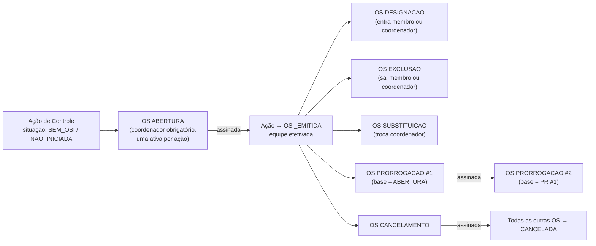
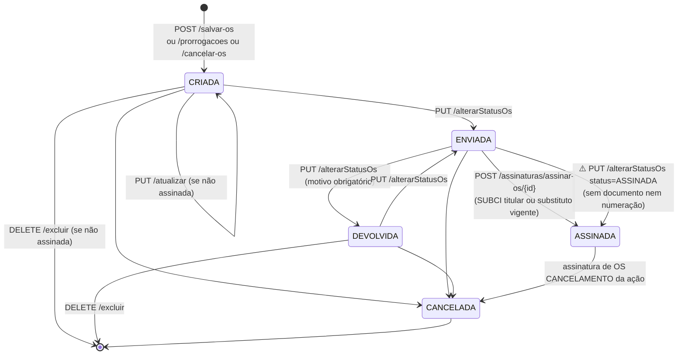

# Fluxo — ciclo de vida da OS

Voltar: [[01-Sistemas/SICI/Backend/00-Backend-Index|Índice do Backend]] · Relacionado: [[01-Sistemas/SICI/Backend/03-Modulos/Ordem-de-Servico|Ordem-de-Servico]], [[01-Sistemas/SICI/Backend/03-Modulos/Prorrogacao-e-Cancelamento|Prorrogacao-e-Cancelamento]], [[01-Sistemas/SICI/Backend/02-Dominio/Enums-e-Estados|Enums-e-Estados]], [[01-Sistemas/SICI/Backend/04-Fluxos/Fluxo-Assinatura-OS|Fluxo-Assinatura-OS]]

## 1. Sequência de OS dentro de uma ação de controle ✅ / 🔶

- ✅ A ABERTURA assinada é **exigida** para prorrogação (`CriarProrrogacaoOrdemServico`).
- ⚠️ Para DESIGNACAO, EXCLUSAO, SUBSTITUICAO e CANCELAMENTO, a regra "abertura assinada primeiro" existe no domínio (`OrdemServico.validarCriacaoComBaseNasOrdens`), mas **não é aplicada**. O diagrama mostra a intenção, não uma garantia do código.
- 🔶 A situação da ação depois de `OSI_EMITIDA` (EM_PLANEJAMENTO, EM_EXECUCAO…) não é alterada por nenhum fluxo de OS analisado até aqui.

## 2. Estados de uma OS individual ✅

## 3. Efeitos pendentes → efetivos ✅
Alterações de equipe são gravadas **inativas** na criação e ativadas só na assinatura:

| Momento | DESIGNACAO / ABERTURA | EXCLUSAO | SUBSTITUICAO |
|---|---|---|---|
| Criar OS | `TB_AUDITOR_TB_ORDEM_SERVICO.IN_ATIVO = 0` | marca `ID_OS_EXCLUSAO` + data nos vínculos ativos | coordenador substituto `IN_ATIVO = 0` + `ID_OS_SUBSTITUICAO` |
| Atualizar OS | adiciona/remove vínculos (`DELETE` físico) | remarca/desmarca exclusões | — |
| Excluir OS | (vínculos saem com a OS) | `removerVinculoExclusao` | `excluirOsSubstituicao` |
| **Assinar OS** | `efetivarDesignacao` → `IN_ATIVO = 1` | `efetivarExclusao` → `IN_ATIVO = 0` | inativa coordenador atual, ativa substituto |

Fontes: `SalvarOrdemServico`, `AtualizarOrdemServico`, `ExcluirOrdemServico`, `AssinarOrdemServico`, `AuditorOrdemServicoRepository` (queries nativas), `CoordenadorRepository`.

🔶 Consequência da lacuna "ASSINADA via `/alterarStatusOs`": nesse caminho os efeitos da tabela acima **não são executados**. A OS fica ASSINADA e a equipe continua pendente.
