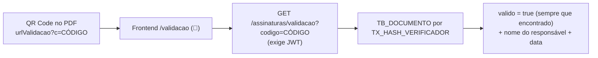

# Fluxo — assinatura de uma OS

Voltar: [[01-Sistemas/SICI/Backend/SICI-Backend-Index|Índice do Backend]] · Relacionado: [[01-Sistemas/SICI/Backend/03-Modulos/SICI-Backend-Modulo-Assinatura-Digital|Assinatura-Digital]], [[01-Sistemas/SICI/Backend/05-Fluxos/SICI-Backend-Fluxo-Ciclo-de-Vida-OS|Fluxo-Ciclo-de-Vida-OS]], [[01-Sistemas/SICI/Backend/03-Modulos/SICI-Backend-Modulo-Ordem-de-Servico|Ordem-de-Servico]]

## Sequência ✅
`POST /assinaturas/assinar-os/{idOrdemServico}` → `AssinaturaController.assinar` → `AssinaturaServiceImpl.salvar` → `AssinarDocumento` → `AssinarOrdemServico.executar` (`@Transactional(rollbackFor = Exception.class)`).

```mermaid
sequenceDiagram
    autonumber
    actor S as SUBCI (titular ou substituto)
    participant API as AssinaturaController
    participant UC as AssinarOrdemServico
    participant DB as SQL Server
    participant PDF as Serviço externo de PDF

    S->>API: POST /assinar-os/{id} (Bearer JWT)
    API->>UC: executar(id, request)
    UC->>UC: status destino = ASSINADA (outro status → erro)
    UC->>DB: já existe assinatura para a OS? → DocumentoException
    UC->>DB: carrega OS (domínio + resposta enriquecida)
    UC->>DB: SUBCI titular ativo / substituto vigente hoje
    UC->>UC: login do JWT == login do titular/substituto? senão AccessDenied
    UC->>DB: max(NUM_SEQUENCIAL) do ano → seq = max+1
    UC->>UC: número = "%06d/ano - SIGLA_UAI/CGDF"<br/>código = HMAC-SHA256(idOS)[0..32]<br/>QR = urlValidacao?c=código
    UC->>UC: Thymeleaf: template do modelo + variáveis
    UC->>PDF: POST {"HtmlString": "..."}
    PDF-->>UC: bytes do PDF
    UC->>DB: INSERT TB_DOCUMENTO (PDF, SHA-256, código)
    UC->>DB: INSERT TB_DOCUMENTO_ASSINADO + TB_ASSINATURA
    UC->>DB: INSERT TB_NUMERACAO_ORDEM_SERVICO_ASSINADA
    UC->>UC: OS.alterarStatusOs(ASSINADA) — exige ENVIADA
    UC->>DB: UPDATE TB_ORDEM_SERVICO status
    alt ABERTURA
        UC->>DB: ação → OSI_EMITIDA; efetivar designação
    else DESIGNACAO
        UC->>DB: efetivar designação (IN_ATIVO=1)
    else EXCLUSAO
        UC->>DB: efetivar exclusão (IN_ATIVO=0)
    else SUBSTITUICAO
        UC->>DB: inativa coordenador atual, ativa substituto
    else CANCELAMENTO
        UC->>DB: demais OS da ação → CANCELADA
    end
    UC-->>API: Assinatura
    API->>DB: busca numeração, documento, documento assinado
    API-->>S: 201 AssinaturaResponse (número, código, id do documento assinado)
```

## Falhas e rollback ✅
- Qualquer exceção desfaz **as gravações** no banco.
- ⚠️ A chamada ao serviço de PDF (passo 10) acontece **antes** da checagem de status (passo 15). Uma OS em CRIADA ou DEVOLVIDA gera um PDF externo que depois é descartado.
- 🔶 Entre a leitura do `max` (passo 6) e o `INSERT` da numeração (passo 13) há uma chamada HTTP externa. Isso **alarga a janela de concorrência** que pode gerar números duplicados — ver [[01-Sistemas/SICI/Backend/03-Modulos/SICI-Backend-Modulo-Assinatura-Digital|Assinatura-Digital]] (achado #1).

## OS genérica — diferenças ✅
`AssinarOrdemServicoGenerica.executar`:
- código verificador = `HMAC("OSG:" + id)`;
- numeração por `NumeracaoOrdemServicoAssinada.criarParaGenerica`;
- tipo de documento `ORDEM_SERVICO_GENERICA`;
- não há efeitos colaterais sobre equipe ou ação.

Mesmas regras de assinante e mesmo sequencial anual compartilhado com as OS de ação de controle.

## Validação posterior ✅

