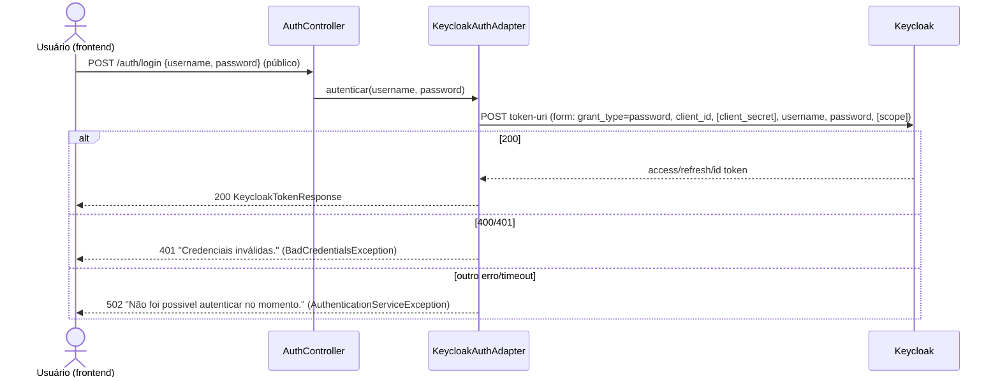
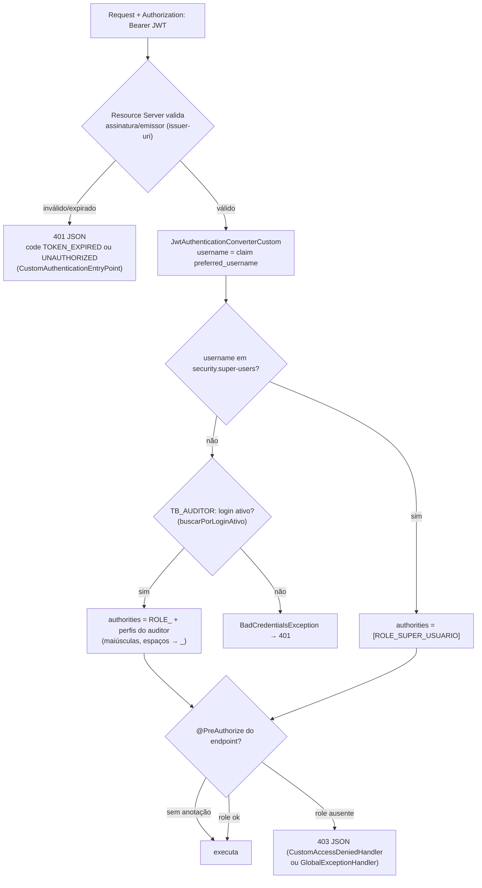

# Fluxo — autenticação e autorização

Voltar: [[01-Sistemas/SICI/Backend/SICI-Backend-Index|Índice do Backend]] · Relacionado: [[01-Sistemas/SICI/Backend/08-Seguranca/SICI-Backend-Seguranca-e-Autorizacao|Seguranca-e-Autorizacao]], [[01-Sistemas/SICI/Backend/03-Modulos/SICI-Backend-Modulo-Auditores-Coordenadores-Perfis|Auditores-Coordenadores-Perfis]], [[01-Sistemas/SICI/Backend/07-Integracoes/SICI-Backend-Integracoes-Externas|Integracoes-Externas]]

## 1. Login (proxy para o Keycloak) ✅

- Timeouts: connect 5 s / read 10 s (`keycloak.auth.*-timeout-ms`, `RestTemplateBuilder`).
- `/auth/login` é ignorado pelo `BearerTokenResolver` customizado: um header `Authorization` inválido não atrapalha o login.
- ✅ O login **não** confere se o usuário é auditor ativo. Essa checagem ocorre só nas chamadas seguintes (passo 2).
- 🔶 Sem limite de tentativas no backend. A proteção contra força bruta depende da configuração do realm no Keycloak.

## 2. Cada requisição autenticada ✅

- ✅ As roles vêm **do banco a cada requisição**, não do token. Mudar perfis tem efeito imediato.
- ✅ `ROLE_SUPER_USUARIO` não aparece em **nenhum** `@PreAuthorize`. O super-usuário passa na autenticação mesmo sem cadastro em `TB_AUDITOR`, mas leva 403 em todos os endpoints com role. Na prática, acessa só os endpoints sem anotação, que são a maioria (ver [[01-Sistemas/SICI/Backend/06-API/SICI-Backend-Catalogo-de-Endpoints|Catalogo-de-Endpoints]]).
- ✅ Assinar OS **não depende de role**: depende de o login ser o do SUBCI titular ou do substituto vigente ([[01-Sistemas/SICI/Backend/03-Modulos/SICI-Backend-Modulo-SUBCI-e-Substitutos|SUBCI-e-Substitutos]]).

## 3. Conta e sessão ✅
- `GET /auth/account`: repassa o access token ao **userinfo** do Keycloak e devolve os dados da conta (`DadosUsuarioAutenticado`).
- `GET /me`: devolve `username` e `roles` calculados pela aplicação.
- Não há endpoint de refresh nem de logout no backend. 🔶 O frontend provavelmente usa o refresh token devolvido no login direto com o Keycloak.

## 4. Healthcheck ✅
`KeycloakHealthIndicator` consulta `/.well-known/openid-configuration` (derivado do token-uri) a cada chamada de `/healthcheck`.
- 🔶 O Dockerfile chama `/healthcheck` a cada 30 s. Se o Keycloak cair, o container fica **unhealthy** e o orquestrador pode reiniciá-lo, propagando a indisponibilidade do Keycloak para a API.
