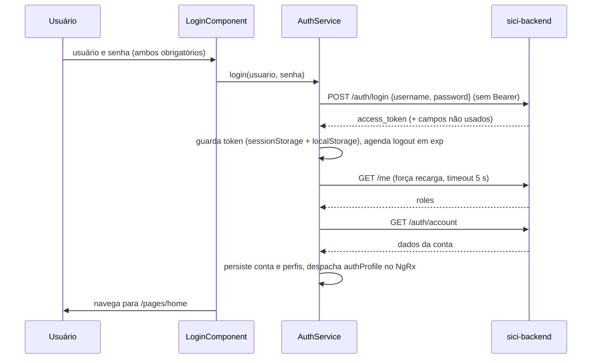

# Fluxo — autenticação (frontend)

Voltar: [[01-Sistemas/SICI/Frontend/SICI-Frontend-Index|Índice do Frontend]] · Relacionado: [[01-Sistemas/SICI/Frontend/08-Seguranca/SICI-Frontend-Seguranca-e-Sessao|Seguranca-e-Sessao]], [[01-Sistemas/SICI/Backend/05-Fluxos/SICI-Backend-Fluxo-Autenticacao|Fluxo-Autenticacao do Backend]], [[01-Sistemas/SICI/Frontend/01-Visao-Geral/SICI-Frontend-Rotas-e-Telas|Rotas-e-Telas]]

## Objetivo
Descrever a sequência de login, restauração de sessão, autorização de rotas e logout no frontend.

## Evidências
Arquivos em `sources`. Contrato do backend em [[01-Sistemas/SICI/Backend/06-API/SICI-Backend-Catalogo-de-Endpoints|Catalogo-de-Endpoints]] (`/auth/login`, `/auth/account`, `/me`).

## Informações confirmadas ✅
### Login

- Erro no login: `401` vira "Credenciais inválidas."; qualquer outro erro vira "Não foi possível autenticar no momento." (`AuthErrorInterceptor`).
- Se `/me` falhar ou expirar, `AuthService` mantém os perfis em cache; os perfis iniciais vêm das claims do JWT.

### Restauração e guarda de rotas
1. Ao iniciar, `AuthService` lê token, conta e perfis do armazenamento e reidrata o estado (`authProfile`).
2. `AuthGuard` em `pages`: sem token válido (inexistente ou expirado) → `/login`.
3. `GuardPerfil` nas rotas com `permissions`: garante os perfis carregados (`ensureRolesLoaded`) e confere `PermissionProfiles`; sem permissão → `/acesso-negado`.
4. Cada requisição ao backend recebe `Authorization: Bearer` (`HttpTokenService`).

### Fim da sessão
- Logout manual (barra superior): limpa chaves, zera o estado, despacha `authClear` e navega para `/login`.
- Expiração do JWT: temporizador chama `logout` e vai ao login.
- Resposta `401` em qualquer chamada (exceto login): `logout(false)` e navegação para `/login`.

## Inferências e limitações
- 🔶 A tela de login não recebe nem guarda a URL pretendida: após login sempre vai a `/pages/home`.
- 🔶 Sem renovação de token (ver [[01-Sistemas/SICI/Frontend/08-Seguranca/SICI-Frontend-Seguranca-e-Sessao|Seguranca-e-Sessao]]): a sessão dura o tempo de vida do `access_token`.
- Fluxo não executado.

## Relacionamentos
- Módulos que dependem dos perfis: [[01-Sistemas/SICI/Frontend/03-Modulos/SICI-Frontend-Ordem-de-Servico|Ordem-de-Servico]], [[01-Sistemas/SICI/Frontend/03-Modulos/SICI-Frontend-Gestao-SUBCI-e-Perfis|Gestao-SUBCI-e-Perfis]]

## Pendências e próximo passo
- Ver [[01-Sistemas/SICI/Frontend/99-Controle/SICI-Frontend-Pendencias|Pendências]].
