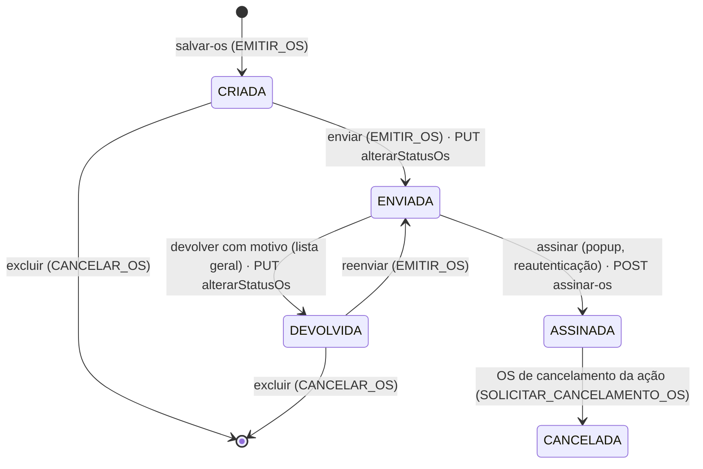

# Fluxo — ciclo de vida da OS (visão do frontend)

Voltar: [[01-Sistemas/SICI/Frontend/SICI-Frontend-Index|Índice do Frontend]] · Backend: [[01-Sistemas/SICI/Backend/05-Fluxos/Fluxo-Ciclo-de-Vida-OS|Fluxo-Ciclo-de-Vida-OS (Backend)]] · Relacionado: [[01-Sistemas/SICI/Frontend/03-Modulos/SICI-Frontend-Ordem-de-Servico|Ordem-de-Servico]], [[01-Sistemas/SICI/Frontend/05-Fluxos/SICI-Frontend-Fluxo-Assinatura-OS|Fluxo-Assinatura-OS]]

## Objetivo
Mostrar quais transições de status a interface **oferece**, por quem e por qual chamada. As regras que de fato validam as transições são do backend.

## Evidências
Arquivos em `sources`; regras do backend em [[01-Sistemas/SICI/Backend/05-Fluxos/Fluxo-Ciclo-de-Vida-OS|Ciclo-de-Vida-OS (Backend)]].

## Informações confirmadas ✅

| Transição | Onde na UI | Condição no cliente | Chamada |
|---|---|---|---|
| criar OS | cadastrar OS | `EMITIR_OS` (rota) | `POST /os-acao-controle/salvar-os/{acao}` |
| editar | lista da ação | `CRIADA`/`DEVOLVIDA`, não `CANCELAMENTO`, `EDITAR_OS` | `PUT /os-acao-controle/atualizar/{id}` |
| `CRIADA`/`DEVOLVIDA` → `ENVIADA` | lista da ação, PDF (`origem=ACAO_CONTROLE`) | `EMITIR_OS`; confirmação em modal | `PUT /os-acao-controle/alterarStatusOs/{id}` `{status: ENVIADA}` (enviada **duas vezes**, ver nota Ordem-de-Servico) |
| `ENVIADA` → `DEVOLVIDA` | lista geral (SUBCI) | modal exige motivo | `PUT .../alterarStatusOs/{id}` `{status: DEVOLVIDA, motivoDevolucao}` |
| `ENVIADA` → `ASSINADA` | lista geral, PDF (`origem=LISTA_GERAL`) | popup com reautenticação | `POST /assinaturas/assinar-os/{id}` |
| excluir | lista da ação | `CRIADA`/`DEVOLVIDA`, permissão `CANCELAR_OS`, confirmação | `DELETE /os-acao-controle/excluir/{id}` |
| cancelar ação | lista da ação | `SOLICITAR_CANCELAMENTO_OS`, sem cancelamento prévio | `POST /os-acao-controle/cancelar-os/{acao}` `{idTipoOrdemServico: 5, justificativa}` |
| prorrogar | lista da ação | abertura assinada e última prorrogação assinada, `EMITIR_OS` | `POST /os-acao-controle/{base}/prorrogacoes` |

Na lista geral as OS são ordenadas por prioridade de status (`ENVIADA`, `DEVOLVIDA`, `CRIADA`). O selo `DEVOLVIDA` abre o motivo.

OS genérica segue o mesmo ciclo com chamadas em `/ordem-servico-generica` ([[01-Sistemas/SICI/Frontend/03-Modulos/SICI-Frontend-OS-Generica|OS-Generica]]).

## Inferências e limitações
- 🔶 `CANCELADA` aparece como status exibido (selo e PDF), mas o frontend não faz uma transição direta: cria uma OS do tipo cancelamento (modelo 5) que, ao ser assinada, supõe-se cancelar a ação. O efeito sobre as demais OS é regra do backend ([[01-Sistemas/SICI/Backend/03-Modulos/Prorrogacao-e-Cancelamento|Prorrogacao-e-Cancelamento]]).
- 🔶 O backend aceita `ASSINADA` em `alterarStatusOs` sem assinatura (achado S3); o frontend não usa essa via em telas ativas, mas o método `alterarStatusOs` aceita qualquer `status`.
- Transições não listadas (por exemplo reabertura) não foram encontradas no frontend.

## Relacionamentos
- [[01-Sistemas/SICI/Frontend/08-Seguranca/SICI-Frontend-Seguranca-e-Sessao|Seguranca-e-Sessao]]

## Pendências e próximo passo
- Ver [[01-Sistemas/SICI/Frontend/99-Controle/SICI-Frontend-Pendencias|Pendências]].
